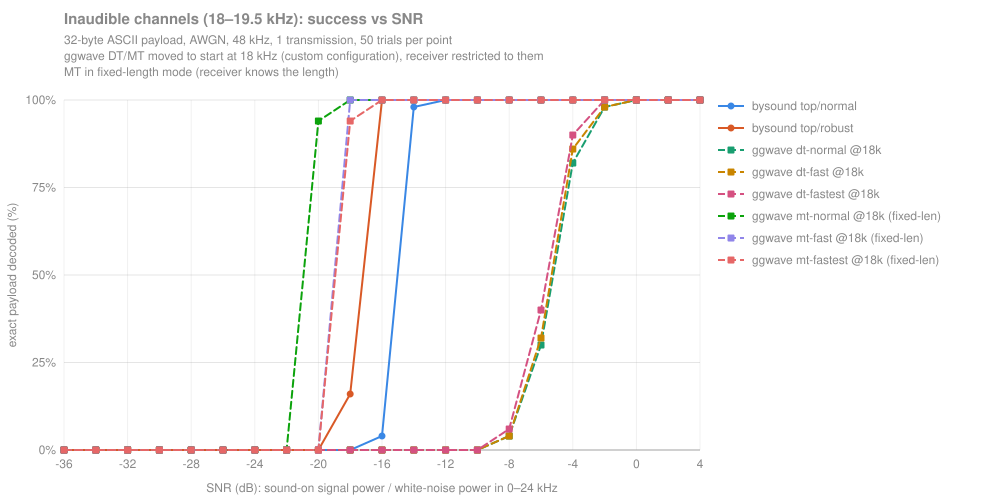

# bysound: incremental changes to near-ultrasonic data-over-sound, measured against ggwave

**Agustin Gandara**<br>
beaglecoder<br>
November 2026

<p align="center"></p>

## Abstract

Data-over-sound lets two devices exchange a short message using only a speaker and a microphone. ggwave [1], a widely used open-source library, sends bytes with multi-frequency shift keying (MFSK) on a 46.875 Hz grid and protects them with Reed–Solomon (RS) coding [5]. bysound keeps that foundation and changes the framing and the receiver: narrower channels (2–6 simultaneous tones within 15–19.5 kHz, plus one audible channel), a per-tone noise floor, a keyed preamble, maximum-likelihood header selection, subtraction of the previous symbol's echo, RS in blocks with an end-to-end CRC-32, and a slower *robust* profile. Byte-compatible implementations exist in TypeScript, Swift, Kotlin and allocation-free C, together with a session layer (acknowledgements by sound, second-sender detection, alert frames, security levels and automatic channel adaptation) that shares test vectors across the four languages. This report compares the C implementation with unmodified ggwave on the same simulated channel with the same seeds (157,670 trials), adds a comparison above 18 kHz with ggwave reconfigured through its API (35,860 trials), and reports 277 over-the-air attempts between one phone and one tablet. At equal in-band SNR the two detectors are within 0–3 dB of each other; most of bysound's margin against broadband noise comes from its narrower channels and lower peak-to-average power ratio. bysound delivered no wrong message in simulation. ggwave's receiver uses 1.2–51× less CPU, ggwave is faster than most bysound channels for very short messages, and it is the more mature project.

**Summary of results.**

- **Detection is similar.** With the signal-to-noise ratio (SNR) measured inside each mode's own band, the two libraries reach 90 % success within 0–3 dB of each other (Section 6.2).
- **Narrow channels tolerate more full-band noise.** At equal average signal power, with the noise measured over 0–24 kHz, bysound's normal-profile channels reach 90 % success at −14 to −8 dB and its robust profile at −16 to −14 dB, against −8 dB for ggwave's ultrasound and audible protocols. This follows mostly from concentrating the same power in a narrower band, a comparison that favours narrowband modes by construction. At equal peak amplitude the difference is 1–12 dB (up to 15 dB for the robust profile), because fewer simultaneous tones give a lower peak-to-average power ratio (PAPR). Normalised for energy per message, the advantage is about 3–5 dB.
- **Echo.** With one synthetic two-tap echo and one transmission, bysound tolerates 4–12 dB more noise, depending on the channel. The part of that difference specific to echo (4 dB) is consistent with echo subtraction (Section 6.3).
- **Message size and integrity.** bysound caps a transmission at 30 s of airtime rather than at 140 bytes. It delivered no wrong message in 87,380 simulated trials; a CRC-32 over the whole text guards delivery. ggwave delivered 34 wrong payloads in 67,320 trials of its default variable-length protocols, 32 of them for 8-byte messages (Section 6.5).
- **Cost.** ggwave's receiver uses less CPU: 41–51× less while idle and 1.2–14× less in trials that decode a message (Section 6.6).
- **Above 18 kHz.** ggwave has no built-in mode there: its "ultrasound" protocols start at 15 kHz. Moved to 18 kHz through its API (a custom configuration, inside the span of bysound's `top` channel), its 2-tone DT mode needs 10–12 dB more SNR than `top` and is slower (3.7 s against 2.3 s for 32 bytes). Its 1-tone MT mode, whose receiver must know the message length, tolerates 4–6 dB more noise than `top` but takes 2.4–7.3× as long, stops at 64 bytes and delivered wrong 8-byte payloads (Section 6.7).
- **Over the air.** In one room, with a private application built on the same over-the-air format, the weakest successful reads were within about 2 dB of the simulated threshold; failures came from broadband noise placed close to the microphone (Section 6.8).

**Scope.** The benchmark was written by the author of bysound and exercises only the C receiver; the session layer is not part of it. ggwave was not measured over the air, and no code was run on a microcontroller.

## 1. Introduction

Acoustic data links use hardware that is already present: phones, laptops and smart speakers have a speaker and a microphone, and a microcontroller board can be given both with an I2S microphone and an amplifier. Typical uses hand over a token that is longer than a person wants to type but shorter than a file:

- a pairing code;
- a URL;
- a payment reference;
- Wi-Fi credentials for an IoT device.

Three properties matter in practice:

1. **It must work in real rooms:** background noise, echo, inexpensive transducers, and clocks that differ between devices.
2. **It must be exact.** A wrong token is worse than no token, so the receiver should reject what it cannot verify.
3. **It should be unobtrusive.** Tones above about 18 kHz are inaudible to most adults, while 15–18 kHz remains audible to many, especially younger listeners. Many phone speakers and microphones also lose sensitivity above about 17 kHz, so unobtrusiveness and reliability pull in opposite directions.

ggwave [1] made the approach easy to adopt: a small C++ library, ready-made bindings for several languages, and protocols in audible, "ultrasound" (15–19.4 kHz), dual-tone and mono-tone variants. bysound was developed for applications that need the three properties above. This report documents what bysound does differently from ggwave, why, and how much of each difference shows up in a simulated comparison.

**Contributions.**
- A specification of **bysound v4**, a payload framing on the same 46.875 Hz grid ([PROTOCOL.md](docs/PROTOCOL.md)).
- A specification of a **session layer** for two-party exchanges by sound ([SESSION.md](docs/SESSION.md)), with a security model ([SECURITY.md](docs/SECURITY.md)).
- Four interoperable open-source implementations of the modem and the session layer that share test vectors, with examples.
- A reproducible benchmark against unmodified ggwave, with all raw data, and an over-the-air dataset with its analysis script.
- An analysis that separates the sources of the difference (bandwidth, peak-to-average power, coding, detection) and lists where ggwave is better.

## 2. Related work

- **ggwave** [1] (G. Gerganov, MIT licence). MFSK on a 46.875 Hz grid, RS error correction, start and end sound markers, and payloads of up to 140 bytes. Its audible and ultrasound protocols play 6 tones at once; it also has dual-tone (DT) and mono-tone (MT) protocols. Each comes in normal, fast and fastest speeds. bysound uses the same grid spacing, which makes the comparison direct.
- **Quiet** [2] (libquiet). Software-defined-radio-style modulation over sound (its profiles include OFDM and GMSK), built on liquid-dsp [8]. It aims at higher bit rates with a more complex receiver.
- **minimodem** [3]. A general-purpose software FSK modem for standard wireline and radio protocols (Bell 103/202, RTTY and others), not for near-ultrasonic links.
- **Dhwani** [4]. Acoustic NFC between phones, with a security model based on self-jamming. It targets confidentiality at very short range, which bysound does not attempt.

The comparison is with ggwave only, because it is the closest in design. Systems with different goals (throughput, secure short-range exchange) would need a different test to be compared fairly.

## 3. Design of bysound v4

**Terminology.** A *channel* is one of bysound's seven named sets of tones (the specification also calls it a *band*); *band* is otherwise used here for a frequency range. A *mode* is one transmit configuration of either library (a bysound channel and profile, or a ggwave protocol). A *lap* is one repetition of a frame.

<p align="center"></p>
<p align="center"><em>Figure 1. The seven bysound channels on the 46.875 Hz grid.</em></p>

**Tone grid.** Every tone sits at `f = (bin + 16·g + nibble) × 46.875 Hz`, where `bin` is the channel's first grid index and `g` the tone group. The analysis window is exactly 1/46.875 s (1,024 samples at 48 kHz), so grid tones are orthogonal and fall on FFT bins. At 44.1 kHz the receiver uses Goertzel filters [6] on the same grid.

**Channels.** Seven channels, each of `G` groups of 16 tones, play one tone per group per symbol (one nibble per group), so `G` tones sound at once (Table 1).

*Table 1. bysound channels.*

| Channel | Span | Tones at once (`G`) | Symbol | Raw rate |
|---|---|---:|---:|---:|
| `top` | 18.0–19.5 kHz | 2 | 32 ms | 250 bit/s |
| `high` | 17.25–19.5 kHz | 3 | 32 ms | 375 bit/s |
| `upper` | 16.5–18.75 kHz | 3 | 32 ms | 375 bit/s |
| `mid` | 15.0–17.25 kHz | 3 | 32 ms | 375 bit/s |
| `xhigh` | 16.5–19.5 kHz | 4 | 32 ms | 500 bit/s |
| `wide` | 15.0–19.5 kHz | 6 | 32 ms | 750 bit/s |
| `audible` | 1.875–4.875 kHz | 4 | 40 ms | 400 bit/s |

`wide` occupies the same span as ggwave's ultrasound protocols (15–19.4 kHz), so it is the like-for-like comparison. ggwave has no protocol confined above 18 kHz, where `top` sits; its dual-tone and mono-tone protocols can be moved there, which Section 6.7 does.

**Frame.** A frame has four parts:
1. An 8-symbol **preamble**, keyed per channel and profile.
2. A 4-byte **header**: type, block count, CRC-8 and version·channel.
3. The **body**: the packed text plus a CRC-32, cut into blocks of at most 48 data bytes. Each block is `RS([index, total] + data, 12 parity)` over GF(256).
4. A 350 ms **gap** of silence.

The length of the last block is not transmitted. The receiver closes it at the first length that Reed–Solomon accepts *and* whose assembled payload passes the CRC-32, because RS alone cannot decide the length (if the last parity byte is `0x00`, the codeword one byte shorter is also valid). The frame is sent several times in a row, one lap after another. The **robust profile**, available on `top`, `high`, `upper` and `mid`, doubles the symbol duration, the analysis window and the search hop.

<p align="center"></p>
<p align="center"><em>Figure 2. Anatomy of a payload frame (not to scale).</em></p>

<p align="center"></p>
<p align="center"><em>Figure 3. Tones of the first symbols of a payload frame on <code>mid</code>, from <code>test-vectors/v4-frames.json</code>.</em></p>

## 4. Differences from ggwave

The benchmark in Section 6 uses the **C receiver**. It is a bounded-memory port of the TypeScript reference receiver: hard decisions per symbol, echo subtraction, a per-tone noise floor, maximum-likelihood header selection and errors-only RS decoding. It does not compute soft symbols, does not mark erasures and decodes each lap on its own (see the header comment of [`c/src/demod.c`](c/src/demod.c)). The differences are therefore listed in two groups: those the benchmark measures (Table 2), and those that are implemented, some only in the TypeScript, Swift and Kotlin receivers, but not exercised by the benchmark (Table 3). The item numbers are used in the rest of the report.

### 4.1 Measured in this benchmark

*Table 2. Differences exercised by the benchmark.*

| # | Area | ggwave | bysound | Expected effect |
|---|---|---|---|---|
| 1 | **Bandwidth** | 6 tones in the audible and ultrasound protocols (≈ 4.4 kHz span) | 2–6 tones per channel (1.5–4.5 kHz) | With the same total power in fewer tones, each tone stands higher above white noise. This accounts for most of the full-band SNR difference (Section 6.2). |
| 2 | **Peak-to-average power** | 6 tones summed: PAPR 12.1–12.9 dB | 2–3 tones: PAPR 6.3–8.3 dB (4 tones 9.5–9.6 dB, 6 tones 11.4 dB) | A speaker is limited by its peak, not its average. At the same peak amplitude, a lower PAPR puts 0.8–6.6 dB more average power in the air than ggwave's ultrasound protocols (32-byte messages; Section 6.2). |
| 3 | **Noise floor per tone** | Fixed-ratio marker detection, no per-tone noise estimate | Running background level for every tone, divided out before detection | A steady narrowband interferer raises the floor of its own tone instead of being read as a symbol. |
| 4 | **Preamble** | Start and end marker tones | 8-symbol pattern keyed per channel and profile; threshold 0.32 on a normalised score (noise alone scores about 1/16 ≈ 0.06). A preamble found inside a frame body is taken as the next lap only if it scores at least 0.7 of the current frame's own preamble score | It identifies the channel and the symbol timing in one step and keeps channels apart. The 0.7 rule separates a real next lap from body data that happens to match a few preamble nibbles. |
| 5 | **Header decision** | 1 length byte with its own RS code | 4-byte header with CRC-8; the receiver picks the most likely of the 259 valid headers | A header with a few wrong nibbles is still chosen correctly, because only valid headers are candidates. |
| 6 | **Echo subtraction** | Hard decision per symbol | Hard decision per symbol after subtracting the previous symbol's echo, whose strength is measured on the preamble | Reverberation leaves energy from the previous chord in the current one. Section 6.3 measures the effect under one synthetic echo. |
| 8 | **Blocks + CRC-32** | One RS codeword of up to 140 B; parity grows with length (4 bytes for 8 B, 12 for 32 B, 56 for 140 B); no checksum | Up to 255 blocks of up to 48 data bytes, each with 12 RS parity bytes, plus a CRC-32 over the whole text | Messages longer than 140 B with the same protection per block, and a final check that rejects a wrongly corrected block (Section 6.5). |
| 10 | **Robust profile** | Speed variants change the symbol length | `top`, `high`, `upper`, `mid` with symbol, window and hop doubled | About 3 dB expected from doubling the symbol energy; 2 dB measured on the 2 dB grid, at half the speed. |

### 4.2 Implemented, not measured here

*Table 3. Differences not exercised by the benchmark.*

| # | Area | ggwave | bysound | Where |
|---|---|---|---|---|
| 7 | **Erasure decoding** | RS errors only | Each block is tried with 0, 2 and 4 erasures on the least-confident bytes | TypeScript, Swift and Kotlin receivers. The C receiver corrects errors only. |
| 9 | **Combining laps** | Each transmission decoded alone | Up to 6 laps from the last 30 s combined per block | TypeScript, Swift and Kotlin receivers. The C receiver decodes each lap on its own. |
| 11 | **Text packing** | Raw bytes | Digit pairs packed into 1 byte; printable ASCII as is; other text as UTF-8 | All four implementations. The benchmark payloads contain no digits, so packing gives no advantage in Section 6. |
| 12 | **Clash detection** | Not provided | Overlapping transmissions the receiver can hear are reported as a clash | All four receivers. No benchmark trial has two senders. |
| 13 | **Soft symbols** | Hard decision per symbol | A likelihood for each of the 16 tones, used by items 7 and 9 | TypeScript, Swift and Kotlin receivers. |

How much items 7, 9 and 13 add is not known from this benchmark. ggwave also has an optional direct-sequence spreading mode (`GGWAVE_OPERATING_MODE_USE_DSS`), which is off by default and was not tested.

## 5. Implementations

*Table 4. Implementations and their size in lines of code.*

| Implementation | Modem | Session layer | Notes |
|---|---:|---:|---|
| TypeScript (`web/src`) | ≈ 1.7 k | ≈ 1.7 k | Reference modem receiver and session layer; Web Audio, AudioWorklet and a Worker |
| Swift (`ios/Sources/BySound`) | ≈ 2.0 k | ≈ 1.9 k | vDSP FFT at 48 kHz, Goertzel at 44.1 kHz; AVAudioEngine |
| Kotlin (`android/bysound/src/main`) | ≈ 2.1 k | ≈ 1.5 k | Modem and session in plain Kotlin (testable on the JVM); AudioTrack/AudioRecord |
| C99 (`c/src`) | ≈ 1.7 k | ≈ 0.9 k | No `malloc`, streaming transmitter and receiver; FFT (float) or Goertzel engine |

Lines are counted with `wc -l`, comments and blank lines included, test files and simulation helpers excluded. **Modem:** `web/src/modem`; the Swift files directly in `ios/Sources/BySound` except `BySoundSession.swift`; the Kotlin `modem` package plus `audio/SoundSender.kt` and `audio/SoundListener.kt`; `c/src` except `session.c` and `sha256.c`, including the internal tables header. **Session layer:** `web/src/session`; `ios/Sources/BySound/Session` plus `BySoundSession.swift`; the Kotlin `session` package plus `audio/BySoundSession.kt`; `session.c` and `sha256.c`. The C public headers are not counted (`bysound.h` ≈ 0.4 k lines, `bysound_session.h` ≈ 0.3 k). The Swift and Kotlin figures include the audio input/output wrappers.

The four modem implementations are tested against the frames in `test-vectors/v4-frames.json`, and the Swift and Kotlin tests also decode audio produced by the C implementation and one recorded transmission. The four session layers are tested against `session-acks.json`, `v4-acks.json`, `v4-risk.json` and `security-levels.json` and run the same scenarios on simulated air (Section 7). On the benchmark host the C modem compiles to about 35 KB of object code (`__TEXT` of the `c/src` objects other than the session layer, arm64, `-O2`), against about 60 KB for `ggwave.o`; the session layer adds about 19 KB.

The ESP32-S3 demo builds with ESP-IDF 5.4 and runs the session layer on the four ladder channels (`top`, `high`, `upper`, `mid`) with two robust-capable demodulators. Its image is 286.7 KB, with 150.1 KB of `.bss` and 10.8 KB of `.data` and no PSRAM (from `idf.py size`; see [`esp32/README.md`](esp32/README.md)); without the robust receiver it needs about 85 KB less RAM. These figures come from the build, not from the benchmark. The demo needs an external I2S microphone and an I2S amplifier, and it has not been run on a board, so on-device behaviour and CPU load are not measured.

The [`examples/`](examples) folder holds small complete applications built on the libraries: Wi-Fi setup (browser side and ESP32-S3 device side), a shop check-in beacon with rotating tokens (browser and ESP32-S3), a payment-style reference flow with a local backend, the channel ladder in the browser, link sharing on iOS, contact sharing on Android and WAV tools in C. They are not part of the evaluation, and the ESP32-S3 examples have only been built.

## 6. Evaluation

### 6.1 Method

Both libraries are compiled from source with the same compiler. The bysound side is the **C library** in [`c/`](c) (FFT engine). ggwave is fetched at commit `060aec7` and used through its C API with its **default parameters**. Each trial:
1. Encodes a payload: 8–128 B of ASCII without digits, so bysound's packing gives no advantage; 512 and 2,048 B for bysound only, where they fit in its 30 s cap (2,048 B only on `wide`); plus a 48-byte UTF-8 case.
2. Passes it through a channel: white, pink or babble-like noise at a given SNR, optional echo (two delayed taps), ±100 ppm clock drift, and lead silence.
3. Feeds the result to each library's own streaming receiver in 1,024-sample chunks.

**Receivers.** The bysound receiver is told which profile to listen for (normal or robust) and then listens to every channel of that profile at once (7 normal, 4 robust). The ggwave receiver listens to all its protocols, as its defaults do. The two are therefore not given the same prior information: ggwave searches a larger set.

**SNR.** Three definitions are used, all with the signal power measured over the sound-on samples only:
- **Full-band SNR**: signal power over noise power in 0–24 kHz. This is the SNR the channel model sets, and the default in this report. By construction it favours modes that use a narrower band.
- **In-band SNR**: full-band SNR plus a per-mode offset, so that signal and noise are both measured in the band that holds 99 % of the mode's signal power (from Welch PSDs [7], `bands.csv`).
- **Peak-referenced (equal-peak) SNR**: full-band SNR plus the mode's PAPR. It compares modes played at the same peak amplitude, which is how a speaker at maximum volume behaves.

The over-the-air receiver reports a fourth, per-tone measure, defined in Section 6.8.

**Metrics.** Success means the exact payload came out. **SNR90** is the lowest grid SNR from which every higher grid point, the noiseless point included, reached at least 90 % success. Unless stated otherwise, a cell is 50 trials at 48 kHz on a 2 dB grid. No confidence intervals are given: with 30–50 trials per cell, one trial moves a cell by 2–3 percentage points. Full method: [bench/README.md](bench/README.md).

**Sources of the numbers.** Every figure in Sections 6.2–6.7 is computed from the raw results in [`bench/results/`](bench/results). Airtimes, including those at 140 B and 1 KB, are the length of each encoder's output (`airtime.csv`) and were not passed through the channel. The over-the-air figures of Section 6.8 come from [`field/`](field). The ESP32 footprint (Section 5) comes from the ESP32 build and the line counts from `wc -l`; neither is a benchmark result. The session layer (Section 7) is not part of the benchmark.

### 6.2 White noise

<p align="center"></p>
<p align="center"><em>Figure 4. Success rate against full-band SNR, near-ultrasonic modes, 32-byte message, one transmission.</em></p>

*Table 5. SNR90 in white noise, 32-byte message, one transmission.*

| Configuration | In band | Equal peak | Full band |
|---|---:|---:|---:|
| bysound `top` | −2 dB | −7 dB | −14 dB |
| bysound `high` / `upper` / `mid` | −2 dB | −4 dB | −12 dB |
| bysound `xhigh` | −1 dB | 0 dB | −10 dB |
| bysound `wide` | −1 dB | +3 dB | −8 dB |
| bysound `audible` | −1 dB | −1 dB | −10 dB |
| bysound `top` robust | −4 dB | −10 dB | −16 dB |
| bysound `high` / `upper` / `mid` robust | −4 dB | −6 dB | −14 dB |
| ggwave ultrasound (normal / fast / fastest) | −1 dB | +4 / +4 / +5 dB | −8 dB |
| ggwave audible (normal / fast / fastest) | −1 dB | +4 / +4 / +5 dB | −8 dB |
| ggwave DT fastest | +8 dB | +4 dB | −4 dB |

The three columns answer different questions. *In band* compares the detectors at the same SNR inside the band each mode uses. *Equal peak* compares the modes when both are played at the same peak amplitude. *Full band* compares them at the same average power against noise spread over 0–24 kHz, and by construction favours whichever mode uses the narrower band.

**Reading.**
- **In band**, bysound is within 0–3 dB of ggwave: equal for `wide`, `xhigh` and `audible`, 1 dB better for the 2- and 3-tone channels, 3 dB better for the robust profile. The detectors are close.
- **Full band**, the 2- and 3-tone channels need 4–6 dB less SNR than ggwave's ultrasound protocols, `xhigh` and `audible` 2 dB less, and the robust profile 6–8 dB less. `wide`, on the same 15–19.4 kHz span as ggwave ultrasound, is equal. The difference is mostly item 1 (bandwidth).
- **Equal peak**, the difference is 1–12 dB for the normal profile and up to 15 dB for `top` robust. Of that, PAPR alone contributes 0.8–6.6 dB (item 2); the rest is the full-band difference above. `wide` is 1–2 dB better than ggwave ultrasound (+3 dB against +4/+5 dB; lower is better). This comparison is against ggwave's 6-tone protocols; its DT protocols have a PAPR of 7.3–7.8 dB and its MT protocols 4.0 dB.
- **Equal power is not equal energy.** The modes take different times to send the same 32 bytes: sound is on for 1.98 s on `top`, 1.44 s on `high`, 0.86 s on `wide` and 3.97 s on `top` robust, against 1.71 s for ggwave ultrasound fastest. Correcting the full-band difference for the ratio of sound-on times, the advantage over ggwave ultrasound fastest in energy per message is 5.3 dB for `top`, 4.7 dB for `high`, 3.0 dB for `wide` (the same SNR90 in half the time), 4.3 dB for `top` robust and 3.7 dB for `high` robust: roughly 3–5 dB in every case. ggwave's slower speeds reach the same SNR90 as its fastest on this grid.

The ggwave `dt-normal` and `dt-fast` protocols have no SNR90 at 32 B because they decoded only 86 % of the noiseless trials (100 % at 0 dB). The noiseless point is the signal at −40 dBFS with int16 quantisation and no noise at all. ggwave's own log shows the cause: in those trials its receiver detects the end marker inside the data and stops recording early. Re-run with the same seed and noise at +60 dB SNR (−100 dBFS, about the size of the int16 quantisation noise), 134 of the 135 DT trials that failed at the noiseless point in any plan decode (`bench/results/dt_clean_check.txt`). This is an artefact of noise-free input, not something a microphone would produce; the noiseless-point requirement in SNR90 penalises only these two rows.

<p align="center"></p>
<p align="center"><em>Figure 5. The trials of Figure 4 against peak-referenced SNR.</em></p>

### 6.3 Echo, coloured noise and drift

*Table 6. SNR90 in dB (full band) under impairments, 32 B, one transmission ¹.*

| Configuration | White | Echo | Pink | Babble-like | Drift ±100 ppm | All combined |
|---|---:|---:|---:|---:|---:|---:|
| bysound `top` | −12 | −8 | −20 | ≤ −32 | −12 | −16 |
| bysound `top` robust | −16 | −12 | −24 | ≤ −32 | −16 | −20 |
| bysound `wide` | −8 | −4 | −16 | ≤ −32 | −8 | −12 |
| bysound `audible` | −8 | −4 | −8 | −12 | −8 | −4 |
| ggwave ultrasound fastest | −8 | 0 | −16 | ≤ −32 | −8 | −8 |
| ggwave audible fastest | −8 | 0 | −8 | −12 | −8 | 0 |

¹ The impairment columns use 30 trials per cell on a 4 dB grid. The White column is the Section 6.2 data (50 trials) read on the same 4 dB grid, which is why `top` shows −12 dB here and −14 dB in Table 5. −32 dB is the lowest point of the grid. "All combined" is echo, +100 ppm drift and pink noise.

**Echo.** With one transmission, bysound tolerates 4–12 dB more noise than ggwave under this echo: 8 dB for the 2- and 3-tone channels (−8 dB against 0 dB; also for `high`, `upper` and `mid` robust), 12 dB for `top` robust, and 4 dB for `xhigh`, `wide` and `audible`. With two transmissions ggwave's ultrasound protocols improve to −4 dB, which leaves 4–8 dB for the 2- and 3-tone channels and `top` robust, and none for `wide`. Relative to white noise alone, the echo costs every bysound configuration 4 dB and ggwave 8 dB. That 4 dB is the part of the difference attributable to echo subtraction (item 6); the rest is the white-noise difference of Section 6.2. The echo is a single synthetic profile (direct path plus taps of 0.5 at 8 ms and 0.25 at 23 ms), not a measured room response.

**Coloured noise.** Pink and babble-like noise have most of their power below 5 kHz, so every near-ultrasonic mode of both libraries decodes at very low full-band SNR; the in-band SNR is much higher. Under pink noise the 2- and 3-tone channels reach 4 dB lower than ggwave ultrasound, and `wide` the same. Under babble-like noise both libraries reach the bottom of the grid, so the test does not separate them.

**Drift.** Clock drift of ±100 ppm did not change the SNR90 of any configuration in Table 6.

<p align="center"></p>
<p align="center"><em>Figure 6. Success rate against full-band SNR with the synthetic echo, 32 B, one transmission.</em></p>

### 6.4 Airtime, throughput and message size

*Table 7. Airtime of one transmission and throughput.*

| Configuration | 8 B | 32 B | 128 B | 140 B | B/s at 128 B |
|---|---:|---:|---:|---:|---:|
| bysound `top` | 1.57 s | 2.33 s | 6.30 s | 6.69 s | 20.3 |
| bysound `high` / `upper` / `mid` | 1.28 s | 1.79 s | 4.41 s | 4.67 s | 29.0 |
| bysound `wide` | **0.96 s** | **1.21 s** | **2.53 s** | **2.65 s** | **50.7** |
| bysound `top` robust | 2.78 s | 4.32 s | 12.25 s | 13.02 s | 10.4 |
| ggwave fastest | 1.00 s | 1.71 s | 4.59 s | 4.97 s | 27.9 |
| ggwave fast | 1.32 s | 2.73 s | 8.49 s | 9.26 s | 15.1 |
| ggwave normal | 1.64 s | 3.75 s | 12.39 s | 13.55 s | 10.3 |

Airtimes are the length of the encoder output as recorded in `bench/results/airtime.csv`, with no lead silence. bysound's include its 350 ms trailing gap; ggwave's include its start and end markers and are the same for its audible and ultrasound protocols. The fastest configuration in each column is in bold.

- On the same span, `wide` is 1.8× faster than ggwave fastest at 128 B.
- At 8 B only `wide` (0.96 s) is faster than ggwave fastest (1.00 s); the other normal-profile channels take 1.09–1.57 s. The fixed preamble, header and gap weigh most on short messages.
- `high`, `upper` and `mid` are about as fast as ggwave fastest from 64 B (2.75 s against 2.67 s) and slightly faster at 128 B and 140 B.
- 140 B is ggwave's maximum per transmission. bysound caps a transmission at **30 s** instead of at a byte count, and the encoder rejects anything longer. That allows 700 B on `top`, 1,052 B on `high`/`upper`/`mid` and 2,114 B on `wide` (335 B and 520 B in the robust profile); the exact limits per channel are in [PROTOCOL.md](docs/PROTOCOL.md). For example, 1 KB takes 14.94 s on `wide`.

The code rate differs between the two libraries and with message length (bysound adds 14 bytes per 48-byte block plus a 4-byte CRC; ggwave adds 3 bytes plus parity that grows with length), so equal airtime does not mean equal redundancy.

<p align="center"></p>
<p align="center"><em>Figure 7. Throughput (payload bytes per second of airtime) against payload size, from the encoders.</em></p>

### 6.5 Wrong payloads

*Table 8. Wrong payloads delivered in the transmission trials.*

| | Trials | Wrong payloads delivered |
|---|---:|---:|
| bysound | 87,380 | 0 |
| ggwave, default variable-length protocols | 67,320 | 34 ² |

bysound delivered no wrong message in 87,380 simulated trials; a CRC-32 over the whole text guards delivery. In 30 minutes of noise with no transmission (10 minutes each of white, pink and babble-like), neither library reported a detection: none for bysound's normal receiver, none for its robust receiver, and none for ggwave.

Of ggwave's 34 wrong payloads:

- **32 were 8-byte messages**, 31 of them on the fast and fastest speeds of the audible and ultrasound protocols and 1 on ultrasound normal. They occurred at SNRs from −12 to +4 dB and at the noiseless point, and in each of those trials the correct payload was not delivered. A separate scan without any channel shows the same: 11–21 of 500 different 8-byte payloads decoded to a wrong payload on those speeds.
- **2 were 32-byte messages** in two-transmission trials (ultrasound fastest, pink and babble-like noise), in which the correct payload was also delivered.

This is consistent with Reed–Solomon mis-correction, though the cause was not traced in ggwave's code: an 8-byte message carries 4 parity bytes, there is no checksum after the RS decode, and the receiver attempts the decode at many time alignments. With 12 parity bytes (32 B) and more, wrong payloads were rare (2) or absent. bysound's CRC-32 (item 8) is the check that turns such a case into a rejection.

² The mono-tone protocols, which ggwave accepts only in fixed-length mode, were run separately (2,970 trials). They delivered 315 wrong payloads in 148 trials, repeats within a trial counted, all for 8-byte messages; 74 of the 315 were at the noiseless point, so part of this is probably an artefact of digital silence. These runs are not part of the comparison above.

### 6.6 Cost

*Table 9. Receiver CPU on the benchmark host (Apple M4 Pro), as a real-time factor: seconds of audio processed per second of CPU (higher is cheaper).*

| | bysound | ggwave | ggwave is lighter by |
|---|---:|---:|---:|
| Idle listening (30 segments of 60 s of noise per receiver, median) | 371× (normal, 7 channels), 463× (robust, 4 channels) | 18,993× | 41–51× |
| 32 B trials that decoded the payload (median per configuration) | 426–533× (6.8–12.4 ms per trial) | 660–5,903× (0.9–8.2 ms per trial) | 1.2–14× |
| All 32 B trials (median per configuration) | 436–534× (6.7–12.1 ms per trial) | 7,585–18,319× (0.3–0.6 ms per trial) | 14–42× |

The decoded-trial and all-trial rows are medians over the one-transmission trials of the white-noise plan, per configuration (11 for bysound, 9 for ggwave), receiver initialisation included; the last column divides the extremes of the two ranges. The all-trials row mixes in the many trials below the threshold, where ggwave does almost no work, so the first two rows describe the two real situations better. bysound's cost is nearly constant because it searches every channel of its profile at every step (4 ms, or 8 ms in the robust profile) whether or not a message is present. Both run far faster than real time on this host. CPU load on a phone or a microcontroller was not measured.

### 6.7 Inaudible channels (18–19.5 kHz)

ggwave's built-in protocols are audible (about 1.9–6.3 kHz; DT and MT at 1.1–2.6 kHz) or start at 15 kHz ("ultrasound", 15.0–19.4 kHz, which many young listeners hear). bysound's `top` channel is the only mode in either library confined above 18 kHz. This section compares it with ggwave moved there.

**Method.** A ggwave protocol is `{freqStart (FFT bin), framesPerTx, bytesPerTx, extra}`; it plays `2·bytesPerTx/extra` tones at once, each over 16 bins of 46.875 Hz. The 6-tone ultrasound layout spans 4.5 kHz and would reach 22.5 kHz from 18 kHz, so it cannot move. The DT protocols (2 tones, 32 bins = 1.5 kHz) and MT protocols (1 tone, 16 bins) can. They were moved to start at bin 384 = 18,000 Hz with ggwave's public C API (`ggwave_txProtocolSetFreqStart`, `ggwave_rxProtocolSetFreqStart`); every other parameter keeps its default. This is a custom configuration, not something ggwave ships.
- **Markers.** DT's start and end markers are generated from the protocol's own start bin (16 marker bits on the same 32 bins), so they move with it; the receiver looks for markers on its enabled protocols and takes the matching start bin. MT runs only in fixed-length mode, which has no markers; there the receiver normalises the spectrum above the lowest start bin of its enabled protocols, which is now 384.
- **Receiver.** The ggwave receiver was restricted to the six moved protocols (`ggwave_rxToggleProtocol`), so it searches only 18.0–19.5 kHz; DT runs in the default variable-length mode, MT in fixed-length mode (the receiver is given the payload length). bysound is unchanged and uses the receivers of the rest of Section 6 (all channels of its profile).
- **Band check.** A Welch PSD of each encoder's whole output (32 B, markers included) puts 99.84–99.99 % of the DT power and 99.98–100 % of the MT power inside `top`'s 32 tone slots (17,977–19,477 Hz); bysound `top` puts 98.96 % there (robust 99.58 %). The bands holding 99 % of the power are 17,988–19,453 Hz (19,465 Hz for `dt-fastest`) for DT, 18,000–18,715 Hz for MT and 17,977–19,477 Hz for `top`.
- **Trials.** Same channel, chunking, grids, trial counts and seeds as Sections 6.2–6.4 (one transmission): 35,860 trials. The 8,140 bysound trials that also exist in those plans gave identical results.

*Table 10. SNR90 (32 B, one transmission) and airtime above 18 kHz. Full band, in band and equal peak on the 2 dB white-noise grid; echo and pink on the 4 dB grid.*

| Configuration | Full band | In band | Equal peak | Echo | Pink | 32 B | 140 B |
|---|---:|---:|---:|---:|---:|---:|---:|
| bysound `top` | −14 dB | −2 dB | −7 dB | −8 dB | −20 dB | 2.33 s | 6.69 s |
| bysound `top` robust | −16 dB | −4 dB | −10 dB | −12 dB | −24 dB | 4.32 s | 13.02 s |
| ggwave DT fastest @18 kHz | −4 dB | +8 dB | +4 dB | +4 dB | −12 dB | 3.69 s | 13.42 s |
| ggwave DT fast / normal @18 kHz | −2 dB | +10 dB | +5 dB | +4 dB | −12 / −8 dB | 6.70 / 9.71 s | 26.15 / 38.89 s |
| ggwave MT fastest @18 kHz ³ | −18 dB | −3 dB | −14 dB | −12 dB | −24 dB | 5.63 s | — (max 64 B) |
| ggwave MT fast / normal @18 kHz ³ | −18 / −20 dB | −3 / −5 dB | −14 / −16 dB | −12 dB | −24 / −28 dB | 11.26 / 16.90 s | — (max 64 B) |

³ Fixed-length mode: the receiver must know the payload length; at most 64 B (11.26–33.79 s).

Babble-like noise put every configuration at the bottom of the grid, and ±100 ppm drift changed no SNR90. Payload size changed little: `top` −12 dB and `top` robust −16 dB at every size from 8 to 140 B (4 dB grid), DT −4 to 0 dB, MT −20 or −16 dB up to 64 B. At 8 B, MT fastest (1.54 s) and DT fastest (1.64 s) take about as long as `top` (1.57 s).

**Reading.**
- **DT moved to 18 kHz** keeps the noise tolerance of the built-in DT at 1.1–2.6 kHz (−4 dB for the fastest speed at both positions). It is 10–12 dB behind `top` (11–12 dB at equal peak). Both put two tones in the same 1.5 kHz, so the full-band and in-band differences are the same: unlike the 6-tone comparison of Section 6.2, this gap is not a bandwidth effect. With echo it is 12 dB behind (+4 against −8 dB). It is also slower: 3.69–9.71 s for 32 B and 13.42–38.89 s for 140 B, against 2.33 s and 6.69 s.
- **MT moved to 18 kHz** is the most noise-tolerant configuration measured: 4–6 dB better than `top` in full band (2–4 dB better than `top` robust), 1–3 dB in band, and 7–9 dB at equal peak, helped by a single tone (PAPR 4.0 dB against 6.6 dB) in half the bandwidth. With echo it matches `top` robust (−12 dB). It pays in time: 2.4–7.3× the airtime of `top` for 32 B. Normalised for energy per message, MT fastest is within 0.5 dB of `top`, and MT fast and normal need 3.3–3.5 dB more; DT needs 12.7–18.9 dB more.
- **Constraints.** MT needs a receiver that knows the payload length and carries at most 64 B. In these trials it delivered 276 wrong payloads in 142 of 12,210 trials, all 8-byte; DT and bysound delivered none (4,730 trials per configuration). In the noiseless scan, MT also returned a wrong payload besides the right one for many 8-byte payloads (167–758 wrong decodes over 500 payloads, depending on the speed).
- **Noiseless point.** 19 of the 1,140 noiseless DT trials at 18 kHz (1.7 %) failed in the same way as the built-in DT in Section 6.2; all 19 decode with noise at +60 dB SNR, and the noiseless point stays at or above 90 %, so no SNR90 in this section is affected.
- **Cost.** Restricted to DT and MT, ggwave's variable-length receiver idles at 22,965× real time, 44–46× lighter than a bysound receiver listening to `top` only (496–527×); its fixed-length receiver, needed for MT, idles at 728×, 1.4–1.5× lighter. None of these receivers detected anything in 30 minutes of noise without a transmission.

The two libraries occupy the same band here, so speaker and microphone roll-off above 18 kHz would affect both alike. There was no listening test.

<p align="center"></p>
<p align="center"><em>Figure 8. Success rate against full-band SNR above 18 kHz: bysound <code>top</code> and ggwave DT/MT moved to 18 kHz.</em></p>

### 6.8 Over-the-air measurements

Sections 6.2–6.7 use a simulated channel. This section reports what SNR a real speaker-to-microphone link reached, and what the receiver did at that level. The data, the analysis script and the full tables are in [`field/`](field).

**Setup.** The measurements were made with the author's private application, not with the code in this repository. That application is built on three builds (labelled 4.0.0, 4.1.0 and 4.2.0) of the author's private library, which implements the same v4 over-the-air format and the same receiver design (preamble detection, per-tone noise floor, Reed–Solomon, lap combining). It wraps the modem in a payment-style flow with a server: the sender registers a request and plays only a reference frame (a 12-byte fingerprint, Section 7, "With a backend"); the receiver resolves it on the server; acknowledgements and conflict watching run at security level `maximum`; a request lives 20 s and the receiver gives up after 22 s. The sender started on `top` and fell back to `mid` without an acknowledgement; the profile used was not recorded. One Samsung Galaxy A50 and one iPad (10th generation) lay on a table in an indoor room; a laptop's built-in speakers played noise recordings or another sender's frames. Each scenario ran in both directions. Five layouts were used (sender to microphone 44–65 cm), with the noise source 10–63 cm from the listening microphone, usually closer than the sender: estimated effective margins (free-field distance ratio minus occlusion and off-axis penalties) of −24 to +3 dB, all in the medium, hard or ultra classes of the application's geometric scale. No sound level meter was used: there are no SPL figures, only the receiver's own measurements. ggwave was not run over the air. Fourteen runs on 1–5 November 2026 produced 293 attempts; one run in which the receivers' noise floor did not rise above the quiet baseline (the noise source was silent) is excluded, leaving 277 (146 with noise, 105 with another sender, 26 quiet).

**What the receiver measures.** For each preamble symbol and tone group, the receiver divides the energy of the expected tone (1,024-sample window at 48 kHz, equivalent noise bandwidth 48.7 Hz) by that tone's running noise floor; the reported SNR is the median of those ratios. It is a per-tone, in-band figure that includes the room's echo in the noise, and it exists only for a decoded frame. With white noise it equals the benchmark's in-band SNR plus 10·log10(B ÷ (K · ENBW)), where B is the occupied band and K the number of simultaneous tones: +11.9 dB on `top` (B = 1,500 Hz, K = 2) and +11.8 dB on `mid` (B = 2,215 Hz, K = 3).

**Noise.** Table 11 summarises the noise attempts. In the quiet room all 26 attempts were read (median SNR 47.0 dB). Noise below the channels did not matter: bar noise (30/30), traffic (6/6) and an audible alarm (6/6) were read every time, as was a whistle at 18–19.5 kHz that covers `top` (6/6, all decoded on `mid`). Broadband noise close to the microphone was the limit: hair dryer 14/28 and vacuum cleaner 7/28, which together account for 34 of the 40 attempts where nothing was decoded. Six further attempts decoded on `mid` only after the request had expired (20.8–22.2 s), and in one sweep attempt the receiver took the sweep for another transmission and refused. Successful reads took a median of 6.5 s from the start of listening (including the application's 3 s pre-listen and server registration) and 1.09 s from the first preamble to the decoded frame. The link was asymmetric: with the iPad sending, 58 of 73 noise attempts were read and the quiet-room SNR was 49.3 dB; with the A50 sending, 41 of 73 and 40.2 dB. One device pair cannot separate speaker, microphone and placement.

*Table 11. Over-the-air reads with noise, by geometric difficulty class. Effective margin = 20·log10(noise→mic ÷ sender→mic) minus occlusion and off-axis penalties; Wilson 95 % confidence intervals [9].*

| Class | Effective margin | Read / attempts | 95 % CI | Median SNR of reads |
|---|---:|---:|---:|---:|
| medium | +3 dB | 13/16 | 57–93 % | 22.3 dB |
| hard | −6 to −5 dB | 25/28 | 73–96 % | 23.6 dB |
| ultra | −24 to −14 dB | 61/102 | 50–69 % | 19.6 dB |
| all | | 99/146 | 60–75 % | |

**Threshold.** Among decoded frames in the noise and quiet attempts, all 79 at 20 dB or more, 43 of 48 at 10–20 dB and 3 of 4 at 0–10 dB were read in time; every miss in those rows was a frame decoded after the request expired. The weakest successful reads were 7.8 dB on `top` and 10.3 dB on `mid`. The simulated SNR90 in white noise (Table 5), converted to the same per-tone measure, is 9.9 dB on `top` and 10.1 dB on `mid` in the normal profile, and 7.9 and 8.1 dB in the robust profile. The over-the-air minimum is therefore 0.2 dB above the simulated figure on `mid` and 2.1 dB below it on `top`, where it matches the robust figure. The two statistics differ (a 90 % point on a 2 dB grid with a 32-byte payload, against the lowest success in a non-random sample with a shorter reference frame and lap combining over up to 22 s), so the comparison holds to about ±2 dB. Within that margin, the decoder needed the same SNR over the air as in simulation; the failures came from links that never reached it.

<p align="center"></p>
<p align="center"><em>Figure 9. Every decoded request in the noise and quiet attempts, by the per-tone SNR the receiver measured.</em></p>

**Another sender.** Table 12 lists the outcomes. "As intended" means not delivered, refused, or delivered with a conflict warning within 3 s of delivery (an assumed time to confirm, not a measurement). An unregistered second sender never caused a delivery: with another request playing continuously on the same or another channel, the legitimate sender heard it and did not play in 52 of 52 attempts, and the receiver's server lookup of the other request failed (51 of 52; the remaining attempt was cancelled). Intermittent rivals, two overlapping requests and risk frames were never delivered either. The hard case is a second request that is genuinely registered on the server and starts with the legitimate one: both resolve, the preambles collide, and the only protection is the conflict warning. Eleven of 34 such attempts were undue deliveries, all of the competing request, with no warning or with one 3.2–4.9 s after delivery. The outcome depended on the build: 6 undue deliveries in 16 attempts with 4.0.0, 5 in 10 with 4.1.0, and 0 in 8 with 4.2.0, where every attempt was delivered with a warning after a median 1.8 s (1.4–2.5 s). Which of these behaviours this repository's implementation has was not measured over the air. No noise or quiet attempt delivered a wrong request (0 of 172).

*Table 12. Over-the-air attempts with another sender in the room.*

| Scenario | Attempts | As intended | Undue delivery | Inconclusive |
|---|---:|---:|---:|---:|
| Another request, continuous, same or other channel | 52 | 52 | 0 | 0 |
| Another request, intermittent (with or without bar noise) | 8 | 8 | 0 | 0 |
| Two overlapping requests, no legitimate sender | 4 | 4 | 0 | 0 |
| Risk frames | 3 | 3 | 0 | 0 |
| Complete unregistered request, no legitimate sender | 4 | 2 (read, as designed) | 0 | 2 (not heard) |
| Competing registered request, 0 / 1.5 / 4 s after | 34 | 22 | 11 | 1 |

**Limits.** One device pair, one room, recordings played by laptop speakers, small cells (2–30 attempts per scenario), no absolute levels, worst-case geometry (no layout in the easy class; a counter with the noise 1–2 m away was not measured), and a private application around builds of a private library rather than this repository's code. Section 9 lists them with the simulation's own limits.

## 7. Session layer and security

The modem moves one text from a speaker to a microphone, intact or not at all. The session layer turns that into a two-party exchange. It is specified in [SESSION.md](docs/SESSION.md) and implemented in TypeScript ([`web/src/session/`](web/src/session), the reference), Swift, Kotlin and C, sharing the test vectors `session-acks.json`, `v4-acks.json`, `v4-risk.json` and `security-levels.json` in [`test-vectors/`](test-vectors). Its security model, including what it does not protect against, is in [SECURITY.md](docs/SECURITY.md). **The session layer is not part of the benchmark in Section 6.** Its behaviour is checked by simulated tests in each implementation (in TypeScript `session.test.ts`, `adapt.test.ts`, `security.test.ts` and `frames.test.ts`; in Swift `SessionAir.swift`; in Kotlin `SimAir.kt`; in C `test_session.c`), which mix the sound of several simulated devices into each microphone with white noise. Its only over-the-air evidence is the security outcomes of Section 6.8, obtained with a private application rather than this implementation.

**Frames.** Two v4 frame types are used besides the payload and reference frames, both in the normal profile with a single RS codeword (8 parity bytes) and a CRC-16:
- **Ack and receipt** (`0x41`): the first 4 bytes of the SHA-256 of the text, plus the channel and profile on which the receiver read it. Acks are looped on `mid`, receipts on `high`; the two channels share no tone, so both sides can play at once.
- **Risk** (`0x58`): a reason (another transmission, a clone of the sender's own data, an overlap), the source (sender or receiver), a hop count and short identifiers of the two texts involved.

**Exchange.** The sender listens before it plays (3 s plus a random extra of up to 1.2 s at the default level), then plays one repetition at a time with a 2 s listen window after each. The receiver keeps listening for 1.5 s after the first frame (up to 6 s if a frame starts on another channel), delivers the text and loops acks until it hears a receipt. The sender stops on the ack and answers with receipts.

**Confirm gate.** After delivery the receiver keeps watching until the application calls `confirmed()`, typically right before it acts on the text. A different text or an alert heard in the meantime makes `confirmed()` fail.

**Second senders and alerts.** A second emitter is detected when a microphone hears it: by the sender before it plays or in its listen windows (including its own data played by another device), and by the receiver as two different texts or as overlapping frames (a clash). Nothing is delivered from a clash. Whoever detects it plays a risk frame; a sender that hears one stops and relays it once, with a maximum of two hops. Alerts reach the application through a callback, together with a suggested quarantine time. **Quarantine is only a callback**: bysound never refuses or delays an operation because of it.

**Security levels.** One option, `securityLevel`, sets the defaults of all of the above (Table 13).

*Table 13. Security levels.*

| | basic | standard | maximum (default) |
|---|---|---|---|
| Integrity (CRCs, Reed–Solomon) | yes | yes | yes |
| Sender pre-listen | 1 s, does not act | 2 s + up to 0.6 s | 3 s + up to 1.2 s |
| Detection of other emitters, clash rejection | no | yes | yes |
| Confirm watch | no | up to 120 s | up to 120 s |
| Emits and honours risk frames | no | yes | yes |
| Suggested quarantine | 30 s (unused) | 30 s | 60 s |

Every field can be overridden; the exact table is `test-vectors/security-levels.json`.

**Automatic adaptation.** Without a fixed channel, the sender adapts:
- **Channel ladder:** it plays 3 repetitions on each of `top`, `high`, `upper` and `mid`, from the least audible down, until an ack arrives.
- **Ambient check:** during the pre-listen it measures the noise of each channel, drops channels more than 10 dB noisier than the quietest, and starts in the robust profile if the first channel is loud. These thresholds are not calibrated in the field.
- **Robust switch:** after 6 normal-profile repetitions without an ack, it continues in the robust profile.
- **Calibration memory:** the ack says where the receiver read the frame; the sender stores that channel and profile and starts there next time (with 6 repetitions per channel), for up to 10 sends unless it is confirmed again. With a simulated speaker that cannot play above about 17.3 kHz, the first send steps down the ladder to `mid`, and the next send starts on `mid` and is read on its first repetition (`adapt.test.ts`).

**With a backend.** Reference mode leaves the lookup of a fingerprint to the application, so an application server can supply the payload. [SECURITY.md](docs/SECURITY.md#using-a-backend) describes that pattern: the sender stores the payload on its server before playing, keyed by fingerprint, with an expiry and single use; only the 12-byte fingerprint is played; the receiver's resolver fetches the payload and the publisher's authenticated identity with a read-only call; and side effects happen only after `confirmed()`. The server then provides what sound cannot (confidentiality, sender authentication, replay protection, blocking of fingerprints involved in a reported clash), while bysound still provides integrity and the detection of a second emitter. Relay attacks and jamming remain out of reach of both. This is design guidance with a local example ([`examples/backend-reference/`](examples/backend-reference)); it is not part of the benchmark.

**Limits.** The session layer adds detection and signalling, not secrecy or authentication. The text travels in the clear; anyone can play a valid frame, record and replay one, or play a fake ack or a fake alert. A fake alert can stop exchanges nearby (a denial of service) but cannot cause a wrong delivery. An emitter that no microphone hears cannot be detected. Applications that need confidentiality, sender authentication or single use add them inside the text (encryption, a signature, a nonce and an expiry) or use a backend as above. In the TypeScript and Swift implementations, ack and risk frames are read by a separate, smaller decoder that does not subtract echo or combine laps, so control frames are somewhat less robust than data in heavy noise; the Kotlin and C modem receivers decode them like data frames (the C one with errors-only RS, as for all its frames). Receipts are played on `high`, so a sender whose speaker cannot play above about 17 kHz cannot deliver them, and its receiver keeps acking for the full 30 s.

## 8. Trade-offs

Table 14 collects the comparison in one place. Every row refers to the evidence behind it; rows marked "not measured" describe design or ecosystem, not benchmark results.

*Table 14. Summary of trade-offs.*

| Dimension | bysound | ggwave | Evidence |
|---|---|---|---|
| White noise, in band | SNR90 −1 to −4 dB | −1 dB (6-tone protocols) | Within 0–3 dB. Section 6.2 |
| White noise, full band and equal peak | 0–8 dB lower SNR90 than ggwave ultrasound (`wide` equal); 1–15 dB lower at equal peak | — | Full band favours narrow bands by construction; about 3–5 dB per unit of energy. Section 6.2 |
| Echo (one synthetic profile) | Costs 4 dB relative to white noise | Costs 8 dB | 4–12 dB difference with one transmission, 0–8 dB with two. Section 6.3 |
| Pink and babble-like noise | Pink: −20 dB on the 2- and 3-tone channels, −16 dB on `wide` | Pink: −16 dB (ultrasound) | Babble-like: both at the grid floor. Section 6.3 |
| Most noise-tolerant mode measured | `top` robust: −16 dB, 4.32 s for 32 B | `mt-normal`: −20 dB, 16.90 s for 32 B, also when moved to 18 kHz; receiver must know the length | Section 6.7; built-in MT in [bench/README.md](bench/README.md) |
| Wrong messages delivered | 0 in 87,380 trials; CRC-32 over the text | 34 in 67,320 trials (32 at 8 B); no checksum after RS | Section 6.5 |
| Airtime, short messages (8 B) | 0.96 s (`wide`) to 1.57 s (`top`) | 1.00 s (fastest) | Section 6.4 |
| Airtime, 128 B | 2.53 s (`wide`), 4.41 s (`high`), 6.30 s (`top`) | 4.59 s (fastest) | Section 6.4 |
| Maximum message per transmission | 335–2,114 B (30 s cap) | 140 B (64 B in fixed-length mode) | Section 6.4 |
| Audibility | `top` at 18–19.5 kHz, `high` at 17.25–19.5 kHz; one audible channel | No built-in mode above 18 kHz: ultrasound at 15–19.4 kHz; audible, DT and MT protocols | Section 3. No listening test |
| Above 18 kHz, same span | `top`: −14 dB, 2.33 s for 32 B, 6.69 s for 140 B; robust −16 dB, 4.32 s | Moved there (custom): DT −2 to −4 dB, 3.69–9.71 s for 32 B; MT −18 to −20 dB, 5.63–16.90 s, fixed length, ≤ 64 B, wrong 8-byte payloads | Section 6.7 |
| CPU while idle | 371–463× real time | 18,993× | ggwave 41–51× lighter. Section 6.6 |
| CPU while decoding | 426–533× real time | 660–5,903× | ggwave 1.2–14× lighter. Section 6.6 |
| Code and memory | C: no `malloc`; ≈ 35 KB object code on the host (+ ≈ 19 KB session layer); ESP32-S3 image 287 KB, ≈ 161 KB static RAM with the session layer (build only) | ≈ 60 KB object code on the host; microcontroller footprint not measured here | Section 5 |
| Acks, clash detection, alerts, adaptation | Specified; implemented in all four languages; simulated tests | Not provided | Section 7; not in the benchmark; over the air only through a private application (Section 6.8) |
| Implementations and platforms | Four native implementations (TypeScript, Swift, Kotlin, C99) sharing test vectors, covering the browser, iOS, Android, desktop and ESP32-S3 | One C++ core with ready-made bindings (Python, JavaScript/WebAssembly, an iOS Swift package) and examples for Arduino, RP2040 and ESP32 boards | Repositories; not measured |
| Maturity | New; over-the-air data from one device pair in one room (Section 6.8); ESP32 demo not run on a board | Years of public use, a larger community, a single self-contained source file | Not measured |

## 9. Limitations

**Scope of the evidence**

- **Mostly simulation.** The comparison with ggwave runs on a simulated channel with no speaker or microphone frequency response, no non-linearity, no automatic gain control or noise suppression, and no measured room response. Many phone speakers and microphones lose sensitivity above about 17 kHz, which would affect `top` (18–19.5 kHz) the most. The over-the-air data (Section 6.8) cover bysound only, with one device pair in one room, a private application built on a private library that implements the same format, worst-case noise placement and no absolute sound levels.
- **No hardware measurements.** The ESP32 demo builds but has not been run on a board; it needs an external I2S microphone and amplifier. CPU load was measured only on a desktop host.
- **No listening test.** The statements about audibility rest on general knowledge of adult hearing, not on a test with listeners. Younger listeners hear higher frequencies, and a speaker driven hard can produce audible artefacts.
- **Only the C receiver was benchmarked.** Soft symbols, erasure decoding and lap combining (items 7, 9 and 13) exist in the TypeScript, Swift and Kotlin receivers and are not in these numbers. No benchmark trial exercised clash detection or text packing.
- **The session layer was not benchmarked.** Its tests run on simulated air with white noise, its ambient thresholds are not calibrated in the field, and its only over-the-air evidence comes from a private application (Section 6.8).

**Fairness of the comparison**

- **Author bias.** The benchmark was written by the author of bysound. ggwave runs unmodified with its defaults and the code is public, but the choice of conditions, payloads and metrics is the author's.
- **Prior information.** The bysound receiver is told the profile; ggwave listens to all its protocols.
- **Full-band SNR favours narrowband modes by construction.** The in-band and equal-peak figures are given alongside for that reason, and the energy-per-message figure in Section 6.2 shows that part of the remaining difference is transmission time.
- **Code rate differs** between the libraries and with message length, so the comparison is between complete systems, not between detectors at equal redundancy.
- **ggwave options not tested:** its direct-sequence spreading mode and 44.1 kHz operation. A receiver restricted to a subset of protocols was tested only for the DT and MT protocols moved to 18 kHz (Section 6.7), which is itself a custom configuration of ggwave.

**Statistics and models**

- 30–50 trials per cell (20 at 512 B, 10 at 2,048 B) on a 2 or 4 dB grid, with no confidence intervals. SNR90 values are quantised to the grid, and differences of one grid step are within the resolution of the method.
- The noise models are synthetic; the babble-like noise is shaped noise, not recorded speech. The echo is a single two-tap profile.
- The noiseless point (signal at −40 dBFS with no noise at all) does not occur with a real microphone. It makes ggwave's DT receiver detect a false end marker in some trials (Section 6.2), which removes the SNR90 of the built-in `dt-normal` and `dt-fast` rows, and probably accounts for part of the mono-tone wrong payloads.
- Payloads are random ASCII without digits. Real payloads with numbers would be shorter on bysound because of digit packing.

**Security**

- **No secrecy and no sender authentication.** Anyone nearby can record the sound, and anyone can play a valid frame. A CRC-32 detects accidental errors, not deliberate ones. Applications must not send secrets in the clear and must validate what they receive ([SECURITY.md](docs/SECURITY.md)).
- **A registered competing request can be delivered.** Over the air, when a second request that the server recognised was played at the same time, the only protection was the conflict warning, and some attempts were delivered without a timely warning (Section 6.8).

## 10. Conclusion

bysound keeps ggwave's core (MFSK on a 46.875 Hz grid with Reed–Solomon) and changes the framing and the receiver. In this simulation the two detectors are within 0–3 dB of each other at equal in-band SNR. The larger differences come from design choices around the detector: narrow channels and a lower peak-to-average power ratio give more margin against broadband noise for the same speaker level; echo subtraction accounts for a 4 dB smaller echo penalty under one synthetic echo; and RS in blocks with an end-to-end CRC-32 allows longer messages and produced no wrong delivery in 87,380 trials. On top of the modem, a session layer adds acknowledgements, second-sender detection, alerts and automatic channel adaptation; it is specified and implemented in all four languages but not benchmarked. The costs are CPU, most visibly while idle, and airtime for very short messages on the narrow channels. Above 18 kHz, where ggwave has no built-in mode, `top` needs 10–12 dB less SNR than ggwave's dual-tone mode moved there; ggwave's mono-tone mode moved there tolerates 4–6 dB more noise than `top`, at 2.4–7.3× the airtime and with a receiver that must know the length. Over the air, with one phone and one tablet and a private application on the same format, the receiver needed about the same SNR as in simulation (within about 2 dB); failures came from noise placed close to the microphone, no wrong message was delivered in 172 attempts without a rival, and a competing request registered on the same server was the case the design handled worst. Measuring ggwave on the same real setup, this repository's code over the air, more devices and rooms, and absolute sound levels are the next steps. The code, test vectors, benchmark and raw results are MIT-licensed.

## Reproducibility

```sh
cd bench && ./fetch-ggwave.sh && make && make run     # ≈ 11 min on an Apple M4 Pro (`make inaudible`: Section 6.7 only, ≈ 2.5 min)
python3 field/analyze.py                              # from the repository root: field/results.md and field/charts/ (Section 6.8)
```

Raw CSV files, the summary and every chart are in [`bench/results/`](bench/results). Benchmark results are deterministic except for the CPU columns. The over-the-air data are in [`field/field-v4.csv`](field/field-v4.csv).

## Disclosure

**Conflict of interest.** The benchmark was designed and written by the author of bysound, one of the two systems compared.

## Acknowledgements

The implementations, the benchmark and the drafting of this report were developed with the assistance of AI tools (Anthropic's Claude). The author designed the protocol, directed the work, reviewed the results and is responsible for all content. ggwave is the work of Georgi Gerganov and contributors.

## References

1. G. Gerganov, *ggwave: Tiny data-over-sound library*, software, MIT licence. https://github.com/ggerganov/ggwave, commit `060aec7` (v0.4.3-2-g060aec7, 16 April 2026).
2. B. Armstrong, *Quiet: transmit data with sound*, software. https://github.com/quiet/quiet.
3. K. Mostafa, *minimodem: general-purpose software audio FSK modem*, software. https://github.com/kamalmostafa/minimodem.
4. R. Nandakumar, K. K. Chintalapudi, V. N. Padmanabhan and R. Venkatesan, "Dhwani: Secure peer-to-peer acoustic NFC," in *Proc. ACM SIGCOMM 2013*, pp. 63–74. https://doi.org/10.1145/2486001.2486037.
5. I. S. Reed and G. Solomon, "Polynomial codes over certain finite fields," *Journal of the Society for Industrial and Applied Mathematics*, vol. 8, no. 2, pp. 300–304, 1960.
6. G. Goertzel, "An algorithm for the evaluation of finite trigonometric series," *The American Mathematical Monthly*, vol. 65, no. 1, pp. 34–35, 1958.
7. P. D. Welch, "The use of fast Fourier transform for the estimation of power spectra: a method based on time averaging over short, modified periodograms," *IEEE Transactions on Audio and Electroacoustics*, vol. 15, no. 2, pp. 70–73, 1967.
8. J. D. Gaeddert, *liquid-dsp: digital signal processing library for software-defined radios*, software. https://github.com/jgaeddert/liquid-dsp.
9. E. B. Wilson, "Probable inference, the law of succession, and statistical inference," *Journal of the American Statistical Association*, vol. 22, no. 158, pp. 209–212, 1927.
