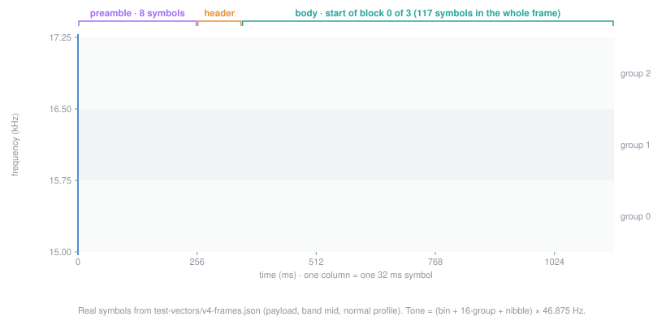
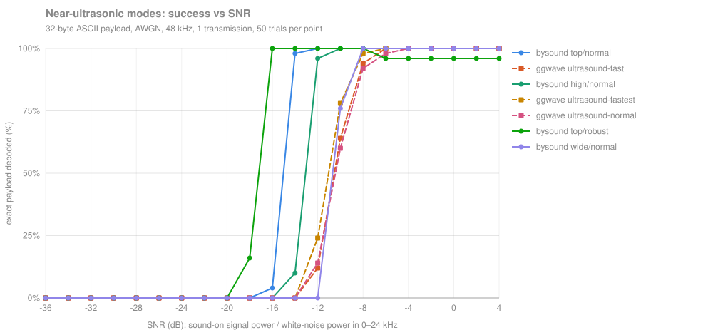
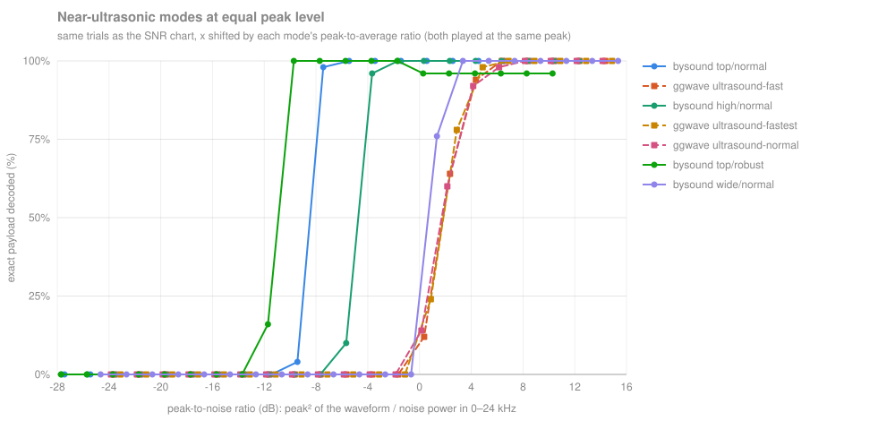
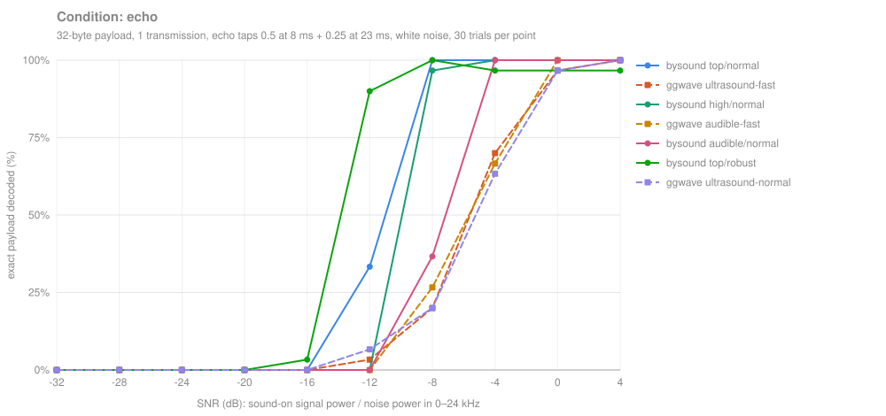
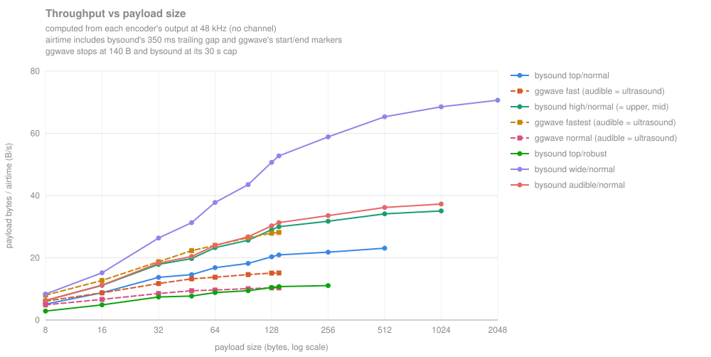

# bysound: incremental improvements to near-ultrasonic data-over-sound, measured against ggwave

**Agustin Gandara** · beaglecoder · November 2026

> **v1.0.** All numbers come from the benchmark in [`bench/`](bench) and are regenerated from its raw results. The first run of the benchmark found two receiver bugs in bysound; they are fixed and documented in Section 7.

<p align="center"></p>

## Abstract

Data-over-sound lets two devices exchange a short message using only a speaker and a microphone: no pairing, no radio, no camera. The best-known open-source implementation, **ggwave**, sends bytes with multi-frequency shift keying (MFSK) on a 46.875 Hz grid and protects them with Reed–Solomon (RS) coding. **bysound** keeps that foundation and adds a set of incremental changes:

- narrower band "channels" (2–6 simultaneous tones) inside 15–19.5 kHz, plus an audible channel;
- a per-tone noise floor;
- a keyed preamble per channel;
- maximum-likelihood header selection;
- soft symbols with echo cancellation;
- erasure decoding;
- blocked RS with an end-to-end CRC-32;
- soft combining of repeated transmissions;
- a slower *robust* profile.

We release byte-compatible implementations in TypeScript, Swift, Kotlin and allocation-free C (ESP32), plus a reproducible benchmark that runs the **unmodified** ggwave library on the same simulated channel with the same seeds (158,510 trials).

At equal average signal power over the full band, bysound's normal channels reach 90 % success at −14 to −8 dB SNR, against −8 dB for ggwave's ultrasound and audible protocols, and its robust profile at −16 dB. With echo the gap widens to 8–12 dB. Measured in-band, the difference shrinks to 0–3 dB: most of the gain comes from concentrating power into narrower bands, not from a better detector.

bysound is not limited to ggwave's 140 bytes per transmission (it caps a transmission at 30 s instead), and it delivered **no wrong payload** in 88,220 trials. ggwave accepted 349 wrong payloads in 70,290 trials. ggwave remains far cheaper to run: its receiver needs 14–42× less CPU.

## 1. Introduction

Acoustic data links are attractive because the hardware is already there. Phones, laptops, smart speakers and $3 microcontroller boards all have a speaker, a microphone, or both. Typical uses hand over a token that is longer than a person wants to type but shorter than a file:

- a pairing code;
- a URL;
- a payment reference;
- Wi-Fi credentials for an IoT device.

Three properties matter in practice:

1. **It must work in real rooms:** background noise, echo, cheap transducers, and clocks that differ between devices.
2. **It must be exact.** A wrong token is worse than no token, so the receiver must reject anything it is not sure about.
3. **It should be unobtrusive.** Above ~16 kHz most adults hear little or nothing, but phone hardware also loses sensitivity there.

ggwave [1] made the approach easy to adopt: a small C++ library, many bindings, and protocols in audible, "ultrasound" (15–19.4 kHz) and dual/mono-tone variants. bysound grew out of a production need for the three properties above. This paper documents what we changed, why, and how much each change is worth when measured honestly against ggwave.

**Contributions.**
- A specification of **bysound v4**, a payload framing on the same 46.875 Hz grid ([PROTOCOL.md](docs/PROTOCOL.md)).
- Four interoperable open-source implementations, sharing test vectors.
- A reproducible, head-to-head benchmark against unmodified ggwave, with all raw data.
- An analysis that separates each source of gain (bandwidth, peak-to-average power, coding, detection), including where ggwave is better.

## 2. Related work

- **ggwave** [1] (G. Gerganov, MIT). MFSK with 6 simultaneous tones on a 46.875 Hz grid, RS error correction, start and end sound markers, and payloads of up to 140 bytes. It has audible, ultrasound, dual-tone (DT) and mono-tone (MT) protocols, each in normal, fast and fastest speeds. bysound uses the same grid spacing, which makes the comparison direct.
- **Quiet** [2] (libquiet). It uses software-defined-radio-style modulation (OFDM, GMSK) over sound, with liquid-dsp. Its bit rates are higher but the receiver is more complex.
- **minimodem** [3]. A general-purpose FSK software modem (Bell 103/202, RTTY…). It is not designed for near-ultrasonic or noisy rooms.
- **Dhwani** [4] (SIGCOMM 2013). Acoustic NFC between phones, with a security model based on self-jamming. It targets confidentiality at very short range, which bysound does not attempt.

We compare against ggwave only, because it is the closest in design and the most used. Comparing against systems with different goals (OFDM throughput, secure NFC) would not be informative without re-implementing them.

## 3. Design of bysound v4

<p align="center"></p>

**Tone grid.** Every tone sits at `f = (bin + 16·g + nibble) × 46.875 Hz`. The analysis window is exactly 1/46.875 s (1,024 samples at 48 kHz), so tones are orthogonal and fall on FFT bins. At 44.1 kHz the receiver uses Goertzel filters on the same grid.

**Channels.** Seven channels, each `G` groups of 16 tones, playing one tone per group per symbol (one nibble per group):

| Channel | Span | G | Symbol | Raw rate |
|---|---|---|---|---|
| `top` | 18.0–19.5 kHz | 2 | 32 ms | 250 bit/s |
| `high` | 17.25–19.5 kHz | 3 | 32 ms | 375 bit/s |
| `upper` | 16.5–18.75 kHz | 3 | 32 ms | 375 bit/s |
| `mid` | 15.0–17.25 kHz | 3 | 32 ms | 375 bit/s |
| `xhigh` | 16.5–19.5 kHz | 4 | 32 ms | 500 bit/s |
| `wide` | 15.0–19.5 kHz | 6 | 32 ms | 750 bit/s |
| `audible` | 1.875–4.875 kHz | 4 | 40 ms | 400 bit/s |

`wide` occupies the same span as ggwave's ultrasound protocols, so it is the like-for-like comparison. `top` lives where ggwave has no protocol.

**Frame.** A frame has four parts:
1. An 8-symbol **preamble**, keyed per channel and profile.
2. A 4-byte **header**: type, block count, CRC-8 and version|channel.
3. The **body**: the packed text plus a CRC-32, cut into ≤ 48-byte blocks. Each block is `RS([index, total] + data, 12 parity)` over GF(256).
4. A 350 ms **gap**.

<p align="center"></p>
<p align="center"></p>

## 4. The improvements, one by one

Each item says what ggwave does, what bysound does, and the mechanism that makes it help.

| # | Area | ggwave | bysound | Why it helps |
|---|---|---|---|---|
| 1 | **Bandwidth** | 6 tones (≈ 4.4 kHz span) per protocol | 2–6 tones per channel (1.5–4.5 kHz) | With the same total power spread over fewer tones, each tone stands higher above white noise. This is most of the full-band SNR gain (Section 6.2). |
| 2 | **Peak-to-average power** | 6 tones summed → PAPR ≈ 12–13 dB | 2–3 tones → PAPR ≈ 6.5–8.3 dB | A speaker clips at its peak, not its average. At the same peak amplitude bysound puts more average power in the air: a 1–15 dB edge at equal peak (Section 6.2). |
| 3 | **Noise floor per tone** | Fixed detection on raw spectrum | Running background level for every tone, whitened before detection | A fan, a monitor whine or a neighbour's ultrasonic sensor becomes "normal" for its tone and stops masking or faking symbols. |
| 4 | **Preamble** | Start/end marker tones | 8-symbol pattern keyed per channel and profile, threshold 0.32 on a normalised score (noise ≈ 0.06) | It identifies the channel and the exact symbol timing in one step, and keeps channels apart. |
| 5 | **Header decision** | — (length in the payload stream) | Maximum likelihood over the 259 valid headers (CRC-8 protected) | A header with a couple of wrong nibbles is still picked correctly, because only valid headers are candidates. |
| 6 | **Soft symbols + echo** | Hard decision per symbol | Probabilities for all 16 tones; previous symbol's echo (measured on the preamble) subtracted | Reverberation leaves energy from the last chord. Removing it gives the biggest robustness gain under echo: −8 dB against 0 dB for ggwave (Section 6.3). |
| 7 | **Erasure decoding** | RS errors only | Retry with the least-certain bytes marked as erasures (0/4/8/12, blocks 0/2/4) | RS fixes 2× as many erasures as unknown errors, and soft symbols tell us which bytes are doubtful. |
| 8 | **Blocks + CRC-32** | One RS codeword, ≤ 140 B, no checksum | ≤ 255 blocks × 48 B with RS(+12) each, plus a CRC-32 over the whole text | Messages longer than 140 B at constant per-block strength. The CRC turns "RS mis-corrected" into "rejected": 0 wrong payloads, against 349 for ggwave (Section 6.5). |
| 9 | **Combining repetitions** | Each transmission decoded alone | Up to 6 laps combined (summed or most-confident soft symbols) per block | A block hit by a door slam on lap 1 and a cough on lap 2 can still be recovered. TypeScript, Swift and Kotlin only; the C receiver does not combine yet. |
| 10 | **Robust profile** | Speed variants change symbol length | `top/high/upper/mid` with 2× symbol, window and hop | About 2 dB more noise tolerance at half speed. Combined with item 1, `top/robust` reaches −16 dB. |
| 11 | **Text packing** | Raw bytes | Digit pairs → 1 byte; ASCII as is; UTF-8 escaped | Numeric tokens (codes, amounts) take ~half the airtime. Not used in the benchmark payloads, to be fair. |
| 12 | **Clash detection** | — | A preamble from another channel during a frame, or overlapping frames → "clash" instead of delivery | Two senders in the same room cannot be confused with each other. |

## 5. Implementations

| | Language | Lines (modem) | Notes |
|---|---|---|---|
| `web/` | TypeScript | ≈ 1.6 k | Normative reference receiver, Web Audio + AudioWorklet + Worker |
| `ios/` | Swift | ≈ 1.5 k | vDSP FFT at 48 kHz, Goertzel at 44.1 kHz; AVAudioEngine |
| `android/` | Kotlin | ≈ 1.5 k | Pure-Kotlin modem (JVM-testable), AudioTrack/AudioRecord |
| `c/` | C99 | ≈ 2.4 k | No `malloc`, streaming TX/RX; FFT (float) or Goertzel (integer) engine |

All four reproduce the frames in `test-vectors/v4-frames.json` byte for byte, decode each other's audio, and decode real recordings. On an ESP32-S3 the demo image is 252 KB, with 70 KB of static RAM and no PSRAM.

## 6. Evaluation

### 6.1 Method

Both libraries are compiled from source with the same compiler. ggwave is fetched at commit `060aec7` and used with its **default parameters**. Each trial:
1. Encodes a payload: 8–128 B of ASCII without digits, so bysound's packing gives no advantage; 512 and 2048 B for bysound only, where they fit in its 30 s cap (2048 B only on `wide`); plus a UTF-8 case.
2. Passes it through a channel: white, pink or babble-like noise at a given SNR, optional echo (two delayed taps), ±100 ppm clock drift, lead silence.
3. Feeds the result to each library's own streaming receiver in 1,024-sample chunks.

Success means the exact payload came out. SNR is defined over the full 0–24 kHz band, and we also report in-band and equal-peak SNR. Unless stated, a cell is 50 trials at 48 kHz. Full method: [bench/README.md](bench/README.md).

### 6.2 White noise

<p align="center"></p>

Lowest SNR with ≥ 90 % success (SNR90), 32-byte message, one transmission:

| Configuration | Full band | In band | Equal peak |
|---|---:|---:|---:|
| bysound `top` | −14 dB | −2 dB | −7 dB |
| bysound `high` / `upper` / `mid` | −12 dB | −2 dB | −4 dB |
| bysound `xhigh` | −10 dB | −1 dB | 0 dB |
| bysound `wide` | −8 dB | −1 dB | +3 dB |
| bysound `audible` | −10 dB | −1 dB | −1 dB |
| bysound `top` robust | −16 dB | −4 dB | −10 dB |
| bysound `high/upper/mid` robust | −14 dB | −4 dB | −6 dB |
| ggwave ultrasound (normal/fast/fastest) | −8 dB | −1 dB | +4 / +4 / +5 dB |
| ggwave audible (normal/fast/fastest) | −8 dB | −1 dB | +4 / +4 / +5 dB |
| ggwave DT fastest | −4 dB | +8 dB | +4 dB |

**Reading.** Over the full band, bysound's narrow channels win by up to 6 dB (8 dB robust). In band they are within 0–3 dB of ggwave, so the gain is mostly item 1 (bandwidth), not a smarter detector at the same in-band SNR. At equal **peak** level, the practical constraint for a speaker, item 2 adds a further 1–15 dB. `wide` against ggwave ultrasound, on the same 15–19.4 kHz span, ties in band and is slightly worse at equal peak (+3 dB against +4/+5, the lower number being better). Its advantage is speed and message size (Section 6.4).

<p align="center"></p>

### 6.3 Echo, coloured noise and drift

SNR90 (full band, 4 dB grid), 32 B, one transmission:

| Configuration | White | Echo | Pink | Babble-like | Drift ±100 ppm | All combined |
|---|---:|---:|---:|---:|---:|---:|
| bysound `top` | −12 | **−8** | −20 | −32 | −12 | −16 |
| bysound `top` robust | −16 | **−12** | −24 | −32 | −16 | −20 |
| bysound `wide` | −8 | −4 | −16 | −32 | −8 | −12 |
| bysound `audible` | −8 | −4 | −8 | −12 | −8 | −4 |
| ggwave ultrasound fastest | −8 | **0** | −16 | −32 | −8 | −8 |
| ggwave audible fastest | −8 | 0 | −8 | −12 | −8 | 0 |

Echo is where the soft symbols and echo subtraction (item 6) show: 8–12 dB better than ggwave. Pink and babble noise sit mostly below 5 kHz, so every near-ultrasonic mode survives very low full-band SNR (the in-band SNR is much higher). Clock drift of ±100 ppm did not affect either library.

<p align="center"></p>

### 6.4 Airtime, throughput and message size

| Configuration | 8 B | 32 B | 128 B | 140 B | B/s at 128 B |
|---|---:|---:|---:|---:|---:|
| bysound `top` | 1.57 s | 2.33 s | 6.30 s | 6.89 s | 20.3 |
| bysound `high/upper/mid` | 1.28 s | 1.79 s | 4.41 s | 4.87 s | 29.0 |
| bysound `wide` | 0.96 s | 1.21 s | 2.53 s | 2.85 s | **50.7** |
| bysound `top` robust | 2.78 s | 4.32 s | 12.25 s | 13.22 s | 10.4 |
| ggwave fastest | **1.00 s** | 1.71 s | 4.59 s | 4.97 s | 27.9 |
| ggwave fast | 1.32 s | 2.73 s | 8.49 s | 9.26 s | 15.1 |
| ggwave normal | 1.64 s | 3.75 s | 12.39 s | 13.55 s | 10.3 |

bysound airtime includes its 350 ms trailing gap. On the same span, `wide` is 1.8× faster than ggwave fastest at 128 B. For 8-byte messages ggwave fastest and bysound `wide` take about the same time, and the narrow bysound channels are slower. 140 B is ggwave's maximum per transmission. bysound caps a transmission at **30 seconds** instead of at a byte count: anything longer is impractical over the air, so the encoder rejects it. That allows 700 B on `top`, 1,052 B on `high`/`upper`/`mid` and 2,114 B on `wide` (335 B and 520 B in the robust profile) (exact limits per channel in [PROTOCOL.md](docs/PROTOCOL.md)); for example, 1 KB takes 15.1 s on `wide`. The 140 B column for bysound was measured with the `bysound` CLI encoder, the rest by the benchmark.

<p align="center"></p>

### 6.5 Wrong payloads

| | Trials | Wrong payloads accepted |
|---|---:|---:|
| bysound | 88,220 | **0** (also 0 detections in 60 min of pure noise) |
| ggwave | 70,290 | 349 |

Most of ggwave's wrong payloads came from its fixed-length mono-tone mode (315). 32 were 8-byte messages in default mode, at every SNR, including with no noise at all. With only a few RS parity bytes and no checksum, an RS mis-correction is delivered as data. bysound's CRC-32 (item 8) turns those cases into rejections.

### 6.6 Cost

| | CPU per 32 B trial | Real-time factor |
|---|---:|---:|
| bysound (listening on all 7 channels) | 7–13 ms | 434–508× |
| ggwave (listening on all protocols) | 0.3–0.7 ms | 7,690–17,452× |

ggwave's receiver is 14–42× cheaper. bysound still runs comfortably in real time on a phone or browser, and the single-channel C build runs at ~740× real time on the host and fits an ESP32-S3.

### 6.7 Where ggwave is better

- **CPU and code size**, as above.
- **Short messages:** ggwave fastest matches the speed of bysound's fastest channel at 8 B.
- **Mono-tone mode** in fixed-length operation is the most noise-tolerant configuration measured (−20 dB), at 5.6 s for 32 B. It requires both ends to know the length in advance, and it accepted 315 wrong payloads.
- **Maturity and reach:** many language bindings, years of use, and a large community.

## 7. Bugs found by the benchmark (fixed)

Running bysound against an independent baseline paid off: the first run exposed two receiver bugs. Neither could deliver a wrong message (the CRC-32 rejected every bad read), but both lost messages in a clean channel. Both are fixed in all four implementations, with regression tests in each.

1. **The last block closed one byte short.** The last block does not state its length, so receivers tried lengths from short to long and stopped at the first one Reed–Solomon accepted. When the true last parity byte is `0x00` (about 1 payload in 256), the codeword without that byte is also a valid codeword (`c(x) = x·c′(x)`). The block then closed early and the CRC-32 rejected the message. **Fix:** among the lengths RS accepts, take the first one whose assembled payload passes the CRC-32. When the CRC cannot be checked yet (another block is still missing), keep the candidate as unchecked and drop it if the final CRC fails.
2. **Some payloads failed only in a clean channel.** Receivers also look for a preamble inside a frame body, because a new repetition can start before the longest possible end of the current frame. In one payload, 6 of the 16 preamble nibbles of `top/robust` happened to appear in the body. With no noise those tones carry all their energy, so the match scored about 6/16 = 0.375, just over the 0.32 threshold, and the read was cut short. With noise the false match fell below the threshold, which is why it failed only at high SNR. **Fix:** a preamble inside a body cuts the read only if it scores at least 0.7× the current frame's own preamble score. A real repetition from the same sender scores about the same; a look-alike scores only its share of matching nibbles.

**Effect.** With the same seeds, 160 trials went from failure to success and none the other way. Every bysound configuration now succeeds 100 % in a clean channel (0 of 500 lost at 8 and 32 B, 0 of 300 at 128 B; before, up to 15 of 500 on `top/robust`). The SNR90 values in Section 6 did not move, because the failures were above those points. `top/robust` at 2048 B improved from −12 to −16 dB. False decodes are unchanged: 0 for bysound.

## 8. Limitations

- **Simulation, not air.** The channel has no speaker or microphone frequency response, no non-linearity and no room acoustics. Phones often lose 10–30 dB above 15 kHz, which hurts `top` (18–19.5 kHz) the most. Over-the-air tests between phones, browsers and the ESP32 are future work.
- The noise models are synthetic; the babble-like noise is not real speech.
- bysound's lap combining was not benchmarked, because the benchmark uses the C receiver, which does not combine.
- ggwave was not tested at 44.1 kHz or in its other modes, and the DT protocols' clean-channel failures (13–67 % with no noise) were not investigated.
- **No secrecy.** Anyone nearby can record the sound. Applications must not send secrets in the clear and must validate what they receive.

## 9. Conclusion

bysound keeps ggwave's elegant core (MFSK on a 46.875 Hz grid with Reed–Solomon) and adds incremental, measurable improvements. Narrow channels and lower peak-to-average power buy most of the noise margin, soft symbols with echo subtraction buy robustness in reverberant rooms, and blocked RS with an end-to-end CRC-32 buys long messages and zero wrong deliveries. The costs are CPU and, for very short messages on narrow channels, speed. Everything (code, vectors, benchmark, raw results) is MIT-licensed and reproducible with three commands.

## Reproducibility

```sh
cd bench && ./fetch-ggwave.sh && make && make run     # ≈ 8 min on an Apple M4 Pro
```

Raw CSV files, the summary and every chart are in [`bench/results/`](bench/results).

## References

1. G. Gerganov, *ggwave: Tiny data-over-sound library*, https://github.com/ggerganov/ggwave (commit 060aec7).
2. B. Armstrong, *Quiet: transmit data with sound*, https://github.com/quiet/quiet.
3. K. Mostafa, *minimodem: general-purpose software audio FSK modem*, https://github.com/kamalmostafa/minimodem.
4. R. Nandakumar, K. K. Chintalapudi, V. N. Padmanabhan, R. Venkatesan, "Dhwani: Secure Peer-to-Peer Acoustic NFC", *ACM SIGCOMM 2013*.
