<div align="center">



# bysound

**Send text between devices through sound. Near-ultrasonic, error-corrected, no network.**

The same modem in **TypeScript · Swift · Kotlin · C**, with a tiny demo for the **browser, iOS, Android and ESP32**.
No accounts, no API keys, no server: everything runs locally.

[](https://github.com/beaglecoder/bysound/actions/workflows/ci.yml)
[](LICENSE)


[How it works](docs/HOW-IT-WORKS.md) · [Paper](PAPER.md) · [Protocol spec](docs/PROTOCOL.md) · [Benchmark vs ggwave](bench/README.md)

</div>

---

## Why

A speaker and a microphone are on almost every device, so sound is a pairing-free way to hand over a short piece of data: a code, a URL, a payment reference, Wi-Fi credentials for an IoT board. **bysound** turns text into a quick burst of tones between **15 and 19.5 kHz** (or an audible band if you prefer) and back into the **exact same text**, or nothing at all.

- **Robust:** Reed–Solomon in every 48-byte block, erasure decoding, soft combining of repetitions, a robust profile for noisy rooms.
- **Exact:** CRC-32 over the whole message. In 88,220 simulated trials and 60 minutes of pure noise it **never delivered a wrong text**.
- **Long messages:** up to **12 KB** in one transmission, about 2.8 minutes on the `wide` channel (ggwave: 140 B, 5 s).
- **Everywhere:** byte-identical frames in four languages, checked against shared test vectors; the C version needs no `malloc` and fits an ESP32-S3 in ~60 KB of RAM.

## bysound vs ggwave, in plain words

[ggwave](https://github.com/ggerganov/ggwave) is the best-known open-source library for sending data with sound, and bysound starts from the same idea. Here is what changes for you, in one line each. The details and the numbers are in the [paper](PAPER.md).

| | What you get with bysound | Compared with ggwave |
|---|---|---|
| ✅ **It never lies** | You get the exact message or nothing. A checksum over the whole text rejects anything doubtful. | ggwave delivered **349 wrong messages** in our tests, some with no noise at all. bysound delivered **0** in 88,220. |
| 🏠 **Works in echoey rooms** | It measures the room's echo and subtracts it before reading each tone. | Handles **8–12 dB more noise** when there is echo, the normal case in a real room. |
| 🔇 **Can be truly inaudible** | A channel at 18–19.5 kHz that almost nobody hears, and it is the most noise-tolerant one. | ggwave's "ultrasound" starts at 15 kHz, which many young people hear. |
| 📏 **Long messages** | Up to **12 KB** in one go, cut into self-correcting blocks: about **2.8 min** on `wide`, 8.4 min on `top`. | ggwave stops at **140 bytes** (5 s at its fastest). |
| ⚡ **Faster on the same frequencies** | On the same 15–19.5 kHz span, the `wide` channel sends 128 bytes in 2.5 s. | **1.8× faster** than ggwave's fastest mode (4.6 s). |
| 🔊 **More signal from the same speaker** | Fewer tones at once, so a speaker can play them louder before it distorts. | More useful power in the air at the same volume. |
| 🔁 **Repetitions add up** | If a noise burst ruins part of one repetition, the next one fills the gap (TypeScript, Swift and Kotlin receivers). | ggwave reads each repetition on its own. |
| 👥 **Two senders at once** | If another device transmits at the same time, the receiver reports a *clash* instead of mixing them. | Not detected. |
| 🎵 **Rides on music** | The message can play above a song and still decode ([try it](#music--hidden-message)). | Not measured for ggwave. |

**Where ggwave is still better:** its receiver needs **14–42× less CPU**, very short messages (8 bytes) are just as fast, and it is more mature, with many language bindings.

**Honest caveats:** all numbers come from a simulated channel. Real phone speakers and microphones lose strength above 17 kHz, so over-the-air results will be lower, especially on the highest channel. Measured inside the same frequency band, both libraries tolerate about the same noise: most of bysound's noise advantage comes from using narrower bands, not from a magic detector.

## Try it in one minute

The quickest test needs two devices with speakers and microphones (two laptops, or a laptop and a phone).

```sh
git clone https://github.com/beaglecoder/bysound && cd bysound/web
npm install && npm run dev        # open http://localhost:5173
```

Press **Listen** on one device and **Send** on the other. If nothing arrives, turn the volume up or pick the `mid` or `audible` band: some speakers and microphones roll off above 17 kHz.

No second device? Use the command-line tool:

```sh
make -C c cli
c/build/bysound encode "hello sound" -o hello.wav   # then play hello.wav near a listening device…
c/build/bysound decode hello.wav                    # …or decode it straight away
```

## Music + hidden message


The playground's **♪ Music + hidden message** button plays a short original melody with the text riding above 18 kHz on the `top` band: you hear the song, and the other device reads the message. The same mix is in [`docs/assets/music-demo.wav`](docs/assets/music-demo.wav). Play it near a listening device, or decode the file directly:

```sh
c/build/bysound decode docs/assets/music-demo.wav
# [  1.59 s] band=top profile=normal corrected=0 text=hello from the music
```

## What is in the box

| Folder | Language | What you get | Run the tests | Run the demo |
|---|---|---|---|---|
| [`web/`](web) | TypeScript | Reference modem + Web Audio + playground page | `npm test` | `npm run dev` |
| [`ios/`](ios) | Swift | Swift package `BySound` + SwiftUI demo | `swift test -c release` | open `Demo/BySoundDemo.xcodeproj` |
| [`android/`](android) | Kotlin | Library `:bysound` + one-screen demo | `./gradlew :bysound:testDebugUnitTest` | `./gradlew :demo:installDebug` |
| [`c/`](c) | C99 | No-malloc library + `bysound` CLI (WAV in/out) | `make test cli-test` | `build/bysound --help` |
| [`esp32/`](esp32) | C (ESP-IDF) | ESP32-S3 + I2S mic + I2S amp demo | — | `idf.py build flash monitor` |
| [`bench/`](bench) | C++ | Reproducible benchmark against ggwave | — | `./fetch-ggwave.sh && make && make run` |
| [`docs/`](docs) | — | Spec, explainer, animated diagrams | — | — |

All demos interoperate: a phone can send to the browser, the browser to the ESP32, and so on, as long as both sides use the same band.

## How it works


Every tone sits on one grid spaced **46.875 Hz** apart. A band plays 2 to 6 tones at once, and each tone picks 1 of 16 slots, which is one nibble. A **frame** is a preamble that identifies the band, a 4-byte header, the text in Reed–Solomon-protected blocks, and a short gap:


The receiver listens to all bands at once, learns the background noise of every tone, finds the preamble, picks the most likely header, reads soft symbols, corrects errors (marking doubtful bytes as erasures) and, if needed, combines several repetitions before checking the CRC.


A gentle walk-through is in **[docs/HOW-IT-WORKS.md](docs/HOW-IT-WORKS.md)**; every byte and constant is in **[docs/PROTOCOL.md](docs/PROTOCOL.md)**.

### Bands

| Band | Range | Tones at once | Raw rate | Hearing |
|---|---|---|---|---|
| `top` | 18.0–19.5 kHz | 2 | 250 bit/s | almost nobody hears it |
| `high` | 17.25–19.5 kHz | 3 | 375 bit/s | very faint |
| `upper` | 16.5–18.75 kHz | 3 | 375 bit/s | faint for young ears |
| `mid` | 15.0–17.25 kHz | 3 | 375 bit/s | audible to many young listeners |
| `xhigh` | 16.5–19.5 kHz | 4 | 500 bit/s | faint |
| `wide` | 15.0–19.5 kHz | 6 | 750 bit/s | same span as ggwave's "ultrasound" |
| `audible` | 1.9–4.9 kHz | 4 | 400 bit/s | clearly audible, works on any speaker |

`top`, `high`, `upper` and `mid` also have a **robust** profile: symbols twice as long, about 2 dB more noise tolerance (half the speed).

## The numbers

Both libraries, unmodified, on the same simulated channel with the same seeds (158,510 trials, reproducible in [`bench/`](bench)). They share the same idea: MFSK on an orthogonal 46.875 Hz grid.


| 32-byte message, 48 kHz | bysound `top` | bysound `top` robust | bysound `wide` | ggwave ultrasound fastest |
|---|---|---|---|---|
| Lowest SNR with ≥ 90 % success (full band) | −14 dB | −16 dB | −8 dB | −8 dB |
| Same, with echo | −8 dB | −12 dB | −4 dB | 0 dB |
| Airtime for 128 bytes | 6.3 s | 12.3 s | 2.5 s | 4.6 s |
| Largest message | 12,236 B | 12,236 B | 12,236 B | 140 B |
| Time to send the largest message | 8.4 min | 16.9 min | 2.8 min | 5.0 s |
| Wrong texts delivered | 0 | 0 | 0 | 349 across all ggwave modes |

ggwave is still the better pick when you need the smallest and fastest receiver (14–42× less CPU) or many language bindings. The [paper](PAPER.md) explains each improvement and where the advantage comes from (narrower bands concentrate power, so in-band the two are within 0–3 dB). It also covers the limits: this is a simulation, and real speakers and microphones lose a lot above 17 kHz.

## Use it in your code

```ts
// TypeScript (browser)
import { send, listen } from 'bysound';
const tx = await send('hello', { band: 'top', repeat: 'forever' });   // from a click
const rx = await listen({ onFrame: (h) => console.log(h.payload) });
```

```swift
// Swift
let sender = SoundSender(); try sender.start(text: "hello", band: .top)
let listener = SoundListener(); listener.onFrame = { print($0.text) }; try listener.start()
```

```kotlin
// Kotlin
SoundSender(context).send("hello", Band.TOP)
SoundListener(context, onFrame = { println(it.text) }).start()
```

```c
// C: text -> PCM, streamed
bys_tx_t tx; bys_tx_init_payload(&tx, NULL, BYS_TOP, BYS_NORMAL, "hello", 5);
int16_t pcm[480]; while (!bys_tx_done(&tx)) { size_t n = bys_tx_fill(&tx, pcm, 480); /* play */ }
```

Each folder's README has the full API.

## Repository layout

```
protocol-v4.json         constants shared by every implementation
protocol/                normative reference encoder (Node) that generates the test vectors
test-vectors/            frames every implementation must reproduce byte for byte
web/  ios/  android/  c/ the four implementations and their demos
esp32/                   ESP-IDF demo for ESP32-S3
bench/                   benchmark against ggwave (fetches ggwave, never vendors it)
docs/                    PROTOCOL.md, HOW-IT-WORKS.md, animated SVGs
PAPER.md                 the write-up
```

## Citing

If bysound helps your research, please cite it (see [`CITATION.cff`](CITATION.cff)):

```bibtex
@software{bysound,
  author  = {Gandara, Agustin},
  title   = {bysound: a robust near-ultrasonic data-over-sound modem},
  year    = {2026},
  url     = {https://github.com/beaglecoder/bysound},
  license = {MIT}
}
```

## License

[MIT](LICENSE). ggwave is MIT-licensed by Georgi Gerganov; the benchmark downloads it, it is not redistributed here.
