<div align="center">


# bysound

**Send text between devices through sound. Near-ultrasonic, error-corrected, no network.**

The same library in **TypeScript · Swift · Kotlin · C**, with a small demo for the **browser, iOS, Android and ESP32**.
No accounts, no API keys, no server: everything runs locally.

[](https://github.com/beaglecoder/bysound/actions/workflows/ci.yml)
[](LICENSE)


[How it works](docs/HOW-IT-WORKS.md) · [Paper](PAPER.md) · [Protocol spec](docs/PROTOCOL.md) · [Session layer](docs/SESSION.md) · [Security](docs/SECURITY.md) · [Benchmark vs ggwave](bench/README.md)

</div>

---

## What it does

- 📱 ➜ 🔊 ➜ 📱 One device **plays** a short burst of tones, another **listens** and gets the **exact same text**.
- 🔇 The tones sit at **15–19.5 kHz**, above what most adults hear well; the `top` channel (18–19.5 kHz) is inaudible to most adults. An audible channel is there too.
- ✅ You get the **exact message or nothing**: a checksum over the whole text guards delivery.
- 🔁 **Adapts itself:** the sender tries channels from the least audible down until the receiver acknowledges, switches to a slower, sturdier mode if nobody answers, and remembers what worked. A phone whose speaker stops around 17 kHz ends up starting on `mid`.
- 🌐 One format for a **browser, a phone and a microcontroller**: all four implementations pass the same test vectors.
- 🔌 No pairing, no Wi-Fi, no Bluetooth, no camera.

Good for: pairing codes, links, payment references, Wi-Fi setup for IoT boards, anything short you'd rather not type.

## Compared with ggwave

[ggwave](https://github.com/ggerganov/ggwave) is a widely used open-source library for data over sound. bysound starts from the same idea (tones on a 46.875 Hz grid with Reed–Solomon) and changes a few things:



- ⚡ **More data in the same time:** on the same frequencies, **twice as much** in 5 seconds.
- 🔇 **Or the same speed, higher up:** for messages of about 64 bytes or more, the `high` channel (17.25–19.5 kHz) matches ggwave's fastest speed.

| Choose bysound when… | Choose ggwave when… |
|---|---|
| 🏠 The room is noisy or echoey: on the narrow channels 2–8 dB more margin against broadband noise, and 4–12 dB more with echo (equal power, simulated) | 🔋 CPU or battery is tight: ggwave's receiver is 41–51× lighter while idle, 1.2–14× while decoding |
| ✅ A wrong message is worse than none: 0 wrong in 87,380 trials (ggwave: 34 in 67,320, mostly 8-byte) | ⏱️ Messages are a few bytes: at 8 B ggwave (1.00 s) beats every bysound channel except `wide` (0.96 s) |
| 📦 Messages go beyond 140 bytes: up to 30 s per transmission (700–2,114 B) | 🏛️ You want years of public use and a larger community |
| 🔇 It should be hard to hear: `top` (18–19.5 kHz) and `high` (17.25–19.5 kHz) | 🧩 You want ready-made bindings (Python, JavaScript/WebAssembly, an iOS Swift package) and Arduino/RP2040/ESP32 examples |
| 🤝 You want acks, second-sender alerts and channel adaptation built in | 🎛️ You want low-frequency few-tone modes (DT/MT, 1.1–2.6 kHz) |
| 🧰 You want native TypeScript, Swift, Kotlin and allocation-free C | 📡 You need something already proven over the air: bysound's numbers are simulation only |

In-band, the two detectors are within 0–3 dB of each other: most of bysound's margin comes from narrower channels. Details and caveats: **[paper](PAPER.md#8-trade-offs)**, **[benchmark](bench/README.md)**.

## Works in noisy places


Noise measured over the whole audio band (0–24 kHz), 32-byte message, simulated:

- 🌬️ **Next to a fan or with static hiss:** still reads when the noise is **25×** stronger than the message. ggwave: 6×.
- 🏠 **In a room with echo:** **6×** (16× with the robust profile). ggwave: up to the message's own level.
- 🚗 **Street noise, air conditioning:** **100×**. ggwave: 40×.
- 🍻 **Bar, people talking:** both work. Voices live below 5 kHz and the message above 15 kHz.
- 🎶 **Over music:** the message decodes on top of a song ([try it](#music--hidden-message)). A loud nightclub has not been tested.
- 🧩 **Repairs damage:** doubtful bytes are marked and fixed, and if a noise burst ruins part of one repetition, the next one fills the gap (TypeScript, Swift and Kotlin receivers).

## Integrity and safety

- ✅ **Exact message or nothing:** three checks before anything is accepted (header checksum, error correction in every block, a CRC-32 over the whole text). No wrong message in 87,380 simulated trials.
- ✓ **Says "got it":** the receiver acknowledges by sound, so the sender stops; the sender answers with a receipt.
- 👥 **Notices a second sender:** if two devices transmit at once, the receiver reports a *clash* and delivers nothing. Call `confirmed()` before acting and it also catches a sender that shows up later.
- ⚠ **Warns the others:** whoever notices another sender plays an alert, relayed at most twice. The suggested quarantine is only a callback: bysound never blocks anything.
- 🎚️ **Security levels:** `basic`, `standard` or `maximum` (the default).
- 🔓 **Not secret:** anyone nearby can hear the sound, just like anyone can photograph a QR code. Don't send passwords in the clear; sign or encrypt in your app if it matters.

Session layer (acks, alerts, levels, adaptation): specified in **[docs/SESSION.md](docs/SESSION.md)**, with the TypeScript implementation as the reference. What is and isn't protected: **[docs/SECURITY.md](docs/SECURITY.md)**.

## Try it in one minute

```sh
git clone https://github.com/beaglecoder/bysound && cd bysound/web
npm install && npm run dev        # open http://localhost:5173 on two devices
```

Press **Listen** on one and **Send** on the other. Nothing arrives? Turn the volume up or pick the `mid` channel: some speakers don't reach 17 kHz.

No second device? Turn text into a sound file and back:

```sh
make -C c cli
c/build/bysound encode "hello sound" -o hello.wav
c/build/bysound decode hello.wav
```

## Music + hidden message


- 🎵 You hear a song; the message rides **above 18 kHz**.
- 👂 The other device reads the text from the music.
- ▶️ Try the **♪ Music + hidden message** button in the playground, or decode [`music-demo.wav`](docs/assets/music-demo.wav) with `c/build/bysound decode`.

## How it works


- 🎹 Text becomes **tones on a fixed grid**; each tone carries 4 bits.
- 🚦 A **preamble** says "a message starts here" and which channel it uses.
- 🧱 The text travels in **blocks with error correction**, plus a checksum over the whole message.
- 📻 The receiver **listens to all channels at once**, so the sender can pick any of them and nothing has to be configured.
- 👂 The receiver **learns the room's noise and echo**, repairs damaged bytes and **checks** everything before answering.


Step by step, with more pictures: **[docs/HOW-IT-WORKS.md](docs/HOW-IT-WORKS.md)**. Every byte: **[docs/PROTOCOL.md](docs/PROTOCOL.md)**.

## What's in the box

| | Folder | Demo |
|---|---|---|
| 🌐 Browser | [`web/`](web) · TypeScript | `npm run dev` |
| 🍎 iOS | [`ios/`](ios) · Swift | open `Demo/BySoundDemo.xcodeproj` |
| 🤖 Android | [`android/`](android) · Kotlin | `./gradlew :demo:installDebug` |
| 🔧 Any computer | [`c/`](c) · C99, no `malloc` | `c/build/bysound` (WAV in/out) |
| 📟 ESP32-S3 | [`esp32/`](esp32) · ESP-IDF | `idf.py build flash monitor` |
| 📊 Benchmark | [`bench/`](bench) · vs ggwave | `./fetch-ggwave.sh && make && make run` |

All of them talk to each other. Each folder's README has its API, tests and details. The ESP32-S3 demo needs an I2S microphone and an I2S amplifier; it builds, but has not been run on a board yet.

## In your code

```ts
import { send, listen } from 'bysound';
await send('hello', { band: 'top' });                       // from a click
await listen({ onFrame: (msg) => console.log(msg.payload) });
```

Swift, Kotlin and C look the same: see [`ios/`](ios), [`android/`](android) and [`c/`](c).

## Citing

```bibtex
@software{bysound,
  author  = {Gandara, Agustin},
  title   = {bysound: a robust near-ultrasonic data-over-sound modem},
  version = {4.0.0},
  year    = {2026},
  url     = {https://github.com/beaglecoder/bysound},
  license = {MIT}
}
```

## License

[MIT](LICENSE). ggwave is MIT-licensed by Georgi Gerganov; the benchmark downloads it and does not redistribute it.
