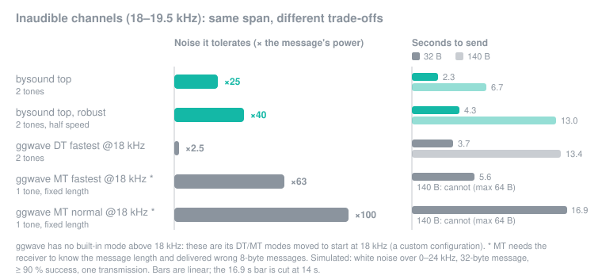
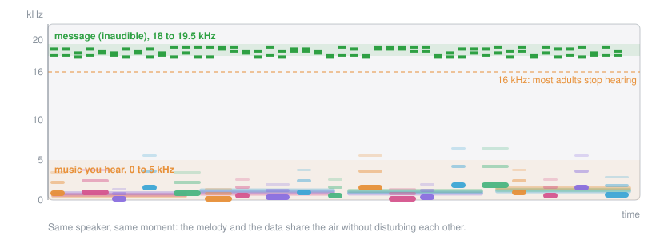

<div align="center">


# bysound

**Send text between devices through sound. Near-ultrasonic, error-corrected, no network.**

The same library in **TypeScript · Swift · Kotlin · C**, with a small demo for the **browser, iOS, Android and ESP32**.
No accounts, no API keys, no server: everything runs locally.

[](https://github.com/beaglecoder/bysound/actions/workflows/ci.yml)
[](LICENSE)


[How it works](docs/HOW-IT-WORKS.md) · [Paper](PAPER.md) · [Protocol spec](docs/PROTOCOL.md) · [Session layer](docs/SESSION.md) · [Security](docs/SECURITY.md) · [Benchmark vs ggwave](bench/README.md)

</div>

---

## What it does

- 📱 ➜ 🔊 ➜ 📱 One device **plays** a short burst of tones, another **listens** and gets the **exact same text**.
- 🔌 No pairing, no Wi-Fi, no Bluetooth, no camera.

## Use cases

- 📶 **Wi-Fi for a device:** the phone plays the network; a board with no screen joins. [example](examples/web-wifi-setup)
- 🏪 **"I'm in the store":** a speaker by the counter plays a rotating token; the customer's phone proves it was there. [example](examples/store-presence)
- 💳 **Pay at the counter:** the register plays a reference; the phone confirms it with your server. [example](examples/backend-reference)
- 🔗 **Share a link or a contact:** hold two phones close, no pairing. [iOS](examples/ios-share-link) · [Android](examples/android-share-contact)
- 🔑 **Pairing and login codes:** a TV or kiosk plays a one-time code instead of making you type it.
- 🎵 **A link inside music or an ad:** people hear the song, phones read the message above 18 kHz. [try it](#music--hidden-message)

## Five pillars



Compared with [ggwave](https://github.com/ggerganov/ggwave), the best-known open-source library for data over sound. Same core idea (tones on a 46.875 Hz grid with Reed–Solomon); bysound changes the framing, the receiver and what sits on top.

### 🔇 Inaudible



- 🔇 `top` (18–19.5 kHz) is inaudible to most adults. ggwave's built-in modes are audible or start at 15 kHz.
- 🔊 Moving ggwave above 18 kHz: `top` tolerates **10× more noise** than its 2-tone mode and is faster.

### ⚡ Speed


- ⚡ **Twice the data** in the same 5 s on the same band, or the same speed higher up.
- 📦 Up to 30 s per message (up to ≈2 KB); ggwave stops at 140 B. For 8-byte messages ggwave is as fast or faster.

### 🌪️ Noisy places



- 🍻 **Over the air:** bar, traffic, an alarm and an 18 kHz whistle read every time; music 23 of 30.
- 📶 Real threshold within ~2 dB of the simulation. [Over the air and distance](docs/HOW-IT-WORKS.md#over-the-air)

### ✅ Exact data

- ✅ **The exact message or nothing:** 0 wrong in 87,380 simulated trials and 172 over the air (ggwave: 34 in 67,320).
- 🧩 Repairs damaged bytes and fills gaps from the next repetition.

### 🔐 Security

- 👥 **Notices a second sender** and warns the others: the real sender held back 52 of 52 times over the air.
- 🔐 **With a backend,** only a fingerprint travels by sound; data and blocking stay on your server. [how](docs/SECURITY.md#using-a-backend)
- 🔓 **Not secret:** like a QR code, anyone nearby can hear it. [SECURITY.md](docs/SECURITY.md)

## CPU and devices

- ⚙️ **CPU:** both run hundreds of times faster than real time on a laptop, but ggwave is lighter (41–51× idle, 1.2–14× decoding). If battery comes first, pick ggwave.
- 🧠 **Memory:** the C library never calls `malloc`; the ESP32-S3 demo fits without PSRAM.

| 🌐 Browsers | 🍎 iOS 15+ · macOS 13+ | 🤖 Android 7.0+ | 🔧 Any computer (C99) | 📟 ESP32-S3 |
|---|---|---|---|---|
| TypeScript | Swift | Kotlin | C, WAV in/out | C, I2S mic + amp |

- 🤝 All speak the same format, so any can send to any other.
- 🔈 Many phone speakers fade above 17 kHz; the sender finds the highest channel that works.
- 🧪 Tested over the air on a Galaxy A50 and an iPad; the ESP32 demo builds but hasn't run on a board yet.

## bysound or ggwave?

| Choose bysound when… | Choose ggwave when… |
|---|---|
| 🔇 It should be hard to hear | 🔋 CPU or battery is tight |
| 🏠 The room is noisy or echoey | ⏱️ Messages are only a few bytes |
| ✅ A wrong message is worse than none | 🏛️ You want years of public use |
| 📦 Messages go beyond 140 bytes | 🧩 You want Python or WebAssembly bindings |
| 🤝 You want acks and alerts built in | 🎛️ You want 1–2-tone modes |

Full comparison: **[HOW-IT-WORKS](docs/HOW-IT-WORKS.md#6-bysound-vs-ggwave)** · **[paper](PAPER.md#8-trade-offs)** · **[benchmark](bench/README.md)**.

## Try it in one minute

```sh
git clone https://github.com/beaglecoder/bysound && cd bysound/web
npm install && npm run dev        # open http://localhost:5173 on two devices
```

Press **Listen** on one and **Send** on the other. Nothing arrives? Turn the volume up or pick the `mid` channel: some speakers don't reach 17 kHz.

No second device? Turn text into a sound file and back:

```sh
make -C c cli
c/build/bysound encode "hello sound" -o hello.wav
c/build/bysound decode hello.wav
```

## Music + hidden message



- 🎵 You hear a song; the other device reads the text riding **above 18 kHz**. Try the **♪ Music + hidden message** button in the playground, or decode [`music-demo.wav`](docs/assets/music-demo.wav).

## How it works



- 🎹 Text becomes **tones on a fixed grid**, in **blocks with error correction** and a checksum over the whole message.
- 📻 The receiver **listens to all channels at once**, learns the room's noise and echo, and checks everything before answering.

Step by step, with more pictures: **[docs/HOW-IT-WORKS.md](docs/HOW-IT-WORKS.md)**. Every byte: **[docs/PROTOCOL.md](docs/PROTOCOL.md)**.

## What's in the box

| | Folder | Demo |
|---|---|---|
| 🌐 Browser | [`web/`](web) · TypeScript | `npm run dev` |
| 🍎 iOS | [`ios/`](ios) · Swift | open `Demo/BySoundDemo.xcodeproj` |
| 🤖 Android | [`android/`](android) · Kotlin | `./gradlew :demo:installDebug` |
| 🔧 Any computer | [`c/`](c) · C99, no `malloc` | `c/build/bysound` (WAV in/out) |
| 📟 ESP32-S3 | [`esp32/`](esp32) · ESP-IDF | `idf.py build flash monitor` |
| 🧪 Examples | [`examples/`](examples) · all platforms | see [`examples/README.md`](examples/README.md) |
| 📊 Benchmark | [`bench/`](bench) · vs ggwave | `./fetch-ggwave.sh && make && make run` |

Each folder's README has its API, tests and details.

## Examples

The use cases above as small complete apps, all local and with no keys, plus the [channel ladder](examples/web-channel-ladder) and [WAV tools in C](examples/c-wav-tools): see [`examples/`](examples).

## In your code

```ts
import { send, listen, sendSession, receiveSession } from 'bysound';
await send('hello', { band: 'top' });                       // from a click
await listen({ onFrame: (msg) => console.log(msg.payload) });

// With the session layer: ack, channel ladder, second-sender alerts
await (await sendSession('pay 12.50 to shop 7')).delivered; // resolves on the receiver's ack
const rx = await receiveSession();
const { text } = await rx.result;
await rx.confirmed();                                       // right before acting on text
```

Swift, Kotlin and C look the same: see [`ios/`](ios), [`android/`](android) and [`c/`](c).

## Citing

```bibtex
@software{bysound,
  author  = {Gandara, Agustin},
  title   = {bysound: a robust near-ultrasonic data-over-sound modem},
  version = {4.0.0},
  year    = {2026},
  url     = {https://github.com/beaglecoder/bysound},
  license = {MIT}
}
```

## License

[MIT](LICENSE). ggwave is MIT-licensed by Georgi Gerganov; the benchmark downloads it and does not redistribute it.
