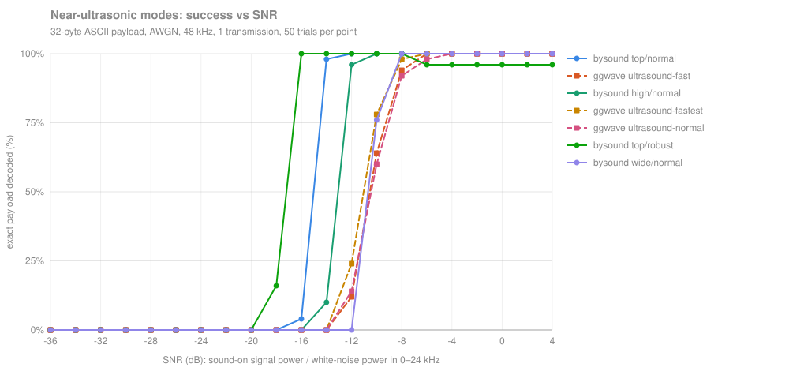
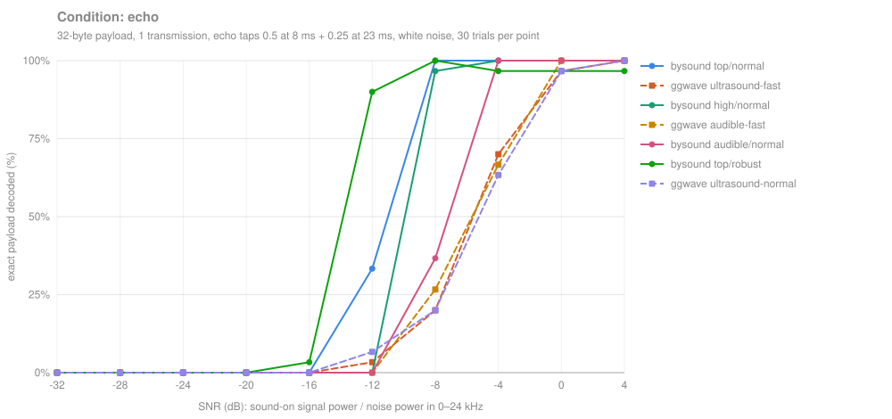
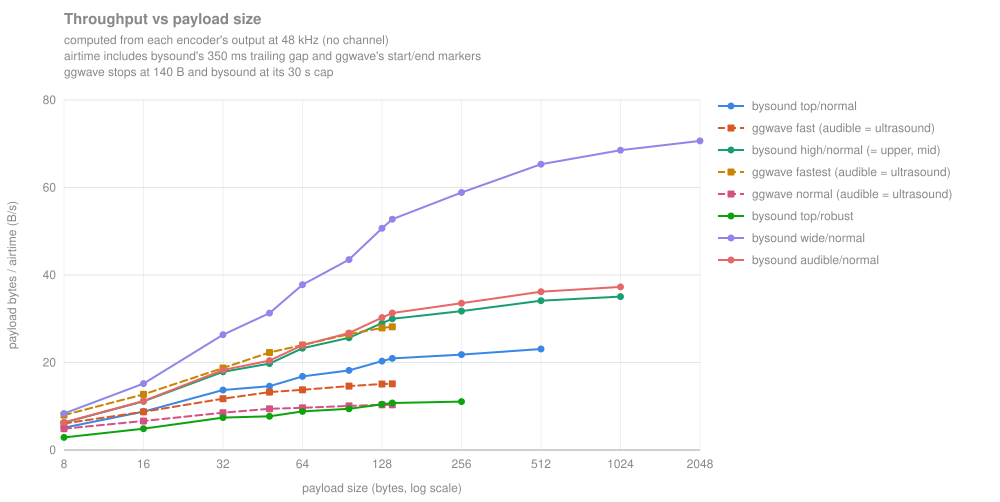

# bysound v4 vs ggwave: simulated-channel benchmark

This folder compares two data-over-sound modems on the same simulated channel, with the same seeds and the same payloads:

- **bysound v4**, the C99 library in [`../c`](../c): `bys_tx_init_payload` + `bys_tx_fill` to transmit and the streaming demodulator `bys_demod_*` to receive (FFT engine, robust profile and audible channel compiled in).
- **ggwave** by Georgi Gerganov (MIT), commit [`060aec73dd7123ccac200442f75bdc7369795ffe`](https://github.com/ggerganov/ggwave/commit/060aec73dd7123ccac200442f75bdc7369795ffe) (`v0.4.3-2-g060aec7`, 2026-04-16), used through its C API (`ggwave_init`, `ggwave_encode`, `ggwave_ndecode`) with its default parameters.

Every number in `results/` was measured by the code here. Nothing is extrapolated. The full tables are in [`results/summary.md`](results/summary.md).

## Reproduce

```sh
./fetch-ggwave.sh   # clones ggwave into third_party/ggwave and checks out the pinned commit (not vendored; see .gitignore)
make                # builds build/bench (Apple clang, -O2): harness + ../c/src/*.c + ggwave.cpp
make run            # every plan sharded over all CPUs, then the scans, then results/summary.md and results/charts/*.svg
```

On the machine below, `make run` took 7 min 46 s of wall time (4310 s of CPU time on 12 processes), plus about 1 min for the scans; the rerun after the receiver fixes took 7 min 13 s for the plans. Other targets: `make report` rebuilds the summary and charts from the CSV files, `make quick` runs a smoke test, and `make scans` re-runs only the noiseless scans.

Results are deterministic. Re-running reproduces every CSV column except `cpu_s` and the `audio_s / cpu_s` ratios; this was checked by re-running 110 `snr` trials with the final binary and comparing them row by row. Single trials can be replayed verbosely (same seed as in the CSV): `build/bench trial <plan> "<config>" <size> <condition> <snr|clean> <reps> <trial>`, for example `build/bench trial snr "bysound top/robust" 32 awgn 4 1 4`.

**Machine:** Apple M4 Pro (12 logical CPUs), macOS 27.2.1, Apple clang 21.0.0 (clang-2100.1.1.101), Python 3.15.2 (standard library only, for the report).

## What is measured

### Configurations

| system | configurations |
|---|---|
| bysound | normal profile on all 7 channels: `top` (~18.0–19.5 kHz, 2 tones), `high` (~17.2–19.5 kHz, 3 tones), `upper`, `mid` (~15.0–17.2 kHz), `xhigh` (4 tones), `wide` (6 tones, 15.0–19.4 kHz), `audible` (~1.9–4.8 kHz, 4 tones); robust profile on `top`, `high`, `upper`, `mid` |
| ggwave | `audible-normal/fast/fastest`, `ultrasound-normal/fast/fastest`, `dt-normal/fast/fastest`, all in the default variable-length mode. The mono-tone `mt-*` protocols **cannot be used in variable-length mode** (ggwave refuses them: "Mono-tone protocols with variable length are not supported"), so they were run separately in fixed-length mode (section 7 of the summary), which requires the receiver to know the payload length in advance. |

The exact frequency band of each mode (the band holding 99 % of its signal power, measured from the waveform) is in `results/bands.csv`.

### Receivers

Both receivers listen to everything they can decode, because neither knows in advance what the sender is using:

- bysound: one demodulator per profile, as the library is built. For the normal profile it listens to all 7 channels (`band_mask = 0x7f`). For the robust profile it listens to `top`, `high`, `upper` and `mid` (`0x0f`). The receiver is told which profile to use. It is not told the channel.
- ggwave: `ggwave_getDefaultParameters()` (48 kHz, 1024 samples per frame, variable-length payloads, every protocol enabled for reception). The only change is the input format: int16 samples, because the channel produces int16 for both systems.

Audio is fed in chunks of 1024 samples to both. The TX side also uses library defaults: bysound at full level with its 350 ms trailing gap, and ggwave at `volume = 10` (`GGWave::kDefaultVolume`) with float output. Volume does not matter here because the channel normalises the level.

### Payloads

- 8, 32, 64 and 128 bytes of random printable ASCII for both systems. **Digits are excluded**: bysound packs pairs of digits into one byte, which would make it look faster than its raw byte capacity.
- A 48-byte UTF-8 case with multi-byte characters (accents, Cyrillic, CJK, emoji).
- 512 and 2048 bytes for bysound only. ggwave carries at most 140 bytes per transmission: longer inputs are **silently truncated** by `ggwave_encode`, so they are reported as "cannot send".
- The payload text depends only on (size, trial index), so both systems send the same text in every trial.

### Channel (`channel()` in `src/bench.cpp`)

1. **Lead silence**: uniform 0.25–1.25 s before the first message, and 1 s after the last.
2. **Repeats**: either 1 transmission, or 2. For 2, ggwave gets its message twice with a 350 ms silence between them. bysound gets two laps; each lap already ends in its own 350 ms gap.
3. **Echo** (optional): direct path + 0.5 × (8 ms delay) + 0.25 × (23 ms delay).
4. **Clock drift** (optional): ±100 ppm, using a 64-tap Blackman-windowed sinc interpolator with 2048 phases. Linear interpolation would attenuate the 15–20 kHz modes. The interpolator was checked: a sine at 1, 15 and 19.5 kHz changes level by at most 0.0026 dB (`results/resampler_check.txt`).
5. **Gain**: the received signal is scaled so that its RMS **over the sound-on samples only** is −40 dBFS. Lead, tail, gaps and bysound's trailing gap are excluded from this measurement.
6. **Noise**, one of three kinds:
   - white Gaussian;
   - pink (Paul Kellett's filter);
   - "babble-like": 6 independent sources, each white noise high-passed at 100 Hz, low-passed twice at 800 Hz, and multiplied by a random ~4 Hz envelope. This is a crude proxy for speech, not recorded speech.
7. **Quantisation** to int16 with clipping. Clipping (`clip_frac`) is 0 from −22 dB SNR upward, at most 0.4 % of samples at −24 to −28 dB, and up to 11.5 % at −36 dB. No configuration decodes anything below −18 dB, so clipping does not affect any success figure above 0 %.

The RNG is xoshiro256\*\*. Its seed comes from (plan, rate, size, condition, SNR, repeats, trial) **without the system or configuration**, so both systems get the same lead silence and the same noise realisation.

**SNR definition.**
- **Full-band SNR** = sound-on signal power / noise power over 0–24 kHz. The charts and tables use this.
- **In-band SNR** = full-band SNR + a per-mode offset. The offset is computed from the measured PSDs (Welch, 4096-point) as `10·log10(P_sig,in-band / P_sig) − 10·log10(P_noise,in-band / P_noise)` over the band holding 99 % of the mode's power (`results/bands.csv`).
- **Peak-referenced SNR** = full-band SNR + the mode's peak-to-average power ratio (PAPR, `results/airtime.csv`). It answers "which mode survives more noise when both are played at the same peak amplitude", which is how a speaker at maximum volume behaves. The `*_peak_1x.svg` charts show the same trials on this axis.
- "Clean" means no noise at all: the signal at −40 dBFS plus int16 quantisation.

### Metrics (one CSV row per trial)

- `success`: at least one **exact** payload match.
- `n_wrong`: any decoded payload that differs from the one sent counts as a false decode. For bysound, acknowledgement, reference and risk frames decoded out of noise also count.
- `n_failed`: ggwave's "detected but could not decode" (−1) events.
- `air_s`: length of one message as each encoder outputs it, times the number of repeats. For bysound this includes the 350 ms trailing gap that `bys_tx_fill` emits. For ggwave it includes the start and end markers.
- `active_s`: sound-on time only.
- `latency_s`: time from the first transmitted sample to the chunk in which the decoder returned the payload.
- `cpu_s`: receiver thread CPU time, including receiver init.
- `clip_frac`: fraction of samples clipped at int16.

### Plans and trial counts

| plan | what | trials per cell |
|---|---|---:|
| `snr` | 32 B, AWGN, 48 kHz, −36…+4 dB in steps of 2 + clean, 1 and 2 transmissions, all 20 configurations | 50 |
| `size` | 8, 64, 128 B and 48 B UTF-8, AWGN, −32…+4 dB in steps of 4 + clean, 1 transmission | 30 |
| `size` | 512 and 2048 B, bysound only, −24…−8 dB in steps of 4, 0 dB and clean | 20 for 512 B, 10 for 2048 B |
| `cond` | 32 B, each of echo / pink / babble / drift +100 ppm / drift −100 ppm / combo (echo + drift +100 ppm + pink), −32…+4 dB in steps of 4 + clean, 1 and 2 transmissions | 30 |
| `rate44` | bysound at 44.1 kHz, 32 B, AWGN | 30 |
| `mtfixed` | ggwave `mt-*` in fixed-length mode, 8, 32 and 64 B | 30 |
| `idle` | no transmission: 10 × 60 s of each noise type at −20 dBFS, into each receiver | — |
| scans | noiseless delivery of 300–500 different payloads per configuration, and the bysound symbol-level codec round trip | — |

In total: 158,510 transmission trials.

**SNR90** in the tables is the lowest grid SNR from which every higher grid point, the clean point included, reached at least 90 % success. "—" means even the clean point stayed below 90 %.

## Results

### Success vs SNR (32 B, AWGN, 48 kHz, 1 transmission, 50 trials per point)




Percentage of trials that decoded the exact payload:

| configuration | −16 dB | −14 dB | −12 dB | −10 dB | −8 dB | −4 dB | 0 dB | clean | SNR90 full-band | SNR90 in-band | SNR90 peak-ref. | airtime 32 B |
|---|---:|---:|---:|---:|---:|---:|---:|---:|---:|---:|---:|---:|
| bysound top/normal | 4 | 98 | 100 | 100 | 100 | 100 | 100 | 100 | −14 | −2 | −7 | 2.33 s |
| bysound high/normal | 0 | 10 | 96 | 100 | 100 | 100 | 100 | 100 | −12 | −2 | −4 | 1.79 s |
| bysound wide/normal | 0 | 0 | 0 | 76 | 100 | 100 | 100 | 100 | −8 | −1 | +3 | 1.21 s |
| bysound audible/normal | 0 | 0 | 38 | 100 | 100 | 100 | 100 | 100 | −10 | −1 | −1 | 1.75 s |
| bysound top/robust | 100 | 100 | 100 | 100 | 100 | 100 | 100 | 100 | −16 | −4 | −10 | 4.32 s |
| ggwave ultrasound-fast | 0 | 0 | 12 | 64 | 94 | 100 | 100 | 100 | −8 | −1 | +4 | 2.73 s |
| ggwave ultrasound-fastest | 0 | 0 | 24 | 78 | 98 | 100 | 100 | 100 | −8 | −1 | +5 | 1.71 s |
| ggwave audible-fast | 0 | 0 | 14 | 52 | 94 | 100 | 100 | 100 | −8 | −1 | +4 | 2.73 s |
| ggwave dt-fastest | 0 | 0 | 0 | 6 | 2 | 90 | 100 | 100 | −4 | +8 | +4 | 3.69 s |

All 20 configurations, and the 2-transmission results, are in `results/summary.md` section 1.

- At equal average power, the bysound normal-profile channels need 0–6 dB less SNR than ggwave's ultrasound and audible protocols (SNR90 of −8 to −14 dB against −8 dB). The robust profile needs 6–8 dB less.
- Measured **in band**, most of that gap disappears: bysound −1 to −4 dB against ggwave −1 dB. Most of bysound's full-band advantage comes from concentrating the same power into a narrower band (1.5–3 kHz against ggwave's 4.4 kHz), not from a better detector at equal in-band SNR.
- At **equal peak level**, the gap grows: bysound's waveforms have a lower PAPR (6.3–11.4 dB against ggwave's 12.1–12.9 dB), so peak-referenced SNR90 is −10 to +3 dB for bysound against +4 to +5 dB for ggwave.

### Impairments (32 B, SNR90 in full-band dB, grid step 4, 1 transmission)

| configuration | AWGN | echo | pink | babble | drift +100 ppm | drift −100 ppm | combo |
|---|---:|---:|---:|---:|---:|---:|---:|
| bysound top/normal | −12 | −8 | −20 | −32 | −12 | −12 | −16 |
| bysound high/normal | −12 | −8 | −20 | −32 | −12 | −12 | −16 |
| bysound audible/normal | −8 | −4 | −8 | −12 | −8 | −8 | −4 |
| bysound top/robust | −16 | −12 | −24 | −32 | −16 | −16 | −20 |
| ggwave ultrasound-fast | −8 | +0 | −16 | −32 | −8 | −8 | −8 |
| ggwave audible-fast | −8 | +0 | −8 | −8 | −8 | −8 | +0 |
| ggwave dt-fastest | −4 | +4 | +0 | +0 | +0 | +0 | clean only |

The "babble" column hits the bottom of the grid (−32 dB) for every near-ultrasonic mode of both systems. That is the expected result: the babble-like noise has almost no energy above 15 kHz (the in-band offset is about +40 dB).



### Airtime and throughput (deterministic, from the encoders)

| configuration | 8 B | 32 B | 64 B | 128 B | 512 B | 2048 B | B/s at 32 B | B/s at 128 B |
|---|---:|---:|---:|---:|---:|---:|---:|---:|
| bysound top/normal | 1.57 s | 2.33 s | 3.81 s | 6.30 s | 22.17 s | 85.66 s | 13.7 | 20.3 |
| bysound high/normal (= upper, mid) | 1.28 s | 1.79 s | 2.75 s | 4.41 s | 15.01 s | 57.34 s | 17.9 | 29.0 |
| bysound xhigh/normal | 1.09 s | 1.47 s | 2.21 s | 3.45 s | 11.39 s | 43.13 s | 21.8 | 37.1 |
| bysound wide/normal | 0.96 s | 1.21 s | 1.69 s | 2.53 s | 7.84 s | 28.99 s | 26.4 | 50.7 |
| bysound audible/normal | 1.27 s | 1.75 s | 2.67 s | 4.23 s | 14.15 s | 53.83 s | 18.3 | 30.3 |
| bysound top/robust | 2.78 s | 4.32 s | 7.26 s | 12.25 s | 44.00 s | 170.97 s | 7.4 | 10.4 |
| ggwave normal (audible = ultrasound) | 1.64 s | 3.75 s | 6.63 s | 12.39 s | — | — | 8.5 | 10.3 |
| ggwave fast | 1.32 s | 2.73 s | 4.65 s | 8.49 s | — | — | 11.7 | 15.1 |
| ggwave fastest | 1.00 s | 1.71 s | 2.67 s | 4.59 s | — | — | 18.8 | 27.9 |
| ggwave dt-fastest | 1.64 s | 3.69 s | 6.51 s | 12.27 s | — | — | 8.7 | 10.4 |

Maximum payload per transmission:
- bysound: **12,236** ASCII bytes (255 blocks), which takes 506.7 s on `top`.
- ggwave, variable-length mode: **140** bytes.
- ggwave, fixed-length mode: **64** bytes.




### Receiver CPU and latency (32 B, median over the `snr` plan)

- bysound: 436–534× real time, 7–12 ms of CPU per 3–7 s trial, while listening to 7 channels (4 for robust).
- ggwave: 7,585–18,319× real time, 0.3–0.6 ms per trial.
- **ggwave's receiver used 14–42× less CPU** in this setup (by median real-time factor).
- Decode latency (clean) is airtime minus 0.25–0.35 s for both: bysound returns before its trailing gap ends, and ggwave before its end marker ends.

Code size of the built objects (arm64, -O2, `size`; one host measurement, not a microcontroller figure):
- bysound `../c/src`: 34,648 bytes of `__TEXT`, from 2,000 lines of source.
- ggwave `ggwave.o`: 59,880 bytes of `__TEXT`, from about 4,800 lines including its Reed-Solomon and FFT headers.

### False decodes

**bysound accepted 0 wrong payloads** in 88,220 transmission trials and in 60 minutes of noise-only input.

**ggwave accepted 349 wrong payloads**:
- 315 were from the fixed-length `mt-*` runs, which are not the default mode.
- 32 were from **8-byte payloads in the default variable-length mode**, at every SNR including the clean point. ggwave protects 8 bytes with only 4 Reed-Solomon bytes and has no CRC, so a miscorrection is delivered as data. The noiseless scan confirms this: with no channel at all, 11–21 of 500 different 8-byte payloads decoded to a wrong payload on `*-fast` and `*-fastest`.
- 2 were 32-byte, 2-transmission trials where one repeat came out wrong.

ggwave produced 0 detections in the 30 minutes of pure noise.

## Discussion

**Where bysound is better in this simulation:**
- **Noise:** SNR90 is 0–6 dB lower than ggwave's ultrasound and audible protocols at equal average power (normal profile; 6–8 dB lower for robust). At equal peak level it is 1–15 dB lower (for example, −7 dB for top/normal against +4 dB for ggwave ultrasound-fast). Most of the full-band advantage comes from using a narrower band; at equal in-band SNR the detectors are within about 0–3 dB.
- **Echo:** −8 dB against +0 dB for the near-ultrasonic modes.
- **Payload size:** up to 12,236 bytes against 140.
- **Throughput above about 32 bytes:** `wide` reaches 50.7 B/s at 128 B and 70.6 B/s at 2048 B. The best ggwave figure is 27.9 B/s at 128 B.
- **No false decodes:** CRC-32 over the payload plus RS per block. ggwave delivered wrong 8-byte payloads.

**Where ggwave is better:**
- **CPU:** its receiver costs 14–42× less in this configuration, partly because bysound evaluates 7 channels with a 4 ms search step.
- **Short messages:** for 8–32 byte payloads, ggwave `fastest` (1.00 s at 8 B, 1.71 s at 32 B) is faster than every bysound channel except `wide` and `xhigh`. bysound's mandatory 350 ms trailing gap is a large share of a short message.
- **Maturity and reach:** years of public use, bindings for many languages and platforms (JS/WASM, Python, Arduino, ESP32, iOS/Android examples), and a single self-contained C++ file. bysound v4 is new, and this benchmark found two receiver bugs in it (described below, now fixed).
- **Low audible band:** the DT/MT protocols sit at 1.1–2.6 kHz. In fixed-length mode, MT reaches SNR90 = −16 to −20 dB, but its receiver must know the payload length and it is very slow (1.9–5.7 B/s).

**Two transmissions** help both systems only a little (section 1 and 5 of the summary).
- The C streaming demodulator in `../c` **does not combine laps**. `src/demod.c` says so: memory is bounded. Each lap is decided on its own, so the 2-lap gain is just "two independent chances".
- The lap combining described in the protocol exists in the TypeScript receiver (`../web/src/modem`), which this benchmark does not exercise.

## bysound bugs found by this benchmark (now fixed)

The first run of this benchmark found two receiver bugs in bysound. Both are fixed in all four receivers (C, TypeScript, Swift, Kotlin), each with regression tests, and every result in `results/` was regenerated with the fixed library. The on-air format did not change: the test vectors and the C golden audio are identical. This section keeps the history.

**What the first run showed.** The `bysound top/robust` row was 96 % at −4 dB, 0 dB and clean, but 100 % from −16 to −8 dB. This was **not a harness artefact**:
- Same seeds as every other configuration.
- No clipping (`clip_frac` = 0).
- It failed identically with 20 different lead offsets.
- It failed with 480- or 1024-sample chunks.
- It failed with the FFT and the Goertzel engine.

Without any channel (`bench scan 32 500`), bugs 1 and 2 together lost 15/500 payloads on top/robust, 8/500 on top/normal, 5/500 on high/normal and mid/robust, 3/500 on mid/normal and 1–2/500 on the other channels. They also caused every other bysound clean-point figure below 100 % (for example, 90 % at 2048 B was the single trial-5 payload, which hit bug 1). The first run reported these as measured; nothing was filtered out or re-run.

**1. The last block closed one byte short when its final Reed–Solomon parity byte was 0x00 (codec bug; no audio involved).**
- The last block's length is not transmitted, so the receiver tries lengths from shortest to longest. It used to accept the first one RS accepted (`bys_rx_finish` in `../c/src/rx.c`, and the per-symbol probe in `../c/src/demod.c`).
- If the codeword's last parity byte is 0x00, then c(x) = x·c′(x), and c′ (the block without that byte) is also a valid codeword with zero corrections.
- So the block closed one byte short. The CRC-32 check then failed with `BYS_E_CRC`, and the receiver did not go on to try the true length. The message was lost, never delivered wrong.
- This affected about 1/256 of all payloads, on every channel and profile.
- `bench codec <size> <n>` showed it for 8, 32, 128, 512 and 2048 B: the prediction "last parity byte = 0x00" matched the failing set in 300 of 300 payloads at each size.
- Repro: `build/bench repro 0 0 32 268` (band 0 = top, profile 0 = normal, 32 B, payload of trial 268). It used to print `symbol-level decode (no audio): status -7, payload MISMATCH`.
- **Fix.** Among the lengths RS accepts with the expected index and total, the receiver now takes the first one for which the whole assembled payload passes the CRC-32. On a CRC failure it goes on to the next length, so no candidate that the CRC rejects is ever delivered.
  - C: `close_last` in `rx.c` is used by `bys_rx_finish` and by a last block that reaches full length. The demodulator's probe calls the new `bys_rx_last_fits`, which checks RS and the CRC-32, before it closes the frame.
  - TypeScript, Swift and Kotlin: `tryBlocks` (each length as it arrives) and `closeLast` (laps combined) call `lastBlockCheck`. These receivers combine laps, so another block may still be missing when the last one closes. Then the CRC cannot be checked yet. The first length RS accepts is kept, but marked as unchecked. If the assembled payload then fails the CRC, only that last block is forgotten, and a later lap closes it again with the check.

**2. A body that looks like the preamble cut off the read, only at high SNR (demodulator bug; codec OK).**
- Example: payload `q(qs@TgOXJfdn<NXK<f,h?<StQ*yJq)b` (32 B, trial 4) on top/robust; trial 37 is a second one. The symbol-level round trip succeeded, but the audio decode failed without noise and at SNR ≥ −6 dB, while it succeeded between −16 and −8 dB. The header was read (`BYS_EV_HEADER`); then the demodulator reported 2 failures and no frame.
- Repro: `build/bench repro 0 1 32 4 [lead] [chunk]` (top, robust, 32 B, trial 4). It used to print `audio decode ...: correct 0 ... headers 1 failures 2`.
- The TypeScript receiver failed the same payload the same way (clean and up to moderate noise), so the cause is in the shared algorithm, not in the C port.
- **Root cause.** The receiver also searches for the preamble inside a body. A preamble found after the frame's earliest possible end is taken as the next repetition, and the read of the current frame stops there. That is needed because the last block's length is unknown, so the read cannot otherwise tell where the frame ends.
- In this payload, body symbols 50–57 match the top/robust preamble in 6 of its 16 nibbles (top has 2 groups per symbol, so the preamble has 16 nibbles).
- In a clean channel, each matching nibble carries almost all of its symbol's energy, so the preamble score is about 6/16 = 0.375, over the 0.32 threshold. With noise, each nibble's share of the energy drops and the score falls below the threshold. That is why the failure appeared only at high SNR.
- The false "next repetition" started after the frame's minimum length. So the read stopped after 46 of the 50 body symbols, the last block could not close (failure 1), and the false frame's header was unreadable (failure 2).
- It was not the noise floor, the echo estimate or a header tie: the floor and echo of the real frame were normal, and the header was read correctly.
- top/robust was hit most because its preamble has the fewest nibbles, so chance matches reach the threshold most often.
- **Fix.** A preamble inside a body cuts off the read only if it scores at least 0.7 of the current frame's own preamble score (`REPEAT_SCORE_SHARE`). A real next repetition comes from the same sender, so it scores about the same; a look-alike in the data scores only its share of matching nibbles.
  - At low SNR the frame's score is near the threshold, so the condition does not change anything there.
  - The candidate's score also no longer overwrites the score reported for the frame being read.
  - The change is the same in `demod.c` (`search_in_body`) and in `searchInBody` of the TypeScript, Swift and Kotlin receivers.

**Tests added.**
- C: `test_zero_parity` in `../c/test/test_all.c` (symbol level) and `test_regressions` in `../c/test/test_demod.c` (audio, both engines).
- TypeScript: `../web/src/modem/regressions.test.ts`.
- Swift: `../ios/Tests/BySoundTests/RegressionTests.swift`.
- Kotlin: `../android/bysound/src/test/kotlin/io/github/beaglecoder/bysound/modem/RegressionTest.kt`.
- Each one covers:
  - one- and two-block payloads whose last parity byte is 0x00, found by counting up a number in the text, in the normal and robust profiles;
  - the bug 2 payload on top/robust in a clean channel at 48 kHz and 44.1 kHz, and in 2 repetitions.
- All of them fail without the fixes.

**Effect on the results (rerun with the same seeds).**
- 160 trials changed from failure to success:
  - 28 in `snr`;
  - 43 in `size`;
  - 85 in `cond`;
  - 4 in `rate44`.
- No trial changed from success to failure, and no false-decode count changed. ggwave's rows are unchanged except for the CPU columns.
- Noiseless scans: bysound now delivers every payload on every channel, 0 of 500 lost at 8 B and 32 B and 0 of 300 at 128 B (`results/noiseless_scan_*B.txt`).
- Codec scan: 0 of 300 payloads fail at every size, including the 1–2 per size whose last parity byte is 0x00 (`results/bysound_codec_scan.txt`).
- top/robust is now 100 % from −16 dB to clean. Its 2048 B SNR90 moved from −12 to −16 dB. Its clean-point success under every impairment (summary section 5) and at 44.1 kHz went from 97 % to 100 %, as did high/normal's under babble and drift +100 ppm. Every bysound clean-point figure in the summary is now 100 %.

## Threats to validity

- **Simulation, not air.** No speaker or microphone frequency response, no automatic gain control or noise suppression, no room impulse response beyond two taps, no Doppler, no moving sources.
  - Phone speakers and microphones often lose 10–30 dB between 15 and 20 kHz, and the loss varies by device. That would hurt every near-ultrasonic mode, bysound `top` (18–19.5 kHz) more than `mid` or ggwave ultrasound (15–19.4 kHz).
  - Real-air results can rank the modes differently.
- **SNR is a modelling choice.** The full-band, in-band and peak-referenced views lead to different conclusions; all three are reported. Peak-referenced assumes the speaker's limit is digital full scale.
- **Noise models are synthetic.** The pink filter is designed for 44.1 kHz (it was used at 48 kHz). "Babble" is a modulated, speech-shaped noise, not real speech. White noise is the main condition.
- **Clean ≠ realistic.** Exact digital silence around the signal triggers behaviour that never occurs with a real microphone. ggwave `dt-normal` and `dt-fast` fail 14 % at the clean point but 0 % at 0 dB, and 0/500 in the full-scale noiseless scan. We did not investigate this. The +4 dB point is the realistic upper end.
- **Receiver setup.** bysound was told the profile and listened to all channels of that profile. ggwave listened to all protocols. A deployment that listens to fewer channels would use less CPU and could have a different false-decode exposure.
- **Payload statistics.** Random ASCII without digits. Real payloads (URLs, JSON, numbers) favour bysound's digit packing, which is not reflected here.
- **Grid resolution.** SNR90 is quantised to the grid: 2 dB for section 1, 4 dB elsewhere. Trial counts are 50, 30, 20 or 10 per cell, so one failure moves a cell by 2–10 %.
- **Not covered:**
  - ggwave's direct-sequence spread (`GGWAVE_OPERATING_MODE_USE_DSS`), which is not a default.
  - ggwave at 44.1 kHz.
  - bysound's other frame types (acknowledgement, reference, risk).
  - The TypeScript receiver.
  - Microcontroller timing.
- **Author bias.** The benchmark was written by the bysound side. Every setting given to ggwave is its library default (listed above), and the code is here to check.

## Files

- `fetch-ggwave.sh`: fetches the pinned ggwave commit.
- `Makefile`: build, run, scans, report.
- `src/bench.cpp`: harness, containing:
  - the channel model;
  - both encoders and receivers;
  - the plans;
  - the commands `info`, `jobs`, `run`, `trial`, `repro`, `scan` and `codec`.
- `scripts/report.py`: `results/summary.md` and the SVG charts (Python standard library only; transparent background, mid-tone palette validated for contrast and colour-vision deficiency on both `#ffffff` and `#0d1117`).
- `results/*.csv`: raw results, one row per trial; `airtime.csv`, `bands.csv` and `max_payload.csv` are deterministic.
- `results/*.txt`: noiseless scans, codec scan, resampler check.
- `results/charts/*.svg`: 17 charts.
