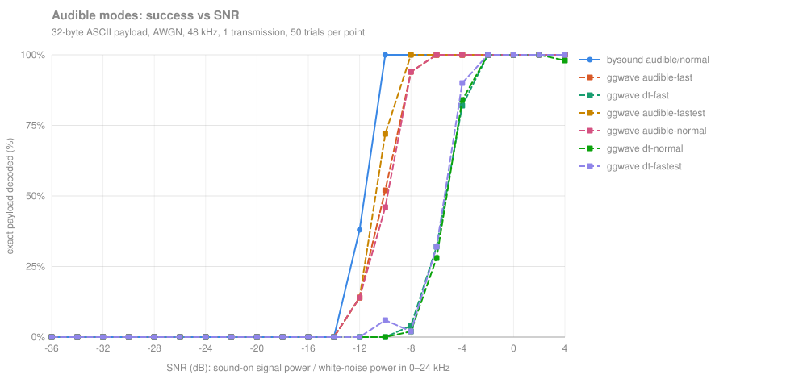
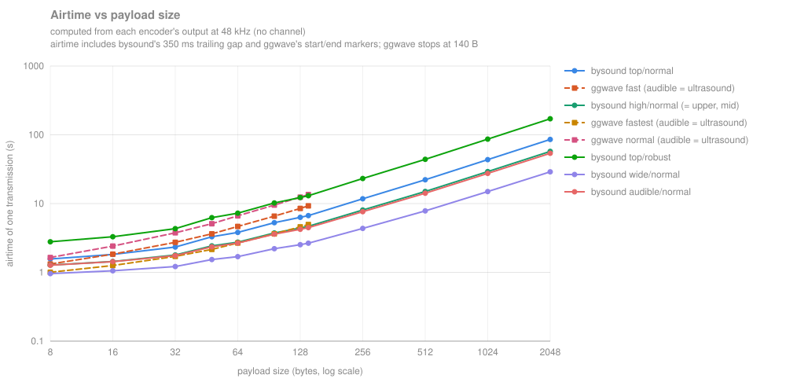
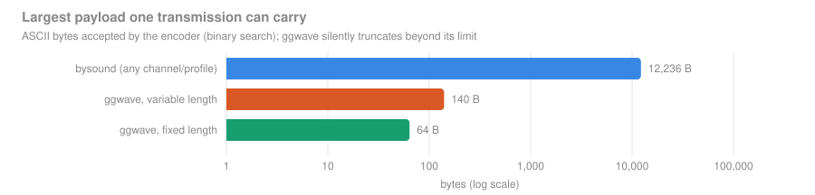

# bysound v4 vs ggwave: simulated-channel benchmark

This folder compares two data-over-sound modems on the same simulated channel, with the same seeds and the same payloads:

- **bysound v4**, the C99 library in [`../c`](../c): `bys_tx_init_payload` + `bys_tx_fill` to transmit and the streaming demodulator `bys_demod_*` to receive (FFT engine, robust profile and audible channel compiled in).
- **ggwave** by Georgi Gerganov (MIT), commit [`060aec73dd7123ccac200442f75bdc7369795ffe`](https://github.com/ggerganov/ggwave/commit/060aec73dd7123ccac200442f75bdc7369795ffe) (`v0.4.3-2-g060aec7`, 2026-04-16), used through its C API (`ggwave_init`, `ggwave_encode`, `ggwave_ndecode`) with its default parameters.

Every number in `results/` was measured by the code here. Nothing is extrapolated. The full tables are in [`results/summary.md`](results/summary.md).

The bysound receiver measured here is the C one: hard decisions per symbol, echo subtraction, a per-tone noise floor, maximum-likelihood header selection and errors-only Reed–Solomon. It does not compute soft symbols, does not mark erasures and decodes each lap on its own (see the header comment of [`../c/src/demod.c`](../c/src/demod.c)). Those features exist in the TypeScript, Swift and Kotlin receivers and are not in these numbers. The session layer ([`../docs/SESSION.md`](../docs/SESSION.md): acknowledgements, second-sender alerts, adaptation) is not part of this benchmark either.

## Reproduce

```sh
./fetch-ggwave.sh   # clones ggwave into third_party/ggwave and checks out the pinned commit (not vendored; see .gitignore)
make                # builds build/bench (Apple clang, -O2): harness + ../c/src/*.c + ggwave.cpp
make run            # every plan sharded over all CPUs, then the scans, then results/summary.md and results/charts/*.svg
```

On the machine below, the plans of `make run` take about 7–8 min of wall time (about 4,300 s of CPU time on 12 processes), plus about 1 min for the scans. Other targets: `make report` rebuilds the summary and charts from the CSV files, `make quick` runs a smoke test, and `make scans` re-runs only the noiseless scans.

Results are deterministic. Re-running reproduces every CSV column except `cpu_s` and the `audio_s / cpu_s` ratios; this was checked by re-running 110 `snr` trials and comparing them row by row. Single trials can be replayed verbosely (same seed as in the CSV): `build/bench trial <plan> "<config>" <size> <condition> <snr|clean> <reps> <trial>`, for example `build/bench trial snr "bysound top/robust" 32 awgn 4 1 4`.

**Machine:** Apple M4 Pro (12 logical CPUs), macOS 27.2.1, Apple clang 21.0.0 (clang-2100.1.1.101), Python 3.15.2 (standard library only, for the report).

## What is measured

### Configurations

| system | configurations |
|---|---|
| bysound | normal profile on all 7 channels: `top` (~18.0–19.5 kHz, 2 tones), `high` (~17.2–19.5 kHz, 3 tones), `upper`, `mid` (~15.0–17.2 kHz), `xhigh` (4 tones), `wide` (6 tones, 15.0–19.4 kHz), `audible` (~1.9–4.8 kHz, 4 tones); robust profile on `top`, `high`, `upper`, `mid` |
| ggwave | `audible-normal/fast/fastest`, `ultrasound-normal/fast/fastest`, `dt-normal/fast/fastest`, all in the default variable-length mode. The mono-tone `mt-*` protocols **cannot be used in variable-length mode** (ggwave refuses them: "Mono-tone protocols with variable length are not supported"), so they were run separately in fixed-length mode (section 7 of the summary), which requires the receiver to know the payload length in advance. |

The exact frequency band of each mode (the band holding 99 % of its signal power, measured from the waveform) is in `results/bands.csv`.

### Receivers

The two receivers are not given the same prior information:

- bysound: one demodulator per profile, as the library is built. **The receiver is told which profile to use** (normal or robust), not the channel. For the normal profile it listens to all 7 channels (`band_mask = 0x7f`); for the robust profile to `top`, `high`, `upper` and `mid` (`0x0f`).
- ggwave: `ggwave_getDefaultParameters()` (48 kHz, 1024 samples per frame, variable-length payloads, every protocol enabled for reception), so it searches all its protocols at once. The only change is the input format: int16 samples, because the channel produces int16 for both systems.

Audio is fed in chunks of 1024 samples to both. The TX side also uses library defaults: bysound at full level with its 350 ms trailing gap, and ggwave at `volume = 10` (`GGWave::kDefaultVolume`) with float output. Volume does not matter here because the channel normalises the level.

### Payloads

- 8, 32, 64 and 128 bytes of random printable ASCII for both systems. **Digits are excluded**: bysound packs pairs of digits into one byte, which would make it look faster than its raw byte capacity.
- A 48-byte UTF-8 case with multi-byte characters (accents, Cyrillic, CJK, emoji).
- 512 and 2048 bytes for bysound only. ggwave carries at most 140 bytes per transmission: longer inputs are **silently truncated** by `ggwave_encode`, so they are reported as "cannot send". bysound's encoder refuses any payload whose transmission (gap included) would last more than **30 s** (`BYS_E_TOO_LONG`): those sizes are not run on that configuration and are reported as "exceeds 30 s cap" (airtime table, `airtime.csv` column `status`). 512 B runs on every configuration except `top/robust` (cap 335 B); 2048 B runs only on `wide` (cap 2,114 B).
- The payload text depends only on (size, trial index), so both systems send the same text in every trial.

### Channel (`channel()` in `src/bench.cpp`)

1. **Lead silence**: uniform 0.25–1.25 s before the first message, and 1 s after the last.
2. **Repeats**: either 1 transmission, or 2. For 2, ggwave gets its message twice with a 350 ms silence between them. bysound gets two laps; each lap already ends in its own 350 ms gap.
3. **Echo** (optional): direct path + 0.5 × (8 ms delay) + 0.25 × (23 ms delay). This is one synthetic profile, not a measured room response.
4. **Clock drift** (optional): ±100 ppm, using a 64-tap Blackman-windowed sinc interpolator with 2048 phases. Linear interpolation would attenuate the 15–20 kHz modes. The interpolator was checked: a sine at 1, 15 and 19.5 kHz changes level by at most 0.0026 dB (`results/resampler_check.txt`).
5. **Gain**: the received signal is scaled so that its RMS **over the sound-on samples only** is −40 dBFS. Lead, tail, gaps and bysound's trailing gap are excluded from this measurement.
6. **Noise**, one of three kinds:
   - white Gaussian;
   - pink (Paul Kellett's filter);
   - "babble-like": 6 independent sources, each white noise high-passed at 100 Hz, low-passed twice at 800 Hz, and multiplied by a random ~4 Hz envelope. This is a crude proxy for speech, not recorded speech.
7. **Quantisation** to int16 with clipping (`clip_frac` = fraction of samples clipped):
   - From −22 dB SNR upward, no sample is clipped in any plan.
   - White, pink, echo, drift and combined noise: clipping starts below −24 dB and reaches 1.4 % of samples at −32 dB and, on the 2 dB grid of the white-noise plan, 4.7 % at −34 dB and 11.5 % at −36 dB. No configuration decodes anything at those SNRs (the lowest SNR with any success is −24 dB, under pink and combined noise), so clipping does not affect these results.
   - Babble-like noise, which is concentrated at low frequency: 0.016 % at −24 dB, 0.36 % at −28 dB and 2.4 % at −32 dB. The near-ultrasonic modes of both systems still decode there, so the babble results at the bottom of the grid include those clipped samples.

The RNG is xoshiro256\*\*. Its seed comes from (plan, rate, size, condition, SNR, repeats, trial) **without the system or configuration**, so both systems get the same lead silence and the same noise realisation.

**SNR definition.**
- **Full-band SNR** = sound-on signal power / noise power over 0–24 kHz. The charts and tables use this. By construction it favours modes that use a narrower band.
- **In-band SNR** = full-band SNR + a per-mode offset. The offset is computed from the measured PSDs (Welch, 4096-point) as `10·log10(P_sig,in-band / P_sig) − 10·log10(P_noise,in-band / P_noise)` over the band holding 99 % of the mode's power (`results/bands.csv`).
- **Peak-referenced SNR** = full-band SNR + the mode's peak-to-average power ratio (PAPR, `results/airtime.csv`). It answers "which mode survives more noise when both are played at the same peak amplitude", which is how a speaker at maximum volume behaves. The `*_peak_1x.svg` charts show the same trials on this axis.
- "Clean" means no noise at all: the signal at −40 dBFS plus int16 quantisation.

### Metrics (one CSV row per trial)

- `success`: at least one **exact** payload match.
- `n_wrong`: any decoded payload that differs from the one sent counts as a false decode. For bysound, acknowledgement, reference and risk frames decoded out of noise also count.
- `n_failed`: ggwave's "detected but could not decode" (−1) events.
- `air_s`: length of one message as each encoder outputs it, times the number of repeats. For bysound this includes the 350 ms trailing gap that `bys_tx_fill` emits. For ggwave it includes the start and end markers.
- `active_s`: sound-on time only.
- `latency_s`: time from the first transmitted sample to the chunk in which the decoder returned the payload.
- `cpu_s`: receiver thread CPU time, including receiver init.
- `clip_frac`: fraction of samples clipped at int16.

### Plans and trial counts

| plan | what | trials per cell |
|---|---|---:|
| `snr` | 32 B, AWGN, 48 kHz, −36…+4 dB in steps of 2 + clean, 1 and 2 transmissions, all 20 configurations | 50 |
| `size` | 8, 64, 128 B and 48 B UTF-8, AWGN, −32…+4 dB in steps of 4 + clean, 1 transmission | 30 |
| `size` | 512 B (all configurations except `top/robust`) and 2048 B (`wide` only), bysound only, those under its 30 s cap; −24…−8 dB in steps of 4, 0 dB and clean | 20 for 512 B, 10 for 2048 B |
| `cond` | 32 B, each of echo / pink / babble / drift +100 ppm / drift −100 ppm / combo (echo + drift +100 ppm + pink), −32…+4 dB in steps of 4 + clean, 1 and 2 transmissions | 30 |
| `rate44` | bysound at 44.1 kHz, 32 B, AWGN | 30 |
| `mtfixed` | ggwave `mt-*` in fixed-length mode, 8, 32 and 64 B | 30 |
| `idle` | no transmission: 10 × 60 s of each noise type at −20 dBFS, into each receiver | — |
| scans | noiseless delivery of 300–500 different payloads per configuration, and the bysound symbol-level codec round trip | — |

In total: **157,670 transmission trials**: 87,380 for bysound and 70,290 for ggwave (67,320 in its default variable-length protocols and 2,970 in the fixed-length mono-tone runs).

**SNR90** in the tables is the lowest grid SNR from which every higher grid point, the clean point included, reached at least 90 % success. "—" means even the clean point stayed below 90 %. No confidence intervals are given; with 30–50 trials per cell, one trial moves a cell by 2–3 percentage points.

## Results

### Success vs SNR (32 B, AWGN, 48 kHz, 1 transmission, 50 trials per point)




Percentage of trials that decoded the exact payload:

| configuration | −16 dB | −14 dB | −12 dB | −10 dB | −8 dB | −4 dB | 0 dB | clean | SNR90 full-band | SNR90 in-band | SNR90 peak-ref. | airtime 32 B |
|---|---:|---:|---:|---:|---:|---:|---:|---:|---:|---:|---:|---:|
| bysound top/normal | 4 | 98 | 100 | 100 | 100 | 100 | 100 | 100 | −14 | −2 | −7 | 2.33 s |
| bysound high/normal | 0 | 10 | 96 | 100 | 100 | 100 | 100 | 100 | −12 | −2 | −4 | 1.79 s |
| bysound wide/normal | 0 | 0 | 0 | 76 | 100 | 100 | 100 | 100 | −8 | −1 | +3 | 1.21 s |
| bysound audible/normal | 0 | 0 | 38 | 100 | 100 | 100 | 100 | 100 | −10 | −1 | −1 | 1.75 s |
| bysound top/robust | 100 | 100 | 100 | 100 | 100 | 100 | 100 | 100 | −16 | −4 | −10 | 4.32 s |
| ggwave ultrasound-fast | 0 | 0 | 12 | 64 | 94 | 100 | 100 | 100 | −8 | −1 | +4 | 2.73 s |
| ggwave ultrasound-fastest | 0 | 0 | 24 | 78 | 98 | 100 | 100 | 100 | −8 | −1 | +5 | 1.71 s |
| ggwave audible-fast | 0 | 0 | 14 | 52 | 94 | 100 | 100 | 100 | −8 | −1 | +4 | 2.73 s |
| ggwave dt-fastest | 0 | 0 | 0 | 6 | 2 | 90 | 100 | 100 | −4 | +8 | +4 | 3.69 s |

All 20 configurations, and the 2-transmission results, are in `results/summary.md` section 1.

- At equal average power, the bysound normal-profile channels need 0–6 dB less SNR than ggwave's ultrasound and audible protocols (SNR90 of −8 to −14 dB against −8 dB; `wide`, on the same span as ggwave ultrasound, is equal). The robust profile needs 6–8 dB less.
- Measured **in band**, most of that gap disappears: bysound −1 to −4 dB against ggwave −1 dB. Most of bysound's full-band advantage comes from concentrating the same power into a narrower band (1.5–3 kHz for the 2- to 4-tone channels, against ggwave's 4.4 kHz), not from a better detector at equal in-band SNR.
- At **equal peak level**, the gap grows: bysound's waveforms have a lower PAPR (6.3–11.4 dB against 12.1–12.9 dB for ggwave's 6-tone protocols), so peak-referenced SNR90 is −10 to +3 dB for bysound against +4 to +5 dB for ggwave. `wide` (+3 dB) is 1–2 dB better than ggwave ultrasound (+4/+5 dB). ggwave's DT protocols have a lower PAPR (7.3–7.8 dB) and its MT protocols 4.0 dB.
- The modes do not take the same time to send 32 bytes, so equal power is not equal energy. Corrected for sound-on time, the full-band advantage over ggwave ultrasound fastest is about 3–5 dB in energy per message (PAPER.md, section 6.2).
- ggwave `dt-normal` and `dt-fast` have no SNR90 because they decoded 86 % of the clean trials while decoding 100 % at 0 dB; in the full-scale noiseless scan (section 10 of the summary) they missed 0 of 500 payloads. This points to the exact digital silence of the clean point, which the SNR90 definition then penalises.

### Impairments (32 B, SNR90 in full-band dB, grid step 4, 1 transmission, 30 trials per cell)

| configuration | AWGN | echo | pink | babble | drift +100 ppm | drift −100 ppm | combo |
|---|---:|---:|---:|---:|---:|---:|---:|
| bysound top/normal | −12 | −8 | −20 | ≤ −32 | −12 | −12 | −16 |
| bysound high/normal | −12 | −8 | −20 | ≤ −32 | −12 | −12 | −16 |
| bysound audible/normal | −8 | −4 | −8 | −12 | −8 | −8 | −4 |
| bysound top/robust | −16 | −12 | −24 | ≤ −32 | −16 | −16 | −20 |
| ggwave ultrasound-fast | −8 | +0 | −16 | ≤ −32 | −8 | −8 | −8 |
| ggwave audible-fast | −8 | +0 | −8 | −8 | −8 | −8 | +0 |
| ggwave dt-fastest | −4 | +4 | +0 | +0 | +0 | +0 | clean only |

The AWGN column is the `snr` plan (50 trials) read on the same 4 dB grid. "≤ −32" means the bottom of the grid: the babble-like noise has almost no energy above 15 kHz (the in-band offset is about +40 dB), so every near-ultrasonic mode of both systems decodes there and the test does not separate them.

**Echo.** With one transmission, bysound needs 4–12 dB less SNR than ggwave under this echo: 8 dB for the 2- and 3-tone channels (−8 against +0 dB), 12 dB for `top/robust`, 4 dB for `xhigh`, `wide` and `audible`. With two transmissions ggwave's ultrasound protocols reach −4 dB, which leaves 4–8 dB (none for `wide`). Relative to AWGN alone the echo costs the bysound configurations above 4 dB and ggwave 8 dB; that 4 dB difference is the part attributable to bysound's echo subtraction.


### Airtime and throughput (deterministic, from the encoders)

| configuration | 8 B | 32 B | 64 B | 128 B | 512 B | 2048 B | B/s at 32 B | B/s at 128 B |
|---|---:|---:|---:|---:|---:|---:|---:|---:|
| bysound top/normal | 1.57 s | 2.33 s | 3.81 s | 6.30 s | 22.17 s | exceeds 30 s cap | 13.7 | 20.3 |
| bysound high/normal (= upper, mid) | 1.28 s | 1.79 s | 2.75 s | 4.41 s | 15.01 s | exceeds 30 s cap | 17.9 | 29.0 |
| bysound xhigh/normal | 1.09 s | 1.47 s | 2.21 s | 3.45 s | 11.39 s | exceeds 30 s cap | 21.8 | 37.1 |
| bysound wide/normal | **0.96 s** | **1.21 s** | **1.69 s** | **2.53 s** | **7.84 s** | **28.99 s** | **26.4** | **50.7** |
| bysound audible/normal | 1.27 s | 1.75 s | 2.67 s | 4.23 s | 14.15 s | exceeds 30 s cap | 18.3 | 30.3 |
| bysound top/robust | 2.78 s | 4.32 s | 7.26 s | 12.25 s | exceeds 30 s cap | exceeds 30 s cap | 7.4 | 10.4 |
| ggwave normal (audible = ultrasound) | 1.64 s | 3.75 s | 6.63 s | 12.39 s | — | — | 8.5 | 10.3 |
| ggwave fast | 1.32 s | 2.73 s | 4.65 s | 8.49 s | — | — | 11.7 | 15.1 |
| ggwave fastest | 1.00 s | 1.71 s | 2.67 s | 4.59 s | — | — | 18.8 | 27.9 |
| ggwave dt-fastest | 1.64 s | 3.69 s | 6.51 s | 12.27 s | — | — | 8.7 | 10.4 |

The fastest configuration in each column is in bold. Sizes that would last more than 30 s on a configuration are not sent by bysound; the 512 B and 2048 B columns of `results/summary.md` show "exceeds 30 s cap" there (`wide`: 28.99 s at 2048 B is the only 2048 B that fits; `high/robust`, `upper/robust` and `mid/robust` fit 512 B in 29.66 s). `airtime.csv` also lists 140 B (ggwave's maximum: 2.65 s on `wide`, 4.67 s on `high`, 6.69 s on `top`, 13.02 s on `top/robust`, 4.97 s on ggwave fastest) and 1024 B (14.94 s on `wide`); these are encoder lengths and were not passed through the channel.

**Max payload in one transmission** (ASCII bytes the encoder accepts; bysound is capped at 30 s of airtime, 350 ms gap included):

| configuration | max bytes | airtime at max |
|---|---:|---:|
| bysound wide | 2,114 | 30.0 s |
| bysound xhigh | 1,408 | 30.0 s |
| bysound audible | 1,122 | 30.0 s |
| bysound high / upper / mid | 1,052 | 29.8 s |
| bysound top | 700 | 30.0 s |
| bysound high / upper / mid robust | 520 | 30.0 s |
| bysound top robust | 335 | 30.0 s |
| ggwave, variable-length mode | 140 | 5.0 s (fastest) to 38.9 s (dt-normal) |
| ggwave, fixed-length mode | 64 | 11.3 s to 33.8 s |

The figures are packed bytes: letters pack 1:1, digit pairs 2:1. The code rate differs between the two systems (bysound adds 14 bytes per 48-byte block plus a 4-byte CRC; ggwave adds 3 bytes plus Reed–Solomon parity that grows with length), so equal airtime does not mean equal redundancy.





### Receiver CPU and latency

Real-time factor = seconds of audio processed per second of receiver CPU (higher is cheaper), receiver init included. Medians, from `results/summary.md` section 3:

| situation | bysound | ggwave | ggwave is lighter by |
|---|---:|---:|---:|
| Idle listening (`idle.csv`, 30 segments of 60 s per receiver) | 371× (normal, 7 channels), 463× (robust, 4 channels) | 18,993× | 41–51× |
| 32 B trials that decoded the payload (`snr` plan, 1 transmission, median per configuration) | 426–533× (6.8–12.4 ms per trial) | 660–5,903× (0.9–8.2 ms per trial) | 1.2–14× |
| All 32 B trials, decoded or not (same plan) | 436–534× (6.7–12.1 ms per trial) | 7,585–18,319× (0.3–0.6 ms per trial) | 14–42× |

The last column divides the extremes of the two ranges. The all-trials row includes the many trials below the threshold, where ggwave does almost no work, so the first two rows describe the real situations better. bysound's cost is nearly constant because it searches every channel of its profile every 4 ms (8 ms robust), message or not. Decode latency (clean) is airtime minus 0.25–0.35 s for both: bysound returns before its trailing gap ends, and ggwave before its end marker ends. CPU was measured on the host only, not on a phone or a microcontroller.

Code size of the built objects (arm64, `-O2`, `size`; host figures, not microcontroller figures):
- bysound `../c/src`: 34,984 bytes of `__TEXT` (the seven objects in `build/sbs`), from 1,669 lines of source (`wc -l c/src/*`, comments included; the public header `c/include/bysound.h` adds 367).
- ggwave `ggwave.o`: 59,880 bytes of `__TEXT`, from about 4,800 lines including its public header and its Reed–Solomon and FFT headers.

### False decodes

| system | trials | wrong payloads delivered |
|---|---:|---:|
| bysound | 87,380 | 0 |
| ggwave, default variable-length protocols | 67,320 | 34 |

- **bysound** delivered no wrong payload in 87,380 transmission trials; a CRC-32 over the whole text guards delivery.
- **ggwave**, default protocols:
  - 32 were **8-byte payloads**, 31 of them on the `*-fast` and `*-fastest` speeds of the audible and ultrasound protocols and 1 on `ultrasound-normal`, at SNRs from −12 to +4 dB and at the clean point. In each of those trials the correct payload was not delivered. The noiseless scan shows the same: with no channel at all, 11–21 of 500 different 8-byte payloads decoded to a wrong payload on `*-fast` and `*-fastest`.
  - 2 were **32-byte payloads** in two-transmission trials (`ultrasound-fastest`, pink and babble-like noise), in which the correct payload was also delivered.
  - ggwave's Reed–Solomon parity grows with length (4 bytes at 8 B, 12 at 32 B, 56 at 140 B) and there is no checksum after the decode. The pattern is consistent with Reed–Solomon mis-correction of short payloads; the cause was not traced in ggwave's code.
- **Noise only** (30 minutes per receiver: 10 each of white, pink and babble-like): 0 detections for bysound's normal receiver, 0 for its robust receiver and 0 for ggwave.

The fixed-length mono-tone runs are reported separately (summary section 8): 315 wrong payloads in 148 of 2,970 trials, repeats within a trial counted, all at 8 B. 74 of them were at the clean point, so part of this is probably an artefact of the exact digital silence around the signal.

## Discussion

**Where bysound does better in this simulation:**
- **Broadband noise:** SNR90 is 0–6 dB lower than ggwave's ultrasound and audible protocols at equal average power (normal profile; 6–8 dB lower for robust), and 1–15 dB lower at equal peak level (for example, −7 dB for top/normal against +4 dB for ggwave ultrasound-fast). Most of the full-band advantage comes from using a narrower band; at equal in-band SNR the detectors are within 0–3 dB.
- **Echo:** −8 dB against +0 dB for the 2- and 3-tone channels, with one synthetic echo profile.
- **Payload size:** up to 2,114 bytes in one 30 s transmission (`wide`; 700 on `top`, 335 on `top/robust`) against 140 for ggwave, whose longest transmission (dt-normal) takes 38.9 s.
- **Throughput above about 32 bytes:** `wide` reaches 50.7 B/s at 128 B and 70.6 B/s at 2048 B. The best ggwave figure is 27.9 B/s at 128 B.
- **Wrong payloads:** none delivered, with a CRC-32 over the payload plus Reed–Solomon per block. ggwave delivered wrong 8-byte payloads.

**Where ggwave does better:**
- **CPU:** its receiver costs 41–51× less while idle and 1.2–14× less in trials that decode a payload, partly because bysound evaluates every channel of its profile with a 4 ms search step.
- **Short messages:** for 8–32 byte payloads, ggwave `fastest` (1.00 s at 8 B, 1.71 s at 32 B) is faster than every bysound channel except `wide` (and `xhigh` at 32 B). bysound's 350 ms trailing gap is a large share of a short message.
- **Maturity and ecosystem:** years of public use, a larger community, a single self-contained C++ file, and ready-made bindings (Python, JavaScript/WebAssembly, an iOS Swift package) with examples for Arduino, RP2040 and ESP32 boards. bysound covers the same kinds of platforms with four native implementations (TypeScript, Swift, Kotlin, C), but it is new and has not been measured over the air.
- **Low-frequency, few-tone modes:** the DT/MT protocols sit at 1.1–2.6 kHz. In fixed-length mode, MT reaches SNR90 = −16 to −20 dB (the lowest figure measured), but its receiver must know the payload length and it is slow (1.9–5.7 B/s).

**Two transmissions** help both systems only a little (sections 1 and 5 of the summary). The C demodulator does not combine laps (memory is bounded), so for bysound the 2-lap gain is just "two independent chances". Lap combining exists in the TypeScript, Swift and Kotlin receivers, which this benchmark does not exercise.

## Threats to validity

- **Simulation, not air.** No speaker or microphone frequency response, no automatic gain control or noise suppression, no room impulse response beyond two taps, no Doppler, no moving sources.
  - Many phone speakers and microphones lose sensitivity above about 17 kHz, and the loss varies by device. That would hurt every near-ultrasonic mode, bysound `top` (18–19.5 kHz) more than `mid` or ggwave ultrasound (15–19.4 kHz).
  - Real-air results can rank the modes differently.
- **SNR is a modelling choice.** The full-band, in-band and peak-referenced views lead to different conclusions; all three are reported. Full-band SNR favours narrowband modes by construction. Peak-referenced assumes the speaker's limit is digital full scale.
- **Noise models are synthetic.** The pink filter is designed for 44.1 kHz (it was used at 48 kHz). "Babble" is a modulated, speech-shaped noise, not real speech. White noise is the main condition. The echo is one synthetic profile.
- **Clean ≠ realistic.** Exact digital silence around the signal triggers behaviour that does not occur with a real microphone. ggwave `dt-normal` and `dt-fast` fail 14 % at the clean point but 0 % at 0 dB, and 0/500 in the full-scale noiseless scan; the cause was not investigated. The +4 dB point is the realistic upper end.
- **Receiver setup.** bysound was told the profile and listened to all channels of that profile. ggwave listened to all protocols. A deployment that listens to fewer channels would use less CPU and could have a different false-decode exposure.
- **Only the C receiver.** Soft symbols, erasure decoding and lap combining (TypeScript, Swift and Kotlin receivers) are not measured, nor is the session layer.
- **Payload statistics.** Random ASCII without digits. Real payloads (URLs, JSON, numbers) favour bysound's digit packing, which is not reflected here.
- **Grid resolution and statistics.** SNR90 is quantised to the grid: 2 dB for section 1, 4 dB elsewhere. Trial counts are 50, 30, 20 or 10 per cell, so one failure moves a cell by 2–10 %. No confidence intervals.
- **Not covered:**
  - ggwave's direct-sequence spread (`GGWAVE_OPERATING_MODE_USE_DSS`), which is not a default.
  - ggwave at 44.1 kHz.
  - bysound's other frame types (acknowledgement, reference, risk) and the session layer.
  - The TypeScript, Swift and Kotlin receivers.
  - Microcontroller timing.
- **Author bias.** The benchmark was written by the author of bysound. Every setting given to ggwave is its library default (listed above), and the code is here to check.

## Files

- `fetch-ggwave.sh`: fetches the pinned ggwave commit.
- `Makefile`: build, run, scans, report.
- `src/bench.cpp`: harness, containing:
  - the channel model;
  - both encoders and receivers;
  - the plans;
  - the commands `info`, `jobs`, `run`, `trial`, `repro`, `scan` and `codec`.
- `scripts/report.py`: `results/summary.md` and the SVG charts (Python standard library only; transparent background, mid-tone palette validated for contrast and colour-vision deficiency on both `#ffffff` and `#0d1117`).
- `results/*.csv`: raw results, one row per trial; `airtime.csv` (with a `status` column: ok, exceeds 30 s cap, cannot send), `bands.csv` and `max_payload.csv` are deterministic. A `success` of −1 means the payload could not be sent.
- `results/*.txt`: noiseless scans, codec scan, resampler check.
- `results/charts/*.svg`: 17 charts.
