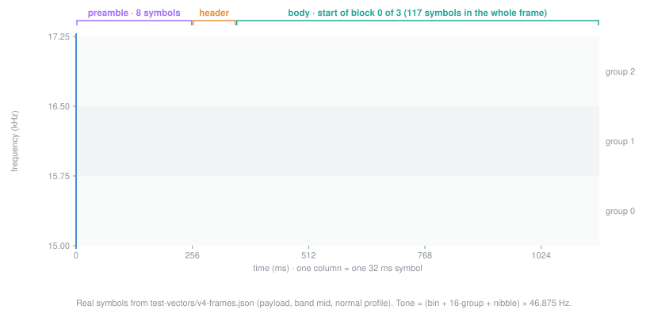
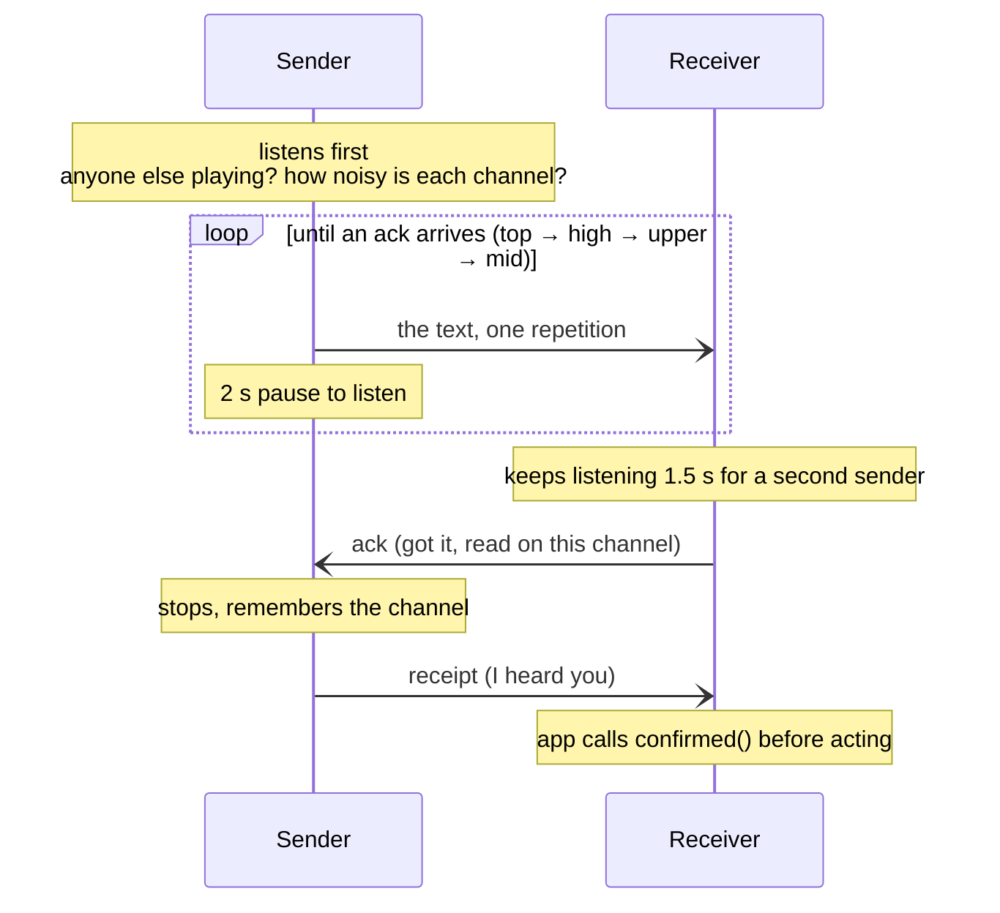
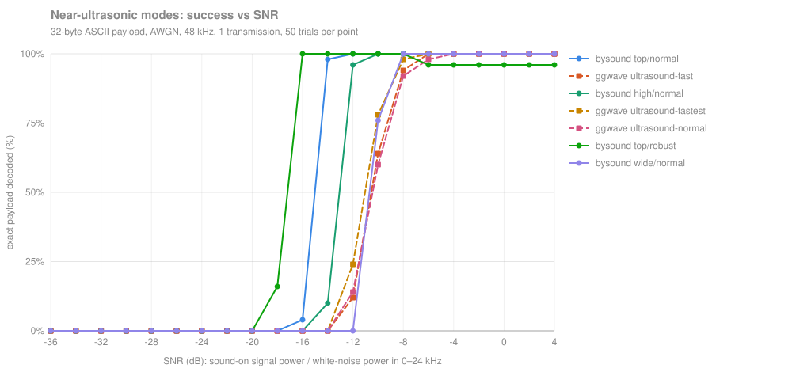

# How bysound works

bysound sends a short text from one device to another **through sound**. The sender plays a quick sequence of tones through its speaker; the receiver listens with its microphone and turns the tones back into the same text. No pairing, no network, no camera: any phone, laptop or microcontroller with a speaker or a microphone will do.

**In short:**

- The text becomes **tones** between 15 and 19.5 kHz, where most adults hear little or nothing (an audible channel exists too).
- It travels in **blocks with repair bytes**, so some damage gets fixed on the way.
- The receiver **listens to every channel at once**, cleans up noise and echo, and delivers the text **only if its checksum matches**.
- Optionally, the two devices **talk back** (acks, alerts) and the sender **adapts** to the room and the speaker.

## 1. Channels

Most channels sit between **15 and 19.5 kHz**: above what most adults hear well, but still within what ordinary phone speakers and microphones handle. Many of them lose volume above about 17 kHz, which is why there are several channels to choose from.

| Channel | Range | Can you hear it? | 32 B take | Use it when |
|---|---|---|---|---|
| `top` | 18–19.5 kHz | Most adults: no | 2.3 s | It must be silent and the speaker reaches 19 kHz |
| `high` | 17.25–19.5 kHz | Most adults: hardly | 1.8 s | Almost silent, a bit faster than `top` |
| `upper` | 16.5–18.75 kHz | Young people may | 1.8 s | The speaker fades near 19 kHz |
| `mid` | 15–17.25 kHz | Many young people | 1.8 s | The speaker fades above 17 kHz (many phones) |
| `xhigh` | 16.5–19.5 kHz | Young people may | 1.5 s | Faster, good speaker |
| `wide` | 15–19.5 kHz | Many young people | 1.2 s | Speed matters more than silence |
| `audible` | 1.9–4.9 kHz | Yes, a short chirp | 1.8 s | Any speaker, or you want people to hear it |

You do not have to pick one: with the session layer the sender tries `top → high → upper → mid` until the receiver answers ([section 6](#6-talking-back-acknowledgements-alerts-and-adaptation)), and the receiver always listens to all of them.

**How tones carry data.** Inside a channel the frequencies form a grid of slots **46.875 Hz** apart, grouped in sets of 16. Playing one slot out of 16 says a number from 0 to 15 (4 bits). A channel plays 2 to 6 groups at once, so every **symbol**, a 32 ms chord, carries 8 to 24 bits.

## 2. What one transmission looks like

Each transmission is a **frame**, played several times in a row with a short silence in between:

- **Preamble:** 8 fixed chords that say "a frame starts here". Each channel has its own pattern, so the receiver knows which one it is hearing.
- **Header:** 4 bytes: kind of frame, how many blocks follow, which channel, and a small checksum.
- **Blocks:** the text in pieces of up to 48 bytes. Each piece carries 12 extra **Reed–Solomon** bytes, the same kind of repair that lets a scratched CD or a dirty QR code still work. A block survives up to 6 wrong bytes; a byte the receiver marks as doubtful costs half as much to repair as a wrong one.
- **Gap:** 350 ms of silence before the next repetition.

A real frame as a spectrogram (time to the right, pitch upward): the diagonal preamble, the header, then the data tones hopping inside their groups.

## 3. From text to tones and back

**Sending** is straightforward:

1. **Pack** the text: two digits fit in one byte, so `"12500"` takes 3 bytes instead of 5. Letters stay as they are; accents and emoji go as UTF-8.
2. Add a **checksum** (CRC-32) of the whole text.
3. Cut it into **blocks** and add the **repair bytes** to each one.
4. Turn every 4 bits into one **tone** and play them, with soft 3 ms fades so the speaker does not click.

**Receiving** is where the work is:

1. **Listen** all the time, measuring every slot of every channel every 4 ms.
2. **Learn the background:** each slot gets its own noise level, so a steady hum or whine is ignored.
3. **Find the start:** look for any channel's preamble pattern. Noise alone scores far below the detection threshold.
4. **Read the header:** choose the closest valid header, which works even if part of it was damaged.
5. **Clean up each chord:** subtract the echo of the previous chord (the preamble already showed how much echo the room has) and keep how likely each tone is, not just the loudest.
6. **Repair:** Reed–Solomon fixes wrong bytes. If that fails, the receiver marks the 2 or 4 least certain bytes as unknown and tries again; known gaps are twice as cheap to fix.
7. **Merge repetitions:** if a door slam hit one repetition and a cough the next, the good parts of each are combined.
8. **Check:** the CRC-32 must match, or nothing is delivered. You get the exact text or nothing.

Steps 6 (the retry with unknown bytes) and 7 are in the TypeScript, Swift and Kotlin receivers. The C receiver, written for the small memory of microcontrollers, reads each repetition on its own. The exact thresholds and formulas are in [PROTOCOL.md](PROTOCOL.md).

## 4. How long does it take?

Time for one transmission, silence included:

| Message | `top` | `high` / `upper` / `mid` | `xhigh` | `wide` | `top` robust |
|---|---|---|---|---|---|
| 8 bytes (a short code) | 1.6 s | 1.3 s | 1.1 s | 1.0 s | 2.8 s |
| 32 bytes (a link id) | 2.3 s | 1.8 s | 1.5 s | 1.2 s | 4.3 s |
| 140 bytes (a long link) | 6.7 s | 4.7 s | 3.6 s | 2.7 s | 13.0 s |
| Most in 30 s | 700 B | 1,052 B | 1,408 B | 2,114 B | 335 B |

- **Robust profile:** every chord lasts twice as long, so it takes twice the time but cuts through more noise. The sender switches to it on its own if nobody answers.
- **30 s is the cap** for one transmission: longer is not practical by sound.
- Over the air, a read took a median **1.1 s** from the first preamble to the decoded text (12-byte reference frames, [field/](../field/README.md)).

## 5. Tips for reliable reads

- 🔊 **Volume up, through the speaker.** Not the earpiece, not Bluetooth headphones: they cut the high frequencies.
- 📏 **Close is better:** arm's length or across a counter. Point the speaker roughly at the other device.
- 🤫 **Keep the listening device away from the noise:** a fan right next to the microphone hurts more than a loud room.
- 🎚️ **Nothing arrives?** Try `mid` or `audible`: some speakers barely reach 17 kHz. The channel ladder does this for you.
- 🌐 **In the browser:** the microphone needs HTTPS or `localhost`, and sound must start from a tap or click. On iPhone, the silent switch can mute the page.
- 📱 **Covers and cases** can block the microphone or speaker holes.

## 6. Talking back: acknowledgements, alerts and adaptation

On top of the modem, a **session layer** turns "play a text" into a short conversation. It is specified in [SESSION.md](SESSION.md) and implemented in TypeScript (the reference, [`web/src/session`](../web/src/session)), Swift, Kotlin and C, which share the same test vectors.

- **"Got it" by sound.** The receiver plays a short acknowledgement, so the sender stops; the sender answers with a receipt, so the receiver stops too.
- **Confirm before acting.** The app calls `confirmed()` right before it pays, unlocks or saves. If another text or an alert was heard in the meantime, it fails.
- **Two devices at once.** If the receiver hears two different texts, or two frames on top of each other (a *clash*), it delivers nothing. A sender that hears someone else, or hears its own text played by another device, stops.
- **Alerts.** Whoever notices another sender plays a short alert frame so the others stop too. A sender relays it once, at most two hops away. The app gets a callback with a suggested pause (quarantine); bysound itself never blocks anything because of it.
- **Security levels.** `basic` (integrity only), `standard`, or `maximum` (the default: listens longer before sending and keeps alerts going longer). Details and limits: [SECURITY.md](SECURITY.md).
- **Adapts itself.** The sender skips channels that are much noisier than the rest, steps down from `top` towards `mid` until it gets an acknowledgement, switches to the robust profile after 6 unanswered repetitions, and remembers where it was read. A phone whose speaker cannot play above about 17 kHz therefore ends up starting on `mid` and being read on the first try.

None of this hides the text: anyone nearby can hear it, and anyone can play a valid frame. Apps that need privacy or proof of who sent something add it inside the text (encryption, a signature, an expiry). The session layer is tested on simulated sound, not in the benchmark below.

## 7. Music + hidden message

Music lives mostly below 5 kHz; `top` lives above 18 kHz. They hardly overlap, so a speaker can play a song and a message at the same time: people hear the song, and a listening device still reads the text.

Try it: `c/build/bysound decode docs/assets/music-demo.wav` ([music-demo.wav](assets/music-demo.wav): an 8.7 s original melody with "hello from the music" underneath), or the **♪ Music + hidden message** button in the web playground. It is rebuilt with `npm run make:music-demo` in `web/`.

## 8. bysound vs ggwave

Both libraries use the same idea: MFSK on an orthogonal 46.875 Hz grid with Reed–Solomon. The numbers below come from a simulated channel ([`bench/`](../bench), 157,670 trials, reproducible). The bysound side of the benchmark is the **C receiver**: plain decisions per symbol, echo subtraction, a per-tone noise floor, the best-matching header and error-only Reed–Solomon. It does not mark unknown bytes or combine repetitions, so those features are not in these numbers. The bysound receiver was told the profile (normal or robust); ggwave listened to all its protocols.

### When to choose which

| Choose bysound when… | Choose ggwave when… |
|---|---|
| The room is noisy or has echo: more margin against broadband noise and echo (tables below) | CPU or battery is tight: ggwave's receiver is 41–51× lighter while idle and 1.2–14× while decoding |
| A wrong message is worse than none: 0 wrong in 87,380 trials; ggwave delivered 34 wrong in 67,320, 32 of them 8-byte messages | Messages are a few bytes: at 8 B ggwave fastest (1.00 s) is faster than every bysound channel except `wide` (0.96 s) |
| Messages are longer than 140 bytes: up to 30 s per transmission (700–2,114 B) | You want a single self-contained C++ source file to vendor, with a larger community |
| It should be hard to hear: `top` (18–19.5 kHz), `high` (17.25–19.5 kHz); ggwave has no built-in protocol above 18 kHz (see below for its DT/MT moved there) | You want ready-made bindings (Python, JavaScript/WebAssembly, an iOS Swift package) and Arduino, RP2040 or ESP32 examples |
| You want acks, second-sender alerts and channel adaptation (session layer, in all four implementations) | You want modes with one or two tones (DT/MT at 1.1–2.6 kHz); MT, with a receiver that knows the length, tolerates the most noise measured, also when moved above 18 kHz |
| You want native TypeScript, Swift, Kotlin and C (no `malloc`) sharing one format | You need a long real-world track record: ggwave has years of use; bysound's over-the-air data is one device pair in one room ([field/](../field/README.md)) |

Both cover the same kinds of platforms (browser, iOS, Android, desktop, microcontrollers): bysound with four native implementations, ggwave with one C++ core and bindings.

### From lab noise to real places

The noise chart in the README labels the simulated noise with everyday places. This is how they map to what the benchmark actually simulated (32-byte message, success ≥ 90 %, noise measured over the whole 0–24 kHz band; `×N` = noise power N times the message's power, i.e. 10^(−SNR/10)):

| Place in the README | Simulated noise | bysound `top` | ggwave ultrasound fastest |
|---|---|---|---|
| Fan, hiss, static | white Gaussian noise | −14 dB (×25) | −8 dB (×6) |
| Room with echo | one synthetic two-tap echo + white noise | −8 dB (×6); robust −12 dB (×16) | 0 dB (×1) |
| Street, air conditioning | pink (1/f) noise | −20 dB (×100) | −16 dB (×40) |
| Bar, people talking | babble-like noise (speech-shaped, synthetic) | ≤ −32 dB (grid floor) | ≤ −32 dB (grid floor) |

Measured inside each mode's own band instead, the two are within 0–3 dB of each other: most of bysound's margin comes from concentrating the same power in narrower bands. These are analogies, not field measurements: real places also bring speaker and microphone limits, distance and reflections that the simulation does not model. See the paper's limitations section.

### Over the air

One Galaxy A50 and one iPad 44–65 cm apart in one room, with recorded noise played by a laptop usually closer to the listening device than the sender. The runs used the author's app on the same v4 format, not this repository's code, and ggwave was not measured over the air ([field/](../field/README.md)):

- **Same threshold as in simulation:** the weakest real reads were at 7.8 dB (`top`) and 10.3 dB (`mid`) of measured SNR; the simulation predicts 9.9 and 10.1 dB. Real failures came from noise too close to the microphone, not from the decoder.
- **By place:** bar, traffic, an audible alarm and a loud whistle at 18–19.5 kHz were read every time; music 23 of 30; hair dryer 14 of 28 and vacuum 7 of 28, with the appliance closer to the microphone than the sender.
- **Latency:** a median 1.1 s from the first preamble to the decoded frame; 6.5 s from the start of listening, including the app's 3 s pre-listen and server round trip.

### Distance

The figures compare the message and the noise where they reach the microphone; over the air only 44–65 cm has been measured.

- **Twice as far, 4× weaker:** in open space, doubling the distance makes the message 4× weaker (−6 dB), so it tolerates 4× less noise. On `top` next to a fan: ×25 at one distance, ×6 at twice that distance, ×1.5 at four times.
- **Where the noise is matters too:** a fan twice as close to the receiver as the sender counts 4× louder. Keep the listening device away from the noise.
- **Short range by design:** arm's length, or across a counter. Many phones lose volume above 17 kHz, so `top` carries less far than `mid` or `audible`.
- **Rooms aren't open space:** walls reflect sound back, so far from the sender it fades more slowly than the rule says; the echo they add is the "room with echo" case above.

### The numbers

| 32-byte message, 48 kHz | bysound `top` | bysound `top` robust | bysound `wide` | ggwave ultrasound fastest |
|---|---|---|---|---|
| Lowest SNR with ≥ 90 % success (full band) | −14 dB | −16 dB | −8 dB | −8 dB |
| Same, with echo (4 dB grid) | −8 dB | −12 dB | −4 dB | 0 dB |
| Airtime for 128 bytes | 6.30 s | 12.25 s | 2.53 s | 4.59 s |
| Airtime for 140 bytes (ggwave's maximum) | 6.69 s | 13.02 s | **2.65 s** | 4.97 s |
| Messages longer than 140 bytes | yes, up to 30 s | yes, up to 30 s | yes, up to 30 s | no |

| | bysound | ggwave |
|---|---|---|
| Wrong texts delivered | 0 in 87,380 trials | 34 in 67,320 trials of its default protocols |
| What else it does | Echo subtraction, per-tone noise floor, blocks with a CRC-32 over the text, acks, clash detection, alerts, adaptation | Start and end markers, one Reed–Solomon codeword of up to 140 B, DT/MT low-frequency modes |
| Above 18 kHz (white noise, ≥ 90 %, 32 B) | `top`: ×25 noise, 2.33 s (robust ×40, 4.32 s) | No built-in mode. Moved there: DT fastest ×2.5, 3.69 s; MT ×63–100, 5.63–16.90 s, fixed length, ≤ 64 B |

With echo, bysound tolerates 4–12 dB more noise in one transmission (4–8 dB when ggwave gets two).

**Above 18 kHz.** ggwave's built-in modes are audible or start at 15 kHz, so `top` has no built-in counterpart. The benchmark also moves ggwave's 2-tone DT and 1-tone MT modes to start at 18 kHz (a custom configuration through its API, receiver restricted to them; 99.8–100 % of their power lands in 18.0–19.5 kHz). There `top` tolerates 10–12 dB more noise than DT and is faster; MT tolerates 4–6 dB more than `top` but needs the receiver to know the length, stops at 64 B and takes 2.4–7.3× as long ([paper, section 6.7](../PAPER.md#67-inaudible-channels-18195-khz)). The [paper](../PAPER.md) explains each change, where the advantage comes from and where ggwave is better, and lists the limits: this is a simulation, the echo is one synthetic profile, and many phone speakers and microphones lose sensitivity above about 17 kHz.

---

For the precise, implementer-grade definition (every constant, formula and byte), see **[PROTOCOL.md](PROTOCOL.md)** and **[SESSION.md](SESSION.md)**.
