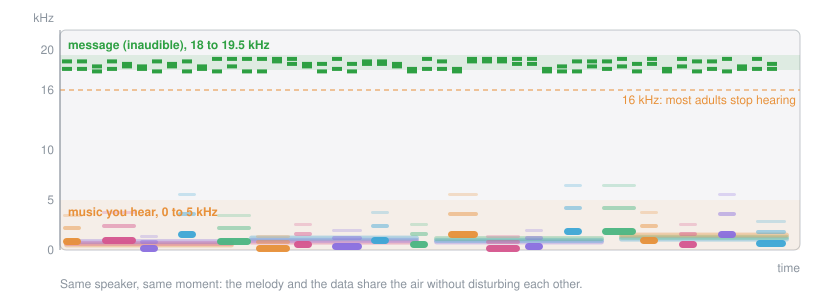

# How bysound works

bysound sends a short text from one device to another **through sound**. The sender plays a quick sequence of tones through its speaker, and the receiver listens with its microphone and turns the tones back into text. There is no pairing, no network and no camera. It works with any phone, laptop or microcontroller that has a speaker or a microphone.

## 1. Picking a slice of the spectrum

Most of the bands sit between **15 and 19.5 kHz**. That range is high enough that most adults hardly notice it, yet it is still low enough for ordinary phone speakers and microphones to handle. One band (`audible`, about 1.9–4.9 kHz) is meant to be heard, and it works with almost any speaker.

Inside a band, the frequencies form a grid of slots, each **46.875 Hz** apart. The slots are grouped in sets of 16. Playing one of the 16 slots of a group says a number from 0 to 15, which is 4 bits. A band uses 2 to 6 groups at once, so every **symbol** (a 32 ms chord) carries 8 to 24 bits.

## 2. What one transmission sounds like

Each transmission is a **frame**, played several times in a row with a short silence between repetitions:

- **Preamble:** a fixed pattern of 8 chords that says "a frame starts here". Each band has its own pattern, so a receiver can tell the bands apart.
- **Header:** 4 bytes: the kind of frame, how many blocks follow, which band it is on, and a small checksum.
- **Blocks:** the text itself, cut into pieces of 48 bytes. Each piece gets 12 extra **Reed–Solomon** bytes, the same kind of error correction that lets a scratched CD or a dirty QR code still work. A block survives up to 6 wrong bytes, or 12 bytes that the receiver already knows are doubtful.
- **Gap:** 350 ms of silence before the next repetition.

Here is a real frame as a spectrogram (time to the right, pitch upward). You can see the diagonal preamble pattern, the header, and then the data tones hopping around inside their groups:

## Music + hidden message

Music lives well below 5 kHz; the `top` band lives above 18 kHz. They do not overlap, so you can play a song and the message in the same speaker at the same time: you hear only the song, and a receiver that listens still decodes the text.

Download and decode it: `c/build/bysound decode docs/assets/music-demo.wav` ([music-demo.wav](assets/music-demo.wav): an 8.7 s original melody with "hello from the music" repeated underneath). In the web playground, the "Music + hidden message" button plays the same thing for another device to hear. It is rebuilt with `npm run make:music-demo` in `web/`.

## 3. From text to tones and back

**Sending** is simple and deterministic:

1. **Pack** the text: each pair of digits becomes one byte, so `"12500"` takes 3 bytes instead of 5. Plain ASCII stays as is, and anything else (accents, emoji) is carried as UTF-8.
2. Add a **CRC-32**: a 4-byte fingerprint of the whole text.
3. Cut the result into **blocks** and add **Reed–Solomon** parity to each one.
4. Split every byte into two **nibbles** (4 bits each), one nibble per group.
5. Play one **tone** per group for each symbol, with soft 3 ms fades so the speaker does not click.

**Receiving** is where the work is:

1. **Listen continuously.** Every 4 ms, measure the energy of every slot on the grid.
2. **Learn the noise.** Each slot gets its own background level. A constant hum or whine is then divided out before the receiver looks for tones.
3. **Find the preamble.** Score how well the last 8 chords match each band's pattern. The frame starts where the score is highest. Noise alone scores about 0.06; a frame must reach 0.32.
4. **Read the header.** Instead of decoding the header bit by bit, pick the closest of the 259 valid headers. This works even when a couple of nibbles are wrong.
5. **Read the symbols softly.** For each group, keep how likely each of the 16 tones is, not just the loudest one. Remove the echo of the previous chord, which the preamble already measured.
6. **Correct errors.** Run Reed–Solomon. If it fails, mark the least certain bytes as "unknown" and try again: known gaps are twice as cheap to fix as hidden errors.
7. **Combine repetitions.** If a block was damaged by a door slam in one repetition and by a cough in the next, add the repetitions together, or take the most confident reading of each piece. Up to 6 repetitions are combined.
8. **Check and deliver.** The CRC-32 must match, or nothing is delivered. You get the exact text or nothing.

## 4. How fast is it?

Raw speeds go from 250 bit/s (`top`, 2 tones) to 750 bit/s (`wide`, 6 tones). A 166-character test string takes **3.7 s** on the 3-tone bands and **2.8 s** on `xhigh`. In very noisy places, the **robust** profile makes every chord twice as long. That doubles the airtime and makes the tones easier to pick out of the noise.

## 5. When two devices talk at once

If two senders play at the same time, the receiver could pick up the wrong one. The receiver watches for frames that overlap, or a preamble that appears in the middle of another frame. When it sees either, it reports a **clash** instead of delivering anything. It cannot catch a sender it cannot hear, and bysound does not encrypt or sign anything. Anyone nearby can listen, so applications should not send secrets in the clear, and should validate what they receive.

## 6. bysound vs ggwave, feature by feature

| | What you get with bysound | Compared with ggwave |
|---|---|---|
| ✅ **It never lies** | You get the exact message or nothing. A checksum over the whole text rejects anything doubtful. | ggwave delivered **349 wrong messages** in our tests, some with no noise at all. bysound delivered **0** in 88,220. |
| 🏠 **Works in echoey rooms** | It measures the room's echo and subtracts it before reading each tone. | Handles **8–12 dB more noise** when there is echo, the normal case in a real room. |
| 🔇 **Can be truly inaudible** | Channels at 17.25–19.5 kHz and 18–19.5 kHz that almost nobody hears; `top` is also the most noise-tolerant. | ggwave's "ultrasound" starts at 15 kHz, which many young people hear. |
| ⚡ **More data in the same time** | 2× the bytes in 5 s on the same frequencies; messages beyond 140 bytes, up to 30 s per transmission. | ggwave stops at **140 bytes**. |
| 🧩 **Rebuilds damaged data** | Doubtful bytes are marked and repaired (Reed–Solomon with erasures), block by block. | Corrects errors only, in a single codeword. |
| 🔊 **More signal from the same speaker** | Fewer tones at once, so a speaker can play them louder before it distorts. | More useful power in the air at the same volume. |
| 🔁 **Repetitions add up** | If a noise burst ruins part of one repetition, the next one fills the gap (TypeScript, Swift and Kotlin receivers). | ggwave reads each repetition on its own. |
| 👥 **Two senders at once** | If another device transmits at the same time, the receiver reports a *clash* instead of mixing them. | Not detected. |
| 🎵 **Rides on music** | The message can play above a song and still decode ([try it](../README.md#music--hidden-message)). | Not measured for ggwave. |

### From lab noise to real places

The README describes the noise results with everyday places. This is how they map to what the benchmark actually simulated (32-byte message, success ≥ 90 %, full-band SNR; `×N` = noise power N times the message's power, i.e. 10^(−SNR/10)):

| Place in the README | Simulated noise | bysound `top` | ggwave ultrasound fastest |
|---|---|---|---|
| Fan, hiss, static | white Gaussian noise | −14 dB (×25) | −8 dB (×6) |
| Room with echo | two echo taps + white noise | −8 dB (×6); robust −12 dB (×16) | 0 dB (×1) |
| Street, air conditioning | pink (1/f) noise | −20 dB (×100) | −16 dB (×40) |
| Bar, people talking | babble-like noise (speech-shaped, synthetic) | −32 dB | −32 dB |

These are analogies, not field measurements: real places also bring speaker and microphone limits, distance and reflections that the simulation does not model. See the paper's limitations section.

### The numbers

Both libraries, unmodified, on the same simulated channel with the same seeds (158,510 trials, reproducible in [`bench/`](../bench)). They share the same idea: MFSK on an orthogonal 46.875 Hz grid.

| 32-byte message, 48 kHz | bysound `top` | bysound `top` robust | bysound `wide` | ggwave ultrasound fastest |
|---|---|---|---|---|
| Lowest SNR with ≥ 90 % success (full band) | −14 dB | −16 dB | −8 dB | −8 dB |
| Same, with echo | −8 dB | −12 dB | −4 dB | 0 dB |
| Airtime for 128 bytes | 6.3 s | 12.3 s | 2.5 s | 4.6 s |
| Time for 140 bytes (ggwave's maximum) | 6.9 s | 13.2 s | **2.9 s** | 5.0 s |
| Messages longer than 140 bytes | yes, up to 30 s | yes, up to 30 s | yes, up to 30 s | no |
| Wrong texts delivered | 0 | 0 | 0 | 349 across all ggwave modes |

ggwave is still the better pick when you need the smallest and fastest receiver (14–42× less CPU) or many language bindings. The [paper](../PAPER.md) explains each improvement and where the advantage comes from (narrower bands concentrate power, so in-band the two are within 0–3 dB). It also covers the limits: this is a simulation, and real speakers and microphones lose a lot above 17 kHz.

---

For the precise, implementer-grade definition (every constant, formula and byte), see **[PROTOCOL.md](PROTOCOL.md)**.
