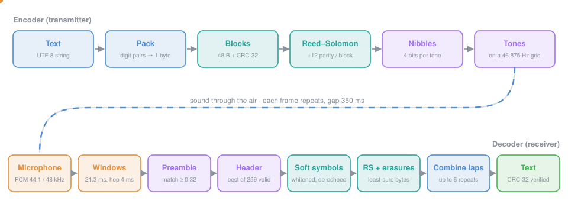
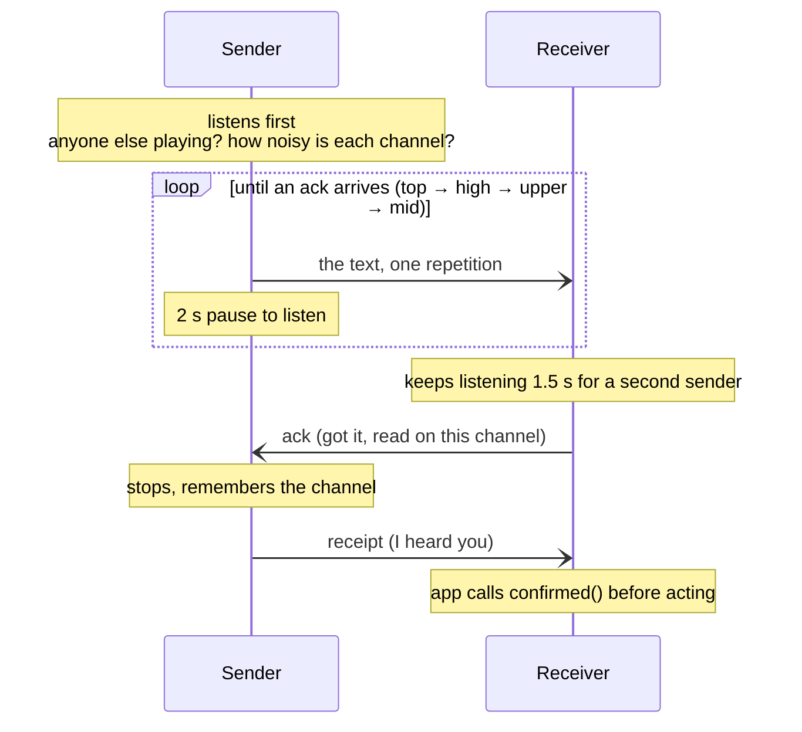

# How bysound works

bysound sends a short text from one device to another **through sound**. The sender plays a quick sequence of tones through its speaker, and the receiver listens with its microphone and turns the tones back into text. There is no pairing, no network and no camera. It works with any phone, laptop or microcontroller that has a speaker or a microphone.

## 1. Picking a slice of the spectrum

Most of the bands sit between **15 and 19.5 kHz**. That range is above what most adults hear well (and `top`, at 18–19.5 kHz, is inaudible to most adults), yet it is still low enough for ordinary phone speakers and microphones to handle, although many of them lose sensitivity above about 17 kHz. One band (`audible`, about 1.9–4.9 kHz) is meant to be heard, and it works with almost any speaker.

Inside a band, the frequencies form a grid of slots, each **46.875 Hz** apart. The slots are grouped in sets of 16. Playing one of the 16 slots of a group says a number from 0 to 15, which is 4 bits. A band uses 2 to 6 groups at once, so every **symbol** (a 32 ms chord) carries 8 to 24 bits.

## 2. What one transmission sounds like

Each transmission is a **frame**, played several times in a row with a short silence between repetitions:

- **Preamble:** a fixed pattern of 8 chords that says "a frame starts here". Each band has its own pattern, so a receiver can tell the bands apart.
- **Header:** 4 bytes: the kind of frame, how many blocks follow, which band it is on, and a small checksum.
- **Blocks:** the text itself, cut into pieces of 48 bytes. Each piece gets 12 extra **Reed–Solomon** bytes, the same kind of error correction that lets a scratched CD or a dirty QR code still work. A block survives up to 6 wrong bytes, or 12 bytes that the receiver already knows are doubtful.
- **Gap:** 350 ms of silence before the next repetition.

Here is a real frame as a spectrogram (time to the right, pitch upward). You can see the diagonal preamble pattern, the header, and then the data tones hopping around inside their groups:

## Music + hidden message

Music lives mostly below 5 kHz; the `top` band lives above 18 kHz. They hardly overlap, so you can play a song and the message in the same speaker at the same time: you hear the song, and a receiver that listens still decodes the text.

Download and decode it: `c/build/bysound decode docs/assets/music-demo.wav` ([music-demo.wav](assets/music-demo.wav): an 8.7 s original melody with "hello from the music" repeated underneath). In the web playground, the "Music + hidden message" button plays the same thing for another device to hear. It is rebuilt with `npm run make:music-demo` in `web/`.

## 3. From text to tones and back

**Sending** is simple and deterministic:

1. **Pack** the text: each pair of digits becomes one byte, so `"12500"` takes 3 bytes instead of 5. Plain ASCII stays as is, and anything else (accents, emoji) is carried as UTF-8.
2. Add a **CRC-32**: a 4-byte fingerprint of the whole text.
3. Cut the result into **blocks** and add **Reed–Solomon** parity to each one.
4. Split every byte into two **nibbles** (4 bits each), one nibble per group.
5. Play one **tone** per group for each symbol, with soft 3 ms fades so the speaker does not click.

**Receiving** is where the work is:

1. **Listen continuously.** Every 4 ms, measure the energy of every slot on the grid.
2. **Learn the noise.** Each slot gets its own background level. A constant hum or whine is then divided out before the receiver looks for tones.
3. **Find the preamble.** Score how well the last 8 chords match each band's pattern. The frame starts where the score is highest. Noise alone scores about 0.06; a frame must reach 0.32. A preamble that seems to appear in the middle of a frame counts as the next repetition only if it scores at least 0.7 of the frame's own preamble, so data that happens to look a little like a preamble does not cut the read short.
4. **Read the header.** Instead of decoding the header bit by bit, pick the closest of the 259 valid headers. This works even when a couple of nibbles are wrong.
5. **Read the symbols.** Remove the echo of the previous chord, which the preamble already measured. The TypeScript, Swift and Kotlin receivers also keep how likely each of the 16 tones is, not just the loudest one.
6. **Correct errors.** Run Reed–Solomon. If it fails, mark the least certain bytes as "unknown" and try again: known gaps are twice as cheap to fix as hidden errors.
7. **Combine repetitions.** If a block was damaged by a door slam in one repetition and by a cough in the next, combine the repetitions. Up to 6 repetitions are combined.
8. **Check and deliver.** The last block does not say how long it is, so the receiver closes it at the first length that both Reed–Solomon and the CRC-32 accept. The CRC-32 must match, or nothing is delivered. You get the exact text or nothing.

Steps 6 (the retry with unknown bytes) and 7 are in the TypeScript, Swift and Kotlin receivers. The C receiver, written for the bounded memory of microcontrollers, reads each repetition on its own with plain error correction.

## 4. How fast is it?

Raw speeds go from 250 bit/s (`top`, 2 tones) to 750 bit/s (`wide`, 6 tones). One frame of a 166-character test string lasts **3.7 s** on the 3-tone bands and **2.8 s** on `xhigh`. In very noisy places, the **robust** profile makes every chord twice as long. That doubles the airtime and makes the tones easier to pick out of the noise.

## 5. Talking back: acknowledgements, alerts and adaptation

On top of the modem, a **session layer** turns "play a text" into a short conversation. It is specified in [SESSION.md](SESSION.md) and implemented in TypeScript (the reference, [`web/src/session`](../web/src/session)), Swift, Kotlin and C, which share the same test vectors.

- **"Got it" by sound.** The receiver plays a short acknowledgement, so the sender stops; the sender answers with a receipt, so the receiver stops too.
- **Confirm before acting.** The app calls `confirmed()` right before it pays, unlocks or saves. If another text or an alert was heard in the meantime, it fails.
- **Two devices at once.** If the receiver hears two different texts, or two frames on top of each other (a *clash*), it delivers nothing. A sender that hears someone else, or hears its own text played by another device, stops.
- **Alerts.** Whoever notices another sender plays a short alert frame so the others stop too. A sender relays it once, at most two hops away. The app gets a callback with a suggested pause (quarantine); bysound itself never blocks anything because of it.
- **Security levels.** `basic` (integrity only), `standard`, or `maximum` (the default: listens longer before sending and keeps alerts going longer). Details and limits: [SECURITY.md](SECURITY.md).
- **Adapts itself.** The sender skips channels that are much noisier than the rest, steps down from `top` towards `mid` until it gets an acknowledgement, switches to the robust profile after 6 unanswered repetitions, and remembers where it was read. A phone whose speaker cannot play above about 17 kHz therefore ends up starting on `mid` and being read on the first try.

None of this hides the text: anyone nearby can hear it, and anyone can play a valid frame. Apps that need privacy or proof of who sent something add it inside the text (encryption, a signature, an expiry). The session layer is tested on simulated sound, not in the benchmark below.

## 6. bysound vs ggwave

Both libraries use the same idea: MFSK on an orthogonal 46.875 Hz grid with Reed–Solomon. The numbers below come from a simulated channel ([`bench/`](../bench), 157,670 trials, reproducible). The bysound side of the benchmark is the **C receiver**: plain decisions per symbol, echo subtraction, a per-tone noise floor, the best-matching header and error-only Reed–Solomon. It does not mark unknown bytes or combine repetitions, so those features are not in these numbers. The bysound receiver was told the profile (normal or robust); ggwave listened to all its protocols.

### When to choose which

| Choose bysound when… | Choose ggwave when… |
|---|---|
| The room is noisy or has echo: more margin against broadband noise and echo (tables below) | CPU or battery is tight: ggwave's receiver is 41–51× lighter while idle and 1.2–14× while decoding |
| A wrong message is worse than none: 0 wrong in 87,380 trials; ggwave delivered 34 wrong in 67,320, 32 of them 8-byte messages | Messages are a few bytes: at 8 B ggwave fastest (1.00 s) is faster than every bysound channel except `wide` (0.96 s) |
| Messages are longer than 140 bytes: up to 30 s per transmission (700–2,114 B) | You want a project with years of public use and a larger community |
| It should be hard to hear: `top` (18–19.5 kHz), `high` (17.25–19.5 kHz); ggwave has no built-in protocol above 18 kHz (see below for its DT/MT moved there) | You want ready-made bindings (Python, JavaScript/WebAssembly, an iOS Swift package) and Arduino, RP2040 or ESP32 examples |
| You want acks, second-sender alerts and channel adaptation (session layer, in all four implementations) | You want modes with one or two tones (DT/MT at 1.1–2.6 kHz); MT, with a receiver that knows the length, tolerates the most noise measured, also when moved above 18 kHz |
| You want native TypeScript, Swift, Kotlin and C (no `malloc`) sharing one format | You need a long real-world track record: ggwave has years of use; bysound's over-the-air data is one device pair in one room ([field/](../field/README.md)) |

Both cover the same kinds of platforms (browser, iOS, Android, desktop, ESP32): bysound with four native implementations, ggwave with one C++ core and bindings.

### From lab noise to real places

The README describes the noise results with everyday places. This is how they map to what the benchmark actually simulated (32-byte message, success ≥ 90 %, noise measured over the whole 0–24 kHz band; `×N` = noise power N times the message's power, i.e. 10^(−SNR/10)):

| Place in the README | Simulated noise | bysound `top` | ggwave ultrasound fastest |
|---|---|---|---|
| Fan, hiss, static | white Gaussian noise | −14 dB (×25) | −8 dB (×6) |
| Room with echo | one synthetic two-tap echo + white noise | −8 dB (×6); robust −12 dB (×16) | 0 dB (×1) |
| Street, air conditioning | pink (1/f) noise | −20 dB (×100) | −16 dB (×40) |
| Bar, people talking | babble-like noise (speech-shaped, synthetic) | ≤ −32 dB (grid floor) | ≤ −32 dB (grid floor) |

Measured inside each mode's own band instead, the two are within 0–3 dB of each other: most of bysound's margin comes from concentrating the same power in narrower bands. These are analogies, not field measurements: real places also bring speaker and microphone limits, distance and reflections that the simulation does not model. See the paper's limitations section.

### The numbers

| 32-byte message, 48 kHz | bysound `top` | bysound `top` robust | bysound `wide` | ggwave ultrasound fastest |
|---|---|---|---|---|
| Lowest SNR with ≥ 90 % success (full band) | −14 dB | −16 dB | −8 dB | −8 dB |
| Same, with echo (4 dB grid) | −8 dB | −12 dB | −4 dB | 0 dB |
| Airtime for 128 bytes | 6.30 s | 12.25 s | 2.53 s | 4.59 s |
| Airtime for 140 bytes (ggwave's maximum) | 6.69 s | 13.02 s | **2.65 s** | 4.97 s |
| Messages longer than 140 bytes | yes, up to 30 s | yes, up to 30 s | yes, up to 30 s | no |

| | bysound | ggwave |
|---|---|---|
| Wrong texts delivered | 0 in 87,380 trials | 34 in 67,320 trials of its default protocols |
| What else it does | Echo subtraction, per-tone noise floor, blocks with a CRC-32 over the text, acks, clash detection, alerts, adaptation | Start and end markers, one Reed–Solomon codeword of up to 140 B, DT/MT low-frequency modes |
| Above 18 kHz (white noise, ≥ 90 %, 32 B) | `top`: ×25 noise, 2.33 s (robust ×40, 4.32 s) | No built-in mode. Moved there: DT fastest ×2.5, 3.69 s; MT ×63–100, 5.63–16.90 s, fixed length, ≤ 64 B |

With echo, bysound tolerates 4–12 dB more noise in one transmission (4–8 dB when ggwave gets two).

**Above 18 kHz.** ggwave's built-in modes are audible or start at 15 kHz, so `top` has no built-in counterpart. The benchmark also moves ggwave's 2-tone DT and 1-tone MT modes to start at 18 kHz (a custom configuration through its API, receiver restricted to them; 99.8–100 % of their power lands in 18.0–19.5 kHz). There `top` tolerates 10–12 dB more noise than DT and is faster; MT tolerates 4–6 dB more than `top` but needs the receiver to know the length, stops at 64 B and takes 2.4–7.3× as long ([paper, section 6.7](../PAPER.md#67-inaudible-channels-18195-khz)). The [paper](../PAPER.md) explains each change, where the advantage comes from and where ggwave is better, and lists the limits: this is a simulation, the echo is one synthetic profile, and many phone speakers and microphones lose sensitivity above about 17 kHz.

---

For the precise, implementer-grade definition (every constant, formula and byte), see **[PROTOCOL.md](PROTOCOL.md)** and **[SESSION.md](SESSION.md)**.
