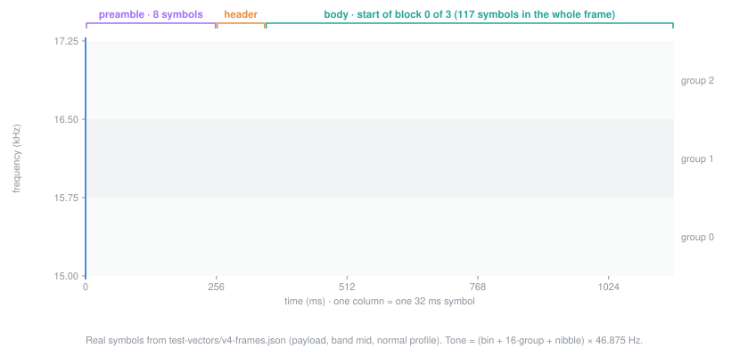
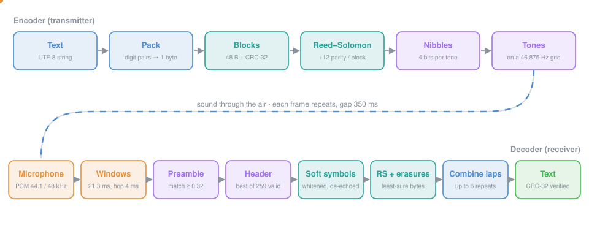

# bysound v4: protocol specification

This document specifies **bysound v4**, a data-over-sound modem. A transmitter turns a text string into a sequence of short multi-tone symbols. Any device with a speaker can play them, and any device with a microphone can decode them. It covers what goes over the air (tone grid, channels, frame format, coding, modulation). It also describes how the reference receiver decodes it, so you can build a compatible implementation.

> If you just want the intuition, read [HOW-IT-WORKS.md](HOW-IT-WORKS.md) first.



## Contents

1. [Scope and sources of truth](#1-scope-and-sources-of-truth)
2. [Overview](#2-overview)
3. [Tone grid](#3-tone-grid)
4. [Channels](#4-channels)
5. [Profiles: normal and robust](#5-profiles-normal-and-robust)
6. [Frame layout and timing](#6-frame-layout-and-timing)
7. [Preamble](#7-preamble)
8. [Header](#8-header)
9. [Payload body](#9-payload-body)
10. [Reed–Solomon code](#10-reedsolomon-code)
11. [Symbol mapping](#11-symbol-mapping)
12. [Modulation](#12-modulation)
13. [Repetitions (laps)](#13-repetitions-laps)
14. [Receiver algorithm](#14-receiver-algorithm)
15. [Integrity and multiple emitters](#15-integrity-and-multiple-emitters)
16. [Other frame types](#16-other-frame-types)
17. [Conformance and testing](#17-conformance-and-testing)
18. [Worked example](#18-worked-example)
19. [Appendix: checksums in pseudocode](#appendix-checksums-in-pseudocode)

The key words MUST, MUST NOT, SHOULD and MAY are used as in RFC 2119. Sections 3–13 are **normative**: they define the bits and the waveform. Section 14 is **informative**. It describes the reference receiver, whose parameters may be tuned without breaking compatibility, except for the analysis window and the frame timing that it relies on.

---

## 1. Scope and sources of truth

| File | Role |
|---|---|
| [`protocol-v4.json`](../protocol-v4.json) | Every protocol constant. Each implementation checks its own constants against this file in its tests. |
| [`protocol/v4-reference.mjs`](../protocol/v4-reference.mjs) | The normative **reference encoder**, an executable definition of the frame. It generates `test-vectors/v4-*.json`. |
| [`test-vectors/v4-frames.json`](../test-vectors/v4-frames.json) | Conformance vectors: header, body, symbols and duration for each channel and profile. |
| [`web/src/modem/`](../web/src/modem/) | TypeScript encoder, modulator and the streaming **reference receiver** (`receiver.ts`). |
| [`ios/Sources/BySound/`](../ios/Sources/BySound/), [`android/bysound/`](../android/bysound/) | Swift and Kotlin ports of the TypeScript encoder, modulator and receiver. |
| [`c/include/bysound.h`](../c/include/bysound.h) | C99 implementation for microcontrollers: encoder, transmitter, symbol decoder and streaming demodulator. |

This document specifies **payload frames** (magic `0x56`): the complete text travels in the sound. The format also defines reference, acknowledgement and risk frames (section 16). All four implementations encode and decode them; their use is specified by the session layer in [SESSION.md](SESSION.md), outside the scope of this document.

If this document and the reference encoder ever disagree, the reference encoder and the test vectors win.

## 2. Overview

A **frame** is a sequence of symbols. In each **symbol**, the transmitter plays `G` pure tones at once, one per **group**. Each group has 16 possible tones, so each tone carries one **nibble** (4 bits). A frame has three parts:

1. **Preamble:** 8 fixed symbols. Each channel and profile has its own pattern. It is used to detect the frame and lock onto its timing.
2. **Header:** 4 bytes that give the frame type, its length, a CRC-8, and the version, channel and parity set.
3. **Body:** the packed text plus a CRC-32, split into blocks of up to 48 data bytes. Each block carries its index, the block count and 12 bytes of Reed–Solomon parity.

The transmitter repeats the frame, with a **gap** of 350 ms of silence after each repetition. The receiver can decode a single repetition, or combine several damaged ones (section 14.8).

## 3. Tone grid

All tones sit on one frequency grid:

```
spacing  Δf = 46.875 Hz                      (protocol-v4.json: spacingHz)
tone frequency  f(bin, g, v) = (bin + 16·g + v) · Δf
```

- A **tone slot** is a grid index `m`; its frequency is `m · Δf`.
- `bin` is the first tone slot of the channel (section 4).
- `g ∈ [0, G)` is the group index.
- `v ∈ [0, 16)` is the nibble value (`tonesPerGroup = 16`).

The receiver's analysis window lasts exactly `1/Δf = 21.333… ms`. Over that window, every grid tone completes a whole number of cycles. Grid tones are therefore orthogonal: they are exactly the bins of a DFT of that length. At 48 kHz the window is `48000 / 46.875 = 1024` samples, a power of two, so tone slot `m` is FFT bin `m`. At 44.1 kHz the window is `44100 / 46.875 = 940.8 → 941` samples, and the reference receiver uses Goertzel filters at the grid frequencies instead.

<a id="4-bands"></a>

## 4. Channels

A **channel** is a block of `16·G` consecutive tone slots, `bin` to `bin + 16·G − 1`. Its 3-bit channel id travels in the header. Code identifiers call it a band (`BandId`, `bys_band_t`, the `band` field of the test vectors).

| Channel | Channel id | `bin` | Groups `G` | Tone slots | First → last tone | Nominal span¹ | Symbol `Ts` | Window start | Tone amplitude | Raw bit rate² |
|---|---|---|---|---|---|---|---|---|---|---|
| `top` | 0 | 384 | 2 | 384–415 | 18 000.000 → 19 453.125 Hz | 18.000–19.500 kHz | 32 ms | 4 ms | 0.30 | 250 bit/s |
| `high` | 1 | 368 | 3 | 368–415 | 17 250.000 → 19 453.125 Hz | 17.250–19.500 kHz | 32 ms | 4 ms | 0.30 | 375 bit/s |
| `upper` | 2 | 352 | 3 | 352–399 | 16 500.000 → 18 703.125 Hz | 16.500–18.750 kHz | 32 ms | 4 ms | 0.30 | 375 bit/s |
| `mid` | 3 | 320 | 3 | 320–367 | 15 000.000 → 17 203.125 Hz | 15.000–17.250 kHz | 32 ms | 4 ms | 0.30 | 375 bit/s |
| `audible` | 4 | 40 | 4 | 40–103 | 1 875.000 → 4 828.125 Hz | 1.875–4.875 kHz | 40 ms | 5 ms | 0.20 | 400 bit/s |
| `xhigh` | 5 | 352 | 4 | 352–415 | 16 500.000 → 19 453.125 Hz | 16.500–19.500 kHz | 32 ms | 4 ms | 0.25 | 500 bit/s |
| `wide` | 6 | 320 | 6 | 320–415 | 15 000.000 → 19 453.125 Hz | 15.000–19.500 kHz | 32 ms | 4 ms | 0.20 | 750 bit/s |

Channel id 7 is unused.

¹ `bin·Δf` to `(bin + 16·G)·Δf`, that is, from the first tone slot to one slot past the last, so the width is `16·G·Δf = G · 750 Hz`.
² `R = 4·G / Ts`: G nibbles per symbol. This is the raw rate before preamble, header, block overhead, parity and gap.



Channels overlap on purpose: `upper` and `xhigh` both start at slot 352, `mid` and `wide` both start at slot 320, and `top`, `high`, `xhigh` and `wide` all end at slot 415. A receiver can listen to all channels at once. Each channel and profile has its own preamble (section 7), and the channel id is covered by the header CRC (section 8), so a frame is not decoded on the wrong channel.

The output sample rate MUST put the channel's highest tone below Nyquist (`Fs / 2`); the TypeScript modulator throws and the C transmitter returns `BYS_E_RATE` otherwise. The channels that reach 19 453.125 Hz need `Fs > 38 906.25 Hz`, so 44.1 kHz or 48 kHz is enough. `audible` also works at 16 kHz.

## 5. Profiles: normal and robust

| | `normal` | `robust` |
|---|---|---|
| Available on | all 7 channels | `top`, `high`, `upper`, `mid` only |
| Symbol duration | `Ts` | `2·Ts` (64 ms) |
| Analysis window start | `windowStart` | `2·windowStart` (8 ms) |
| Analysis window | `1/Δf` (21.33 ms) | `2/Δf` (42.67 ms) |
| Search hop | 4 ms (`hopSeconds`) | 8 ms |
| Preamble key | `preambleKeys.normal` | `preambleKeys.robust` |
| Header CRC profile flag | 0 | 1 |

The robust profile doubles the time spent on every symbol. Doubling the symbol energy is expected to buy about 3 dB of SNR, at the cost of twice the airtime. Its body bytes are identical to the normal frame's. Only the timing, the preamble key and the header CRC change. The ramp (section 12) stays 3 ms. A transmitter MUST NOT use `robust` on `audible`, `xhigh` or `wide`.

> **Implementation note.** The TypeScript, Swift and Kotlin encoders silently fall back to `normal` in that case, the C library returns `BYS_E_PROFILE`, and `v4-reference.mjs` has no key for those channels.

A normal-profile receiver does not decode robust frames, and the reverse is also true. To hear both, run two receivers on the same audio: one with a normal window and hop, one with a doubled window and hop. The reference receiver does this (`ReceiverHost` in `web/src/modem/host.ts`).

## 6. Frame layout and timing

```
| preamble: 8 symbols | header: ⌈8/G⌉ symbols | body: ⌈2·L/G⌉ symbols | gap: 350 ms of silence |
```

The header and the body are each padded with zero nibbles up to a whole symbol, separately (section 11).

For a payload frame whose packed text is `P` bytes long (section 9):

```
D = P + 4                       data bytes (packed text + CRC-32)
B = ⌈D / 48⌉                    number of blocks, 1 ≤ B ≤ 255
L = D + 14·B                    body bytes (each block adds 2 header + 12 parity bytes)
S = 8 + ⌈8/G⌉ + ⌈2·L / G⌉       symbols in the frame
T_frame = S · Ts                (Ts doubled in robust)
T_lap   = T_frame + 0.35 s      one repetition including the gap
```

Symbol `k` of a frame starts at sample `round(k · Ts · Fs)`, where `Fs` is the sample rate, so a frame lasts `round(S · Ts · Fs)` samples followed by `round(0.35 · Fs)` samples of gap. `frameSeconds` in the test vectors is `T_frame`, without the gap.

**Header length in symbols:** `top` 4, `high`/`upper`/`mid` 3, `audible`/`xhigh`/`wide` 2.

**Maximum payload:** `B ≤ 255` is the format's own ceiling (`D ≤ 12 240` bytes, packed text at most 12 236 bytes), but the duration cap below is always reached first.

### Maximum duration

One transmission of a payload frame MUST NOT last more than **30 seconds**: preamble, header, body and the 350 ms gap together (`maxFrameSeconds` in `protocol-v4.json`):

```
S · Ts + 0.35 s  ≤  30 s          (Ts = 32 ms, 40 ms on audible, doubled in robust)
```

The check is exact, in integer microseconds: `S · round(Ts · 10⁶) + 350 000 ≤ 30 000 000`. An encoder MUST reject a longer payload with a "too long" error (`BYS_E_TOO_LONG` in C, code `TOO_LONG` in TypeScript, `ModemError.exceedsMaxDuration` in Swift, `TextTooLongException` in Kotlin). The cap is a transmitter rule: a receiver that decodes a longer frame is still conformant. Longer data needs several transmissions, which the application splits.

The largest packed text (`P`, in bytes, before the CRC-32) that fits, per channel and profile:

| Channel | Profile | `Ts` | Max `P` | Blocks `B` | Symbols `S` | Airtime at max (`T_lap`) |
|---|---|---|---:|---:|---:|---:|
| `top` | normal | 32 ms | 700 | 15 | 926 | 29.982 s |
| `top` | robust | 64 ms | 335 | 8 | 463 | 29.982 s |
| `high`, `upper`, `mid` | normal | 32 ms | 1 052 | 22 | 921 | 29.822 s |
| `high`, `upper`, `mid` | robust | 64 ms | 520 | 11 | 463 | 29.982 s |
| `audible` | normal | 40 ms | 1 122 | 24 | 741 | 29.990 s |
| `xhigh` | normal | 32 ms | 1 408 | 30 | 926 | 29.982 s |
| `wide` | normal | 32 ms | 2 114 | 45 | 926 | 29.982 s |

The limit is in packed bytes. ASCII letters (and any printable ASCII character other than a digit pair) pack 1:1, so the same number is the character limit for such text. Digit pairs pack 2:1, so a text of digits only can have up to twice as many characters (for example 1 400 digits on `top`). A text with characters outside printable ASCII costs more than one byte each (section 9.1).

Here are the durations of the test vector `ejemplo` (166 characters, `P = 112`, `D = 116`, `B = 3`, `L = 158`) on each channel, taken from `test-vectors/v4-frames.json` and matching the formula:

| Channel | Profile | Symbols `S` | `T_frame` | `T_lap` |
|---|---|---|---|---|
| `top` | normal | 8 + 4 + 158 = 170 | 5.440 s | 5.790 s |
| `high`, `upper`, `mid` | normal | 8 + 3 + 106 = 117 | 3.744 s | 4.094 s |
| `audible` | normal | 8 + 2 + 79 = 89 | 3.560 s | 3.910 s |
| `xhigh` | normal | 8 + 2 + 79 = 89 | 2.848 s | 3.198 s |
| `wide` | normal | 8 + 2 + 53 = 63 | 2.016 s | 2.366 s |
| `top` | robust | 170 | 10.880 s | 11.230 s |
| `high`, `upper`, `mid` | robust | 117 | 7.488 s | 7.838 s |

## 7. Preamble

All channels derive their preamble from one base pattern of 8 rows × 4 columns (`protocol-v4.json: preamble`):

| Row `k` | col 0 | col 1 | col 2 | col 3 |
|---|---|---|---|---|
| 0 | 0 | 8 | 4 | 12 |
| 1 | 15 | 7 | 11 | 3 |
| 2 | 2 | 10 | 6 | 14 |
| 3 | 13 | 5 | 9 | 1 |
| 4 | 4 | 12 | 0 | 8 |
| 5 | 11 | 3 | 15 | 7 |
| 6 | 6 | 14 | 2 | 10 |
| 7 | 9 | 1 | 13 | 5 |

Each channel and profile has a **key** `[shift, add]`. Group `g` of preamble symbol `k` carries:

```
nibble(k, g) = (preamble[k][(g + shift) mod 4] + add) mod 16
```

| Channel | normal `[shift, add]` | robust `[shift, add]` |
|---|---|---|
| `top` | [0, 3] | [1, 13] |
| `high` | [3, 9] | [3, 11] |
| `upper` | [2, 14] | [0, 8] |
| `mid` | [1, 13] | [2, 9] |
| `audible` | [0, 0] | none |
| `xhigh` | [1, 5] | none |
| `wide` | [3, 14] | none |

The keys come from a search that minimises how much any two preambles resemble each other at any time offset; the worst case it found is 25 % (as recorded in `protocol/v4-reference.mjs`). Channels with more than 4 groups (`wide`) reuse the columns cyclically.

For example, row 0 for `mid`, normal profile (key [1, 13]) is `[8+13, 4+13, 12+13] mod 16 = [5, 1, 9]`.



## 8. Header

The header has 4 bytes:

| Byte | Field | Value |
|---|---|---|
| 0 | `magic` (frame type) | `0x56` = payload. See section 16 for the others. |
| 1 | `length` | Payload: the **number of blocks** `B` (1–255). |
| 2 | `crc` | CRC-8 of `[magic, length, byte3, profileFlag]`. |
| 3 | version · channel · set | `(4 << 4) \| (channelId << 1) \| set` |

- **Version:** the high nibble of byte 3 is `4`.
- **Channel:** bits 3..1 hold the channel id of the channel the frame is played on (section 4).
- **Set:** bit 0 selects the parity set of reference frames. It MUST be `0` in payload frames.
- **CRC-8:** polynomial `0x2F`, initial value `0xFF`, not reflected, no final XOR (see the appendix). Its input has 4 bytes, in this order: byte 0, byte 1, byte 3, `profileFlag`. `profileFlag` is `0` for normal and `1` for robust. It is **not transmitted**, so a receiver listening for the other profile sees a CRC that does not match.

Examples, for a payload of 3 blocks on `mid`: byte 3 = `0x46`. The normal header is `56 03 0D 46`, and the robust header is `56 03 22 46`.

## 9. Payload body

### 9.1 Text packing

The text is packed into a byte string before transmission. The encoder walks the string from left to right:

| Input | Output |
|---|---|
| Two consecutive ASCII digits `d1 d2` | One byte `0x80 + 10·d1 + d2` (`0x80`–`0xE3`) |
| One printable ASCII character `0x20`–`0x7E` | That byte unchanged |
| A maximal run of characters outside `0x20`–`0x7E` (including control characters such as newline) | `0xFF`, `n`, then `n` bytes of UTF-8 (1 ≤ `n` ≤ 255). A run longer than 255 bytes is split into several `0xFF` chunks, each as long as possible without cutting a character. |

Digit pairs are taken greedily: `"0002"` becomes `80 82`. A lone digit is sent as ASCII.

**Unpacking:**

- `0x20`–`0x7E` is ASCII.
- `0x80`–`0xE3` is two digits.
- `0xFF` reads `n` and then `n` bytes. Consecutive `0xFF` chunks are joined before UTF-8 decoding, and the decoding MUST be strict.
- Any other byte value (`0x00`–`0x1F`, `0x7F`, `0xE4`–`0xFE`), `n = 0`, a truncated chunk or invalid UTF-8 makes the frame **invalid**.

### 9.2 Integrity: CRC-32

```
data = packed || BE32(CRC32(packed))
```

This is the standard CRC-32 (IEEE 802.3, reflected, polynomial `0xEDB88320`, initial value `0xFFFFFFFF`, final XOR `0xFFFFFFFF`), appended big-endian.

Receivers reject a frame with `D ≤ 4`, so an empty text (`P = 0`) encodes but is never delivered. A transmitter SHOULD NOT send one.

### 9.3 Blocks

`data` is split into `B = ⌈len(data)/48⌉` chunks of 48 bytes (`blockData`). The last chunk holds the remaining 1–48 bytes. Block `i` is:

```
block_i = RS_encode( [i, B] || chunk_i ,  nsym = 12 )
        = i, B, chunk_i (≤ 48 bytes), 12 parity bytes          → 62 bytes (last block: 15–62 bytes)
```

The body is the concatenation of every block, in order. The header gives `B`, but **the length of the last block is not transmitted**. The receiver recovers it by trying each possible length (section 14.7).

A block is valid only if all of these hold:

- its length is 15–62 bytes and its RS decoding succeeds;
- `total ≥ 1` and `index < total`;
- `total` equals the header's `length`, and `index` is the block's position in the body;
- every block except the last carries exactly 48 data bytes.

## 10. Reed–Solomon code

| Parameter | Value |
|---|---|
| Field | GF(2⁸), primitive polynomial `x⁸ + x⁴ + x³ + x² + 1` (`0x11D`) |
| Generator element | α = `0x02` |
| Generator polynomial | `g(x) = ∏_{i=0}^{nsym−1} (x − αⁱ)` (first consecutive root α⁰) |
| Form | Systematic: codeword = message ‖ (message(x)·x^nsym mod g(x)). Byte 0 is the highest-degree coefficient. |
| Payload blocks | `nsym = 12`, RS(62, 50), shortened from RS(255, 243). The last block is RS(k+12, k). |
| Correction power | `e` errors and `f` erasures are corrected when `2e + f ≤ 12`: up to 6 unknown errors, or 12 known-bad bytes. |

## 11. Symbol mapping

Bytes become nibbles, **high nibble first**. Nibble `j` goes to group `j mod G` of symbol `⌊j / G⌋`:

```
nibbles(bytes) = [b0 >> 4, b0 & 15, b1 >> 4, b1 & 15, …]
symbol s, group g  ←  nibbles[s·G + g]
```

The header and the body are converted **separately**. Each one is padded with zero nibbles up to a multiple of `G`. The frame's symbol list is `preamble(0..7) ‖ symbols(header) ‖ symbols(body)`.

## 12. Modulation

For symbol `k` with nibbles `v_0 … v_{G−1}`, starting at sample `n0 = round(k·Ts·Fs)` and lasting `N = round((k+1)·Ts·Fs) − n0` samples:

```
x[n0 + n] = A · env(n) · Σ_g sin(2π · f(bin, g, v_g) · n / Fs),     n = 0 … N−1
```

- **Phase** restarts at 0 at the start of every symbol.
- **Envelope:** raised-cosine ramps of `R = round(0.003·Fs)` samples (`rampSeconds = 0.003`) at both edges of every symbol:
  - `env(n) = ½(1 − cos(π n / R))` for `n < R`;
  - `env(n) = ½(1 − cos(π (N−1−n) / R))` for `R ≤ n` and `n ≥ N − R`;
  - `env(n) = 1` otherwise.
- **Amplitude:** `A` is the channel's `toneAmplitude`. The peak can reach `G·A`: 0.6 (`top`), 0.9 (`high`, `upper`, `mid`), 0.8 (`audible`), 1.0 (`xhigh`), 1.2 (`wide`). A transmitter MUST scale the frame down so that it does not clip, because clipping spills energy into neighbouring tones. The TypeScript modulator divides the whole frame by its measured peak when that peak exceeds 1. The C transmitter divides `A` by `G·A` when that bound exceeds 1 (only `wide`), since it cannot measure the peak while streaming.
- **Gap:** after the last symbol come `round(0.35·Fs)` samples of silence.
- **Level:** the reference transmitters play at full scale (`level = 1`).

The analysis window (`windowStart` → `windowStart + 1/Δf`, which is 4 → 25.33 ms in a 32 ms symbol) lies entirely in the flat part of the envelope (3 → 29 ms). The same holds for `audible` (5 → 26.33 ms of 40, flat 3 → 37 ms) and for robust (8 → 50.67 ms of 64, flat 3 → 61 ms).

## 13. Repetitions (laps)

A transmitter repeats the frame back to back, each repetition followed by the 350 ms gap. Repetitions of one payload frame on one channel and profile MUST be identical, which makes the lap period `T_lap` constant. The number of repetitions and the channel or profile changes between them are up to the application, not the protocol; the body bytes stay the same on every channel and profile. Receivers use the repetition in two ways: to combine damaged laps (section 14.8) and to tell an emitter's next lap apart from a second emitter (section 15).

## 14. Receiver algorithm

This section is **informative**: it describes [`web/src/modem/receiver.ts`](../web/src/modem/receiver.ts), which the Swift and Kotlin receivers follow. The C demodulator is a reduced version with bounded memory (section 14.9). A compatible receiver may differ, but it has to solve the same problems.



### 14.1 Windows and tone energies

- **Analysis window:** `1/Δf` (×2 in robust). Sample counts are `round(seconds·Fs)`.
- **Taper:** a Tukey window with taper fraction 0.1 (`TAPER_V4` in `symbolWindow.ts`): over the first and last `0.05·(N−1)` samples the weight rises as `½ − ½·cos(π·d / (0.05·(N−1)))`, where `d` is the distance to the nearer edge. The window is nearly rectangular, so grid tones stay almost orthogonal, but a strong nearby interferer, such as a sweep, does not leak across the whole channel.
- **Search hop:** 4 ms (`hopSeconds`; 8 ms in robust). At hop `i`, the window covers samples `i·hop … i·hop + window − 1`, and the receiver computes the energy `|X|²` of every tone slot in the channel's region. With an FFT, this works when the window is a power of two and the grid falls exactly on FFT bins (48 kHz: stride 1; robust at 48 kHz: stride 2). Otherwise it uses Goertzel filters at the grid frequencies (44.1 kHz).
- **Tone banks:** the reference receiver shares one tone bank between all ultrasonic channels (slots 320–415, 6 × 16 tones) and has a second one for `audible` (slots 40–103). It keeps 160 hops of history and 12 s of audio.

### 14.2 Noise floor and whitening

Each channel keeps a per-tone noise floor `F[t]`, updated only while it is searching:

- **Start:** at the first hop, every tone's floor is set to the median energy across the channel's tones.
- **Update:** after that, at every hop, `F[t] ← F[t] + (h / τ) · (min(E[t], 4·F[t]) − F[t])`, where `h` is the hop duration (4 ms, or 8 ms in robust), `τ = 0.08 s` while the receiver has run less than 0.3 s and `τ = 0.5 s` after that. Limiting each new sample to 4 × the current floor keeps a burst from raising it.
- **Whitening:** energies are divided by the floor: `w[t] = E[t] / max(F[t], 0.05 · mean(F))`. A steady narrow-band interferer (electronics, LED drivers, screens) is flattened, and it no longer dominates the decision.

### 14.3 Preamble search

At each hop, every channel tests the hypothesis "the preamble ended just now":

- The candidate frame start is `hopEnd − round((7·Ts + windowStart + window)·Fs)`, where `hopEnd` is the sample just after the hop's window.
- For each preamble symbol `k`, the receiver takes the hop whose window ends nearest `start + round((k·Ts + windowStart + window)·Fs)`.
- For each group, it computes the share of the whitened group energy that falls on the expected tone: `w[expected] / Σ_v w[v]`.
- The **score** is the mean of these shares over all 8·G (symbol, group) pairs. With noise alone it is about 1/16 = 0.0625. A clean preamble scores close to 1.

When the score reaches `preambleThreshold = 0.32`, the hop becomes a candidate. The receiver keeps collecting candidates (at most 64) while the score stays at or above the threshold. When it falls back below, the frame start is the mean of the candidate starts whose score is at least 0.97 × the best one, rounded to a sample: the centre of the plateau. Candidate starts before the end of the frame just read (or, after a failed header, before that frame's second symbol) are ignored.

### 14.4 Echo estimate and soft symbols

- **Symbol windows:** once the frame start is known, symbol `k` is analysed with a window that starts exactly at `frameStart + round(k·Ts·Fs) + round(windowStart·Fs)`, whitened with the current floor.
- **Echo:** the preamble is known, so the receiver measures, for each group of preamble symbols 1–7, how much of the tone of symbol `k−1` remains in symbol `k` (the ratio of the whitened energies of that tone). The echo factor `ε` is the median of those ratios, clamped to [0, 0.8].
- **Soft symbols:** the echo tail starts as the whitened energies of preamble symbol 7. For each group, the receiver subtracts the tail, `d[v] = max(w[v] − ε·tail[v], 0)`, and updates it, `tail ← w + ε·tail`. The group then becomes a probability vector `p[v] = d[v] / Σ d`, or uniform if the sum is close to zero.
- **Byte decisions:** hard decisions are `argmax p`. The confidence of a nibble is the margin between its best and second-best probabilities, and the confidence of a byte is the smaller of its two nibbles'.

### 14.5 Header decision

The header is not decoded bit by bit. The receiver picks the **most likely valid header**:

- **Candidates:** the receiver builds every valid header for its channel and profile: two reference headers (sets 0 and 1), one risk header, one ack header and 255 payload headers (`B = 1…255`). That is 259 candidates, each with a correct CRC-8.
- **Decision:** it picks the candidate that maximises `Σ_i p_i[candidate nibble i]` over the 8 header nibbles. The **agreement** is the number of hard nibbles that equal the chosen candidate's.
- **Foreign header:** if the hard-decided bytes form a version-4 header whose channel id is a *different* channel and whose CRC-8 matches (with this receiver's profile flag), the frame belongs to another channel, and this channel goes back to searching. This check comes first.
- **Agreement below 5 of 8:** the header is unreadable. If this channel was assembling a payload frame whose last lap started within the last 30 s, that header is reused, because laps are identical (for a reference frame, the previous reading's header with the parity set flipped). Otherwise the receiver goes back to searching.
- **Ack and risk headers:** the reference modem receiver skips their bodies and resumes the search after them; the session layer decodes them.
- **Agreement of 7 or more:** the receiver reports that a frame is starting. The start time is recorded for clash detection (section 15).
- **Agreement below 8 with `B > 1`:** `B` is trusted only once the first block decodes from hard decisions with `index = 0` and `total = B`; otherwise the receiver goes back to searching. A misread length must not leave the channel waiting for a frame that does not exist.

### 14.6 Block decoding with erasures

Each block except the last is first decoded from hard decisions. If that fails, the receiver retries with the **2, then 4 least-confident bytes marked as erasures**. An erasure costs half as much as an unknown error (`2e + f ≤ 12`). A block counts only if it decodes with the expected `index`, `total = B` and 48 data bytes.

### 14.7 Finding the last block

The header does not give the length of the last block. As symbols arrive, the receiver tries every length for the last block (15 → 62 bytes, hard decisions, no erasures) and stops at the first one that decodes with `index = B−1` and `total = B` **and** gives a payload whose CRC-32 checks out and that unpacks. That point is the end of the frame. If none decodes, it reads up to the maximum body length (`B·62` bytes) and closes the lap.

Reed–Solomon alone cannot decide the length. If the last parity byte is `0x00` (about 1 payload in 256), the block one byte shorter is also a valid codeword (c(x) = x·c′(x)), and it would close there. Lengths are tried upwards, not downwards, because appending zeros to a codeword (the padding of the last symbol) also gives a valid codeword. When another block is not available yet, the CRC cannot be checked: the receiver keeps the first length RS accepts, and if the assembled payload then fails the CRC it forgets only the last block and closes it again on a later lap.

### 14.8 Combining laps

A block that fails in one lap is kept as soft symbols. In the next laps, the receiver tries, for each block except the last:

1. the current lap alone;
2. the **sum** of the probability vectors of the current and stored laps, which averages the noise out;
3. the **surest** reading per nibble (the lap with the largest margin), which recovers a block whose start survived in one lap and whose end survived in another.

Each candidate is tried with 0, 2 and 4 erasures. The receiver combines up to 6 laps (the current one and 5 stored) from the last 30 s, and only laps with the same block count. The last block, whose length is unknown, is stored the same way (up to 6 laps); from two stored laps on, the receiver tries their sum and their surest reading, each at every length from 15 to 62 bytes with hard decisions and no erasures, under the same index, total and CRC-32 conditions as section 14.7. Once all `B` blocks are closed, the chunks are concatenated, the CRC-32 is checked, and the text is unpacked.

A preamble found inside a payload frame's body, ending at or after the frame's earliest possible end (its end with a 15-byte last block), marks the start of the next lap if it scores at least 0.7 of the frame's own preamble score. The receiver then closes the current lap and starts reading the new one. The next lap comes from the same sender and scores about the same, while body data that happens to match the preamble in a few nibbles scores only that share of it (6 of 16 nibbles is 0.375 in a clean channel, over the threshold).

### 14.9 Reference receiver parameters

| Parameter | Value | Source |
|---|---|---|
| Search hop | 4 ms (8 ms robust) | `protocol-v4.json: hopSeconds` |
| Preamble threshold | 0.32 | `protocol-v4.json: preambleThreshold` |
| Window | `1/Δf` (×2 robust), Tukey 0.1 | `symbolWindow.ts` |
| Plateau | candidates ≥ 0.97 × best, at most 64 | `receiver.ts` |
| Next lap inside a body | preamble score ≥ 0.7 × the frame's | `receiver.ts` |
| Noise floor | median start; τ 0.08 s for the first 0.3 s, then 0.5 s; new samples clipped at 4× | `receiver.ts` |
| Whitening minimum | 5 % of the channel's mean floor | `receiver.ts` |
| Echo clamp | 0 … 0.8 | `receiver.ts` |
| Header agreement | ≥ 5 of 8 to accept, ≥ 7 to report, 8 = sure | `receiver.ts` |
| Header reuse | from a lap within 30 s | `receiver.ts` |
| Block erasure tries | 0, 2, 4 (not on the last block) | `receiver.ts` |
| Lap combining | up to 6 laps within 30 s | `receiver.ts` |
| History | 160 hops, 12 s of audio | `receiver.ts` |

The C demodulator ([`c/src/demod.c`](../c/src/demod.c), API in [`c/include/bysound.h`](../c/include/bysound.h)) makes the same search, plateau, echo, header and clash decisions with bounded memory: a ring of 4 analysis windows, 80 hops of tone-energy history, at most 16 plateau candidates and 8 recorded frame starts. It decides each lap on its own from hard decisions with errors-only Reed–Solomon decoding: it does not combine laps, does not mark erasures, does not reuse an unreadable header from an earlier lap, and measures the echo on the stored hop energies (the hop nearest each preamble symbol) rather than on exact symbol windows. It also decodes ack and risk bodies. It computes tone energies with a float32 FFT or a fixed-point Goertzel, chosen at compile time.

## 15. Integrity and multiple emitters

### 15.1 Integrity layers

A delivered text has passed all of the following checks. Each one rejects errors that got past the previous ones.

1. **Per-channel, per-profile preamble:** reduces locking onto another channel's frame.
2. **Header:** the most likely of the valid headers only. The CRC-8 also covers the channel id and the profile, and foreign headers are rejected.
3. **Per-block Reed–Solomon**, plus checks that `index` and `total` are consistent with the header.
4. **CRC-32** over the whole packed text.
5. **Strict unpacking:** invalid bytes or invalid UTF-8 reject the frame.

The receiver delivers the exact text or nothing. Every extra combination it tries (erasures, combined laps) is one more chance for a wrong codeword to pass RS. The CRC-32 is the final guard against that, and the reference receiver limits how many combinations it tries.

### 15.2 What bysound does not provide

- **Confidentiality:** anyone within earshot can decode the frame.
- **Authenticity:** anyone can transmit a valid frame.
- **Replay protection:** a recording plays back as a valid frame.

Applications that need these properties must add them inside the text: for example a signature or MAC, an expiry, or single-use identifiers.

### 15.3 Multiple emitters (clash detection)

Two emitters playing at once could make a receiver accept the wrong data. The reference receiver reports a **clash** instead of delivering anything in these cases:

- **Overlapping frames:** a frame start (header agreement ≥ 7) from a different channel, or from the same channel at least 0.3 s away, falls within another frame's minimum span (from its start to its earliest possible end) minus a 0.15 s margin. One emitter never starts a new frame before finishing the previous one.
- **Preamble inside a body:** a preamble plateau of at least 2 hops with a best score of at least 0.45 appears inside a body: it starts at least 0.3 s after the frame's start and ends before the frame's earliest possible end. A single isolated peak is treated as data that happens to look like a preamble.
- **At delivery:** another channel's frame started after this frame's start, and its preamble ended before this frame's end.

Limits:

- An emitter that does not reach the microphone cannot be detected.
- A much weaker second emitter on the same channel may stay hidden under the stronger one.
- Only bysound preambles are recognised; any other sound is treated as noise.

## 16. Other frame types

The first header byte gives the frame type. The v4 format defines four:

| Magic | Type | `length` field | Body |
|---|---|---|---|
| `0x56` (`V`) | **payload** (this document) | block count | blocks (section 9) |
| `0x52` (`R`) | reference: a 12-byte fingerprint of the data plus its CRC-16, with incremental parity sets A/B of an RS(46,14) mother code | 14 | 30 bytes (14 + 16 parity) |
| `0x41` (`A`) | acknowledgement / receipt | 7 | 15 bytes (7 + 8 parity) |
| `0x58` (`X`) | risk signal (another emitter detected) | 10 | 18 bytes (10 + 8 parity) |

Acknowledgements, risk signalling and reference mode (with a local resolver, no backend) are specified by the session layer, [SESSION.md](SESSION.md), implemented in TypeScript (the reference, `web/src/session/`), Swift, Kotlin and C with shared vectors (`session-acks.json`, `v4-acks.json`, `v4-risk.json`, `security-levels.json`); [SECURITY.md](SECURITY.md) describes the security model. The frames are defined in `protocol/v4-reference.mjs`, with vectors in `test-vectors/v4-acks.json` and `test-vectors/v4-risk.json`, and encoded by all four implementations (in C: `bys_frame_init_reference`, `bys_frame_init_ack`, `bys_frame_init_risk`). A payload-only receiver SHOULD still include their headers among its header candidates, then skip their bodies, so they are not misread as payload frames.

## 17. Conformance and testing

- **Constants:** each implementation compares its constants with `protocol-v4.json` in its own tests (`web/src/modem/protocolV4Json.test.ts`, the C `test_constants`).
- **Frames:** an encoder is conformant if it reproduces `header`, `body`, `symbols` (the preamble included) and `frameSeconds` exactly, for every vector in `test-vectors/v4-frames.json`. That file holds 58 vectors (42 normal, 16 robust), 22 of them payload frames, built from two texts: a 166-character string, and a longer one with non-ASCII characters and an emoji.
- **Audio:** golden PCM files in `c/test/golden/` let the C transmitter be checked sample by sample. Recordings in `c/test/recordings/` exercise the demodulator on real audio.
- **Channel simulation:** the receiver tests add white noise, echo, noise bursts that destroy part of each lap (recovered by combining laps), a sweep 38 dB above the signal (handled by the tapered window), and two emitters overlapping on the same or different channels (which must be reported as a clash, not delivered).

## 18. Worked example

This example uses vector index 11 of `test-vectors/v4-frames.json`: `name: "ejemplo"`, `mode: "payload"`, `band: "mid"`, `profile: "normal"`.

**Text** (166 characters, a sample EMVCo-style QR string):

```
00020101021226470017com.example.pagos01220000003100099988877766520454115303032540812500.505802AR5918ALMACEN LA ESQUINA6007CORDOBA62250108F-0001230509PEDIDO-776304F4AF
```

**1. Pack → 112 bytes** (`"00"→80`, `"02"→82`, … `"c"→63`, `"o"→6F`, …):

```
80 82 81 81 82 8C 9A AF 80 91 63 6F 6D 2E 65 78
61 6D 70 6C 65 2E 70 61 67 6F 73 81 96 80 80 80
9F 80 89 E3 D8 D7 CD C2 B4 84 B6 8B B5 83 83 99
A8 D1 99 80 2E B2 BA 82 41 52 BB 92 41 4C 4D 41
43 45 4E 20 4C 41 20 45 53 51 55 49 4E 41 BC 87
43 4F 52 44 4F 42 41 BE 99 81 88 46 2D 80 81 97
85 89 50 45 44 49 44 4F 2D CD BF 84 46 34 41 46
```

**2. CRC-32** = `0x0316AEFF`, appended big-endian, so `D = 116` bytes. **Blocks:** `B = ⌈116/48⌉ = 3`.

**3. Reed–Solomon blocks** (`index, total | data | parity`):

| Block | Index, total | Data | Parity (12 B) | Size |
|---|---|---|---|---|
| 0 | `00 03` | packed[0..47] | `B5 CE 30 5F B0 56 90 1D F5 7E 42 3D` | 62 |
| 1 | `01 03` | packed[48..95] | `0A 33 21 3F EB 52 FE 09 6C D5 2E AC` | 62 |
| 2 | `02 03` | packed[96..111] + `03 16 AE FF` (20 B) | `21 60 F5 88 DB 60 9D 82 FA 2A AD 11` | 34 |

The body is 62 + 62 + 34 = **158 bytes**.

**4. Header:** byte 3 = `(4<<4) | (3<<1) | 0 = 0x46`, and CRC-8(`56 03 46 00`) = `0x0D`. The header is **`56 03 0D 46`**.

**5. Symbols** (`G = 3`):

| Part | Symbols |
|---|---|
| Preamble (key [1, 13]) | `[5,1,9] [4,8,0] [7,3,11] [2,6,14] [9,13,5] [0,12,4] [11,15,7] [14,10,2]` |
| Header `56 03 0D 46` → nibbles `5 6 0 3 0 D 4 6` + one pad nibble | `[5,6,0] [3,0,13] [4,6,0]` |
| Body, from `00 03 80 82 81 …` | `[0,0,0] [3,8,0] [8,2,8] [1,8,1] [8,2,8] …` |
| Body, last symbols (316 nibbles, 2 pad nibbles) | `… [10,2,10] [10,13,1] [1,0,0]` |

**6. Tones.** The first preamble symbol `[5,1,9]` plays three tones at once:

```
g0: (320 +  0 + 5) · 46.875 = 15 234.375 Hz
g1: (320 + 16 + 1) · 46.875 = 15 796.875 Hz
g2: (320 + 32 + 9) · 46.875 = 16 921.875 Hz
```

**7. Duration:** `S = 8 + 3 + ⌈316/3⌉ = 8 + 3 + 106 = 117` symbols, so `T_frame = 117 × 32 ms = 3.744 s`, which matches `frameSeconds`. With the gap, one lap lasts 4.094 s. At a raw rate of 375 bit/s, the 166 characters fit in one lap: digit-pair packing turns them into 112 bytes, and coding adds 4 bytes of CRC-32 plus 14 bytes per block (2 of index and total, 12 of parity), for 158 bytes of body.

## Appendix: checksums in pseudocode

```text
crc8(bytes):                       # header; poly 0x2F, init 0xFF, MSB-first, no final XOR
  c = 0xFF
  for b in bytes:
    c ^= b
    repeat 8: c = ((c << 1) ^ 0x2F) & 0xFF if c & 0x80 else (c << 1) & 0xFF
  return c

crc32(bytes):                      # payload; IEEE 802.3, reflected
  c = 0xFFFFFFFF
  for b in bytes:
    c ^= b
    repeat 8: c = (c >> 1) ^ 0xEDB88320 if c & 1 else c >> 1
  return c ^ 0xFFFFFFFF

rs_encode(msg, nsym):              # GF(256)/0x11D, roots α^0 … α^(nsym-1), systematic
  g = [1]; for i in 0..nsym-1: g = g * (x - α^i)
  out = msg + [0]*nsym
  for i in 0..len(msg)-1:
    coef = out[i]
    if coef: for j in 1..len(g)-1: out[i+j] ^= gf_mul(g[j], coef)
  return msg + out[len(msg):]
```
