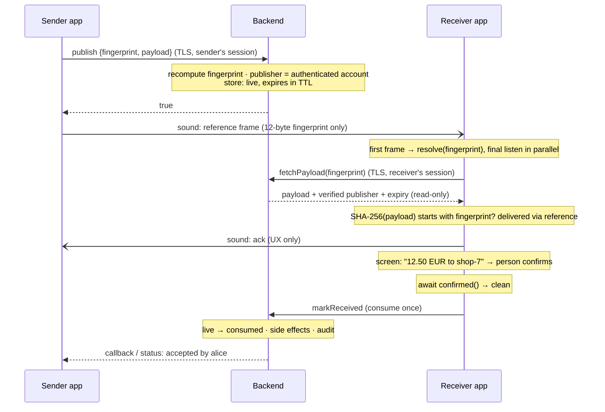
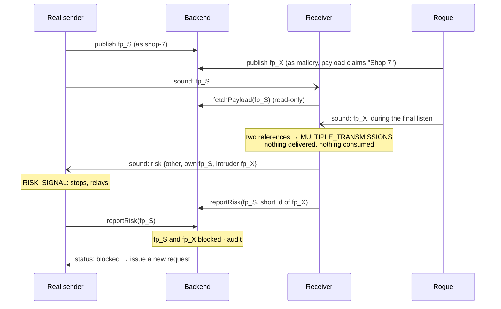

# bysound security model

What bysound protects, what it does not, and what an app has to add. The mechanisms are specified in [PROTOCOL.md](PROTOCOL.md) (frames and integrity) and [SESSION.md](SESSION.md) (acks, the confirm gate, other emitters, risk signal, security levels).

**In one sentence:** bysound delivers the exact text that was played, or nothing, and tells you when more than one device was playing; it does not hide the text, and it cannot tell you *who* played it. A backend of your own can add both: see [Using a backend](#using-a-backend).

## What bysound guarantees

**Integrity: the exact text or nothing.** A delivered text has passed, in order: a per-band preamble, a header chosen only among valid headers and protected by a CRC-8 (which also covers the band and the profile), Reed–Solomon on every block with consistency checks on block index and count, a CRC-32 over the whole text, and strict unpacking (invalid bytes or invalid UTF-8 reject the frame). A frame that fails any of them is dropped, and the receiver waits for the next repetition. Noise, echo and interference can delay a read or prevent it; they do not change what is read. In reference mode, the text the app's resolver returns must also hash to the fingerprint that was heard (SHA-256, 96 bits). Acks and risk frames carry their own CRC-16 and Reed–Solomon parity.

**Detection of a second emitter, when the microphone hears it.** With `standard` or `maximum` (the default):

- a sender does not start if another bysound transmission is already sounding (pre-listen), and stops if it hears one in its listen windows, or hears its own data played by someone else (a clone);
- a receiver delivers nothing if, before delivery, it reads two different texts or two frames overlap (a clash), on the same band or on different ones;
- after delivery, the receiver keeps watching until the app calls `confirmed()`; a different text or an alert heard meanwhile makes `confirmed()` fail.

**Alert propagation.** Whoever detects another emitter plays a risk frame. A receiver that hears one before delivery fails; during the confirm watch it closes the gate. A sender that hears one stops and relays it once, one hop further, up to two hops. Every alert reaches the app through `onAlert` and a suggested quarantine through `onQuarantine`.

## What bysound does not do

- **No secrecy.** The text travels in the clear. Anyone within earshot (including a recorder in a pocket) can decode it. Reference mode sends only a 12-byte fingerprint, but anyone who can guess or enumerate the possible texts can match it.
- **No sender authentication.** Anyone can play a valid frame. bysound cannot tell the shop's phone from a phone that copies it.
- **No replay protection.** A recording plays back as a valid frame. Acks and receipts carry 4 bytes of SHA-256 of a text that may be public: they can be recorded and replayed too. An ack means "a bysound receiver nearby says it read this", not proof of anything.
- **No guarantee of detection.** An emitter that does not reach a microphone cannot be detected by it. A much weaker second emitter on the same band may stay hidden under the stronger one. A second emitter that starts and stops entirely while a half-duplex sender is playing is invisible to that sender (the receiver still protects itself if it hears both). Only bysound frames are recognised; any other sound is noise. After the confirm watch ends, nothing is watched.
- **No enforcement.** Quarantine is a suggestion delivered to the app; bysound never blocks an operation because of it. A device that does not run bysound ignores risk frames.
- **Range is the only boundary.** Near-ultrasonic sound goes through doors and thin walls less than radio, but it is not a perimeter you can rely on.

## Attacks considered

| Attack | What happens | Mitigation |
|---|---|---|
| **Eavesdropping**: someone nearby records and decodes. | They get the text. | Do not send secrets. Use reference mode when the receiver already has the possible texts; send an opaque, short-lived id that only your app can resolve; or encrypt inside the text at the app level. |
| **Replay**: a recording of a past exchange is played again. | It decodes as a valid, unchanged frame. If it sounds while the real sender is sending, the sender reports a clone (`CLONED_TRANSMISSION`) and the receiver a clash or two texts. If it sounds alone, it is delivered. | Make texts single-use at the app level: a nonce or a counter checked by whoever acts on it, an expiry time (TTL), a signature over both. |
| **Jamming**: loud noise or tones on the bands. | Reads are delayed or prevented; corrupted frames are dropped, never delivered wrong. The sender's ambient check skips the noisiest channels and goes robust. | None needed for integrity. For availability, a fallback channel in the app (QR, NFC, typing a code). |
| **Rogue sender racing the real one**: a nearby device plays its own text (another account, another amount) at the same time. | The receiver reads two texts or a clash: nothing is delivered, it plays a risk frame, the real sender stops and relays it. If the rogue starts after delivery, the confirm gate fails. If the real sender hears the rogue, it stops and alerts too. | Use the default `maximum` (at least `standard`) on both sides, call `confirmed()` before acting, show the alert to the person. |
| **Rogue sender alone**: the real sender is silent or out of range, and only the rogue plays. | Its text is delivered: bysound has nothing to compare it with. | Validate the content: whose text is it? Sign it at the app level, or check it against something the person sees (an amount on the shop's screen, a name). |
| **Cloned frames**: a device replays the real sender's own frames, possibly on another band, to confuse or to steal the ack. | The real sender detects its own data played while it is silent or on a band it is not playing (`CLONED_TRANSMISSION`) and alerts. Overlapping copies make a clash at the receiver. | As for replay: single-use texts. |
| **Fake ack**: someone plays an ack for a public text to make the sender stop. | The sender stops and believes it was received. Nothing wrong is delivered to anyone. | Do not treat the ack as a proof of delivery when it matters; confirm at the app level. |
| **Fake alert**: someone plays risk frames to stop exchanges nearby. | bysound senders stop and receivers fail (with `honor`), for as long as it plays: a denial of service, never a wrong delivery. | Retry; with `riskSignal.honor: false` an app can only report alerts. |

## Security levels

| | basic | standard | maximum (default) |
|---|---|---|---|
| Integrity (CRCs, Reed–Solomon) | yes | yes | yes |
| Sender pre-listen | 1 s, does not act | 2 s + up to 0.6 s, refuses if busy | 3 s + up to 1.2 s, refuses if busy |
| Sender watches while sending | no | yes | yes |
| Receiver final listen, clash rejection | no (first frame delivered) | 1.5 s (up to 6 s) | 1.5 s (up to 6 s) |
| Confirm watch until `confirmed()` | no | yes, up to 120 s | yes, up to 120 s |
| Emits / honors risk frames | no / no | yes / yes | yes / yes |
| Risk loop: receiver / sender | — | 4 s / 15 s | 6 s / 30 s |
| Suggested quarantine | 30 s (unused) | 30 s | 60 s |

Exact values: [`test-vectors/security-levels.json`](../test-vectors/security-levels.json). Every field can be overridden. **With `basic`, a receiver can act on a rogue's text even when two senders were playing**: use it only for demos and data without consequences.

## Guidance for apps

1. **Validate the content.** bysound tells you the text is the one that was played, not that it is legitimate. Parse it strictly and check it against your rules.
2. **Use the confirm gate.** Call `await confirmed()` right before acting on the data (paying, unlocking, saving), not right after receiving it. If it fails, do not act; show the alert. If it answers `expired`, decide what an unwatched gap means for you and log it.
3. **Keep the default level** on both sides for anything with consequences.
4. **Add what bysound does not provide, inside the text:** a signature or MAC if you need to know who sent it; a nonce or a counter and an expiry (TTL) if it must be used once; encryption if it must stay private. bysound transports any text you put in, up to 255 blocks.
5. **Show alerts to the person.** A risk alert means another device is playing nearby: it may be harmless (two people paying at the same counter), or it may be an attack. The suggested quarantine is a reasonable time to wait before retrying.
6. **Do not treat acks as proof.** They are for the experience (stop playing, show a check mark).

## Using a backend

Everything above is what bysound does on its own. Most apps that move something of value (a payment, a check-in, a login, a key to a door) also have a server. This section describes how to put that server in the loop so that **sound only bootstraps the link**: the data, the sender's identity and the decision to accept live on the backend. It is design guidance built on the existing reference mode and its pluggable resolver; the session layer itself has no network code, and this pattern has not been evaluated in the field. A runnable local version is in [`examples/backend-reference/`](../examples/backend-reference/).

**Who provides what.** bysound provides integrity (the exact fingerprint or nothing; the resolved text must hash to it) and detection (a second emitter, a clash, a risk frame, the confirm gate). The backend provides confidentiality (the data never travels over the air), authentication (who published it, who resolved it), expiry, single use, rate limiting, revocation and an audit log. Neither replaces the other.

### Architecture

1. **Publish.** The sender app builds the payload: a small text, typically JSON with an opaque id and a random nonce. It computes `fingerprint(payload)` (the first 12 bytes of SHA-256, 24 hex; [SESSION.md §3.3](SESSION.md#33-identifiers)) and calls `publish({fingerprint, payload})` on the backend, over TLS, authenticated as the sender. The backend **recomputes** the fingerprint from the payload, takes the publisher's identity from the authenticated session (never from the payload), and stores `{payload, publisher, expiresAt, state: live}` keyed by fingerprint, with a short TTL.
   - `publish` must be **idempotent** (a retry of the same payload by the same publisher returns the same answer and does not extend the TTL; another account cannot take over a fingerprint) and must have **its own timeout** (a few seconds).
   - The sender plays **only if `publish` returned `true`**. A fingerprint the backend does not know is useless to the receiver, and playing one invites confusion.
2. **Sound.** `sendSession(payload, { mode: 'reference' })`: only the 12-byte fingerprint is played, in reference frames ([PROTOCOL.md §16](PROTOCOL.md#16-other-frame-types)), with the default security level.
3. **Resolve.** The receiver opens `receiveSession({ resolve })`. bysound calls `resolve(fingerprint)` on the first reference frame; the app's resolver calls `fetchPayload(fingerprint)` on the backend, over TLS, authenticated as the receiver. The backend answers with the payload **and the publisher's verified identity** (and the expiry). bysound checks that SHA-256 of the returned payload starts with the fingerprint (`MISMATCH` otherwise).
   - `fetchPayload` is **read-only**. bysound calls the resolver in parallel with the final listen, so it can run for a reception that is rejected a moment later (a second fingerprint, a clash). It must not consume, notify or charge anything.
   - The resolver returns only the text to bysound; keep the rest of the answer (publisher, expiry) in the app, keyed by fingerprint. The resolver has a timeout of `RESOLVE_TIMEOUT_SECONDS` = 15 s; give the HTTP call a shorter one.
4. **Show and confirm.** The receiver app shows the person what matters, taken from the backend's answer: **who** published it (the verified account, not a name written inside the payload) and **what** (the amount). The person confirms on screen.
5. **Gate, then side effects.** Right before acting, `await confirmed()`. Only if it succeeds, call `markReceived(payload, { band })` (the band is only for your statistics): the backend **atomically** moves the entry from live to consumed (single use) and performs the side effects (charge, unlock, tell the sender). If `confirmed()` fails, act on nothing and report the risk (below).
6. **Acks.** The ack by sound tells the sender "a bysound receiver nearby read this fingerprint"; it stops the sound and is good for the experience. The **authoritative** confirmation is the backend's: a callback, push or status poll that says "account X accepted it". Use the sound ack for UX, the backend for decisions.

**Backend operations.** Suggested names, and the endpoints of the example:

| Operation | Example endpoint | Contract |
|---|---|---|
| `publish({fingerprint, payload})` | `POST /publish` | Authenticated. Recomputes the fingerprint. Idempotent. Own timeout. Sender emits only on `true`. Refused for a blocked fingerprint. |
| `fetchPayload(fingerprint)` | `GET /resolve/:fp` | Authenticated, rate limited. Read-only. Returns payload, publisher, expiry; refuses expired, consumed and blocked entries. |
| `markReceived(payload, {band})` | `POST /received` | Authenticated. Only after `confirmed()`. Atomic check-and-set live → consumed: a second call fails. Notifies the publisher. |
| `reportRisk(...)` | `POST /report-risk` | Authenticated, rate limited. Blocks the fingerprints involved in a clash or an alert (full fingerprints, or the 3-byte short ids a risk frame carries). |
| status / callback | `GET /status/:fp` | Only the publisher. The backend side of the ack: live, consumed (by whom), expired, blocked. |

**Accept only what the backend resolved.** A receiver in this design must refuse a delivery with `via: 'payload'` (a plain payload frame never went through the backend; anyone can play one) and any reference it did not resolve through the backend.

**Native ports.** The same resolver hook exists in Swift (`resolve: (fingerprint, done)`, asynchronous), Kotlin (`Resolver`, synchronous or `CompletionStage`) and C (`bys_resolve_fn`, synchronous: on a microcontroller, fetch before the session or block in the callback, and remember there is no resolver timeout in C; SESSION.md §11.1).

### What the backend adds

- **The sensitive data never travels over the air.** Only a 12-byte fingerprint is played. With a random nonce in every payload, the fingerprint cannot be guessed or matched against a list, and it is worthless without an authenticated call to your backend.
- **Authenticated data.** The receiver learns who published it from the backend's authentication, which sound cannot provide. A rogue can copy a merchant's name into its payload; it cannot publish under the merchant's account.
- **Expiry and single use.** A short TTL (tens of seconds to a few minutes) and an atomic consume make recordings and replays worthless after use or after expiry.
- **Rate limiting** on `fetchPayload` and `reportRisk`, per account and per device: guessing fingerprints is hopeless (96 bits), and limits keep it so.
- **Revocation and blocking.** The publisher can cancel; a reported risk blocks the fingerprints involved.
- **Audit log.** Who published, who resolved, who consumed, who reported, when. Useful after an incident, and to spot one account resolving many fingerprints.

### Active attacks and man in the middle

Each attack below assumes the attacker is within earshot and may run modified software (no pre-listen, no detection, ignores risk frames).

**(a) An eavesdropper records the fingerprint.** It decodes the 12 bytes, as anyone nearby can. Without an authenticated session it cannot resolve it; with one, `fetchPayload` is rate limited and logged, and the entry is single use and expires. *Blocked by:* backend authentication, per-account authorization if you need it (only accounts allowed to pay this merchant may resolve), TTL, single use. Put nothing in the payload that you would not show to any authenticated user of your app.

**(b) Replay of a recording later.** The recording decodes as the same, valid fingerprint. *What happens:* the backend answers `gone`: the entry was consumed by the real receiver, or it expired. The receiver's resolver returns nothing and bysound fails with `NOT_FOUND`. If the replay overlaps the real exchange, the sender reports a clone and the receiver a clash (see the table above). *Blocked by:* single use and TTL on the backend.

**(c) Rogue sender racing or overriding the real one.** Someone nearby plays a different fingerprint, for example its own payment request, to redirect a payment. It can even write the real merchant's name in its payload. What happens depends on timing (all four cases are reproduced on simulated air against the example backend):

| When the rogue plays | Receiver | Real sender | Backend |
|---|---|---|---|
| overlapping the real frame | `MULTIPLE_TRANSMISSIONS` (overlap): nothing delivered, risk frame. No fingerprint is known, so the alert carries `000000`. | hears the risk frame: `RISK_SIGNAL`, stops, relays; reports **its own** fingerprint | blocks the real request; the sender issues a new one |
| after the first frame, during the final listen | `MULTIPLE_TRANSMISSIONS` (other): nothing delivered; the alert carries both short ids | `RISK_SIGNAL`, reports its fingerprint | blocks both (the rogue's by its short id) |
| after delivery, before the person confirms | `confirmed()` fails with `MULTIPLE_TRANSMISSIONS`: nothing is consumed | already acked; learns from the backend | blocks both |
| alone (the real sender is silent or out of range) | delivered: bysound has nothing to compare with | — | answers with the **rogue's own account** as publisher |

*Blocked by,* in layers: clash and second-sender detection (bysound, `standard` or `maximum`), the confirm gate before any side effect, the risk signal so the real sender stops too, a `reportRisk` that makes the backend **block** the fingerprints involved (and later publications of them), and, for the last row, the screen: the receiver shows the **verified publisher and amount** from the backend, and the person confirms only if that is who they are paying. A blocked request is never paid; the real sender simply issues a new one (new nonce, new fingerprint). Treat `reportRisk` as untrusted input too: rate limit it, because a malicious reporter can block live requests (a denial of service, never a wrong payment).

**(d) Relay attack.** The attacker captures the sound in one place and plays it in real time somewhere else (a phone on a call, two radios), so a receiver far away resolves a request meant for the person at the counter. *Limits:* sound alone cannot prevent this. Every frame is valid and arrives in time; the fingerprint is the real one; the backend sees a normal resolve. *Mitigations:* a short TTL (it narrows the window, it does not close it); backend-side proximity checks where you have them (both apps' coarse location, the same Wi-Fi network, the venue the publisher is registered at); and an **on-screen confirmation code**: the sender's screen shows a short code derived from the request, and the receiver's screen shows the same code, so the person compares them, or the person at the counter reads the receiver's name back. Treat relays as possible for anything high value.

**(e) Jamming and denial of service.** Noise, loud tones or a stream of fake risk frames delay or prevent reads and stop sessions. *What happens:* nothing wrong is delivered; sessions fail with `TIMEOUT`, `OTHER_TRANSMISSION` or `RISK_SIGNAL`. *Limits:* detectable (failures, alerts, the noise measured by the sender's ambient check), not preventable by sound. *Mitigations:* a fallback channel in the app (QR code, typing a short code, NFC), and backend rate limits on `reportRisk` so that fake reports cannot block everything.

**(f) Malicious or tampered backend responses.** An attacker on the network (or a compromised proxy) changes what `fetchPayload` returns. *What happens:* bysound rejects any text whose SHA-256 does not start with the fingerprint (`MISMATCH`), so the payload cannot be swapped; but the **publisher identity and expiry** are outside the hash. *Mitigations:* TLS everywhere, certificate pinning in mobile apps, and optionally a signed answer: the backend signs `{fingerprint, publisher, expiresAt}` with a key the app knows, and the app verifies it before showing it. A compromised backend is outside what bysound can address.

### Guidance

**Security level.** Keep the default `maximum` on both sides for anything with consequences (at least `standard`). `basic` turns off clash rejection and the confirm gate: a receiver at `basic` can resolve and act on a rogue's fingerprint even when two senders were playing.

**The payload.** An opaque id plus what the person must see, and a random nonce (at least 96 bits) so every request has a fresh, unguessable fingerprint. Never secrets, tokens or credentials: the payload is returned to any authenticated receiver that heard the fingerprint. The receiver should parse it strictly and show the backend's `publisher`, not a name written inside the payload.

**Checklist.**

- [ ] The backend recomputes the fingerprint from the payload and takes the publisher from the authenticated session.
- [ ] `publish` is idempotent, has its own timeout, and the sender plays only after it returned `true`.
- [ ] Entries have a short TTL and are single use (atomic live → consumed).
- [ ] `fetchPayload` is authenticated, rate limited, logged and read-only.
- [ ] The receiver accepts only `via: 'reference'` deliveries that its resolver fetched from the backend.
- [ ] The receiver shows the verified publisher and the amount; the person confirms on screen.
- [ ] `await confirmed()` right before `markReceived`; nothing consumed or charged before it.
- [ ] Any `MULTIPLE_TRANSMISSIONS`, `RISK_SIGNAL`, `OTHER_EMITTER` or `CLONED_TRANSMISSION` is reported, and the backend blocks the fingerprints involved; the sender issues a new request.
- [ ] The backend's confirmation, not the sound ack, decides whether the sender considers the request accepted.
- [ ] TLS everywhere, pinning in mobile apps; a signed answer if the publisher identity must survive a hostile network.
- [ ] For high-value actions, an on-screen confirmation code or a proximity check against relay attacks, and a non-sound fallback against jamming.

## bysound and ggwave

Only properties that can be checked in ggwave's public README and source ([`bench/third_party/ggwave`](../bench/third_party/ggwave)) are listed. "Not provided" means not found in either.

| | bysound | ggwave |
|---|---|---|
| Error correction | Reed–Solomon per 62-byte block (12 parity bytes), erasures from soft decisions, combining of repetitions | Reed–Solomon; parity bytes depend on the length (`max(4, 2·⌊len/5⌋)`, 2 below 4 bytes; `getECCBytesForLength` in `src/ggwave.cpp`) |
| Checksum beyond the error-correcting code | CRC-8 on the header, CRC-32 on the text (CRC-16 on fingerprint, ack and risk frames) | Not provided (decoding succeeds when Reed–Solomon decodes) |
| Exact text or nothing | Yes (CRC-32 after Reed–Solomon, strict UTF-8) | Not documented |
| Maximum length | 255 blocks of 48 bytes | 140 bytes variable-length, 64 fixed-length (`kMaxLengthVariable`, `kMaxLengthFixed`) |
| Detects a second emitter / overlap | Yes (pre-listen, windows, clash, confirm watch) | Not provided |
| Acknowledgement by sound | Yes (ack + receipt) | Not provided |
| Alert propagation between devices | Yes (risk frames, up to 2 relays) | Not provided |
| Security levels | basic / standard / maximum | Not provided |
| Encryption | Not provided | Not provided (the optional "Direct Sequence Spread" mode XORs data with a fixed sequence; it is not documented as a security feature) |
| Sender authentication, replay protection | Not provided | Not provided |
