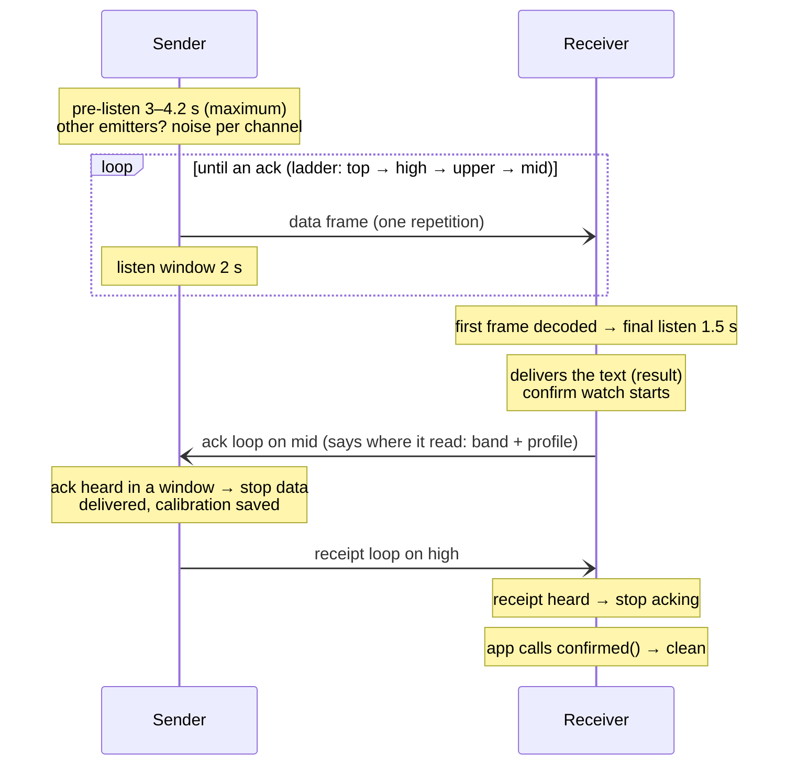
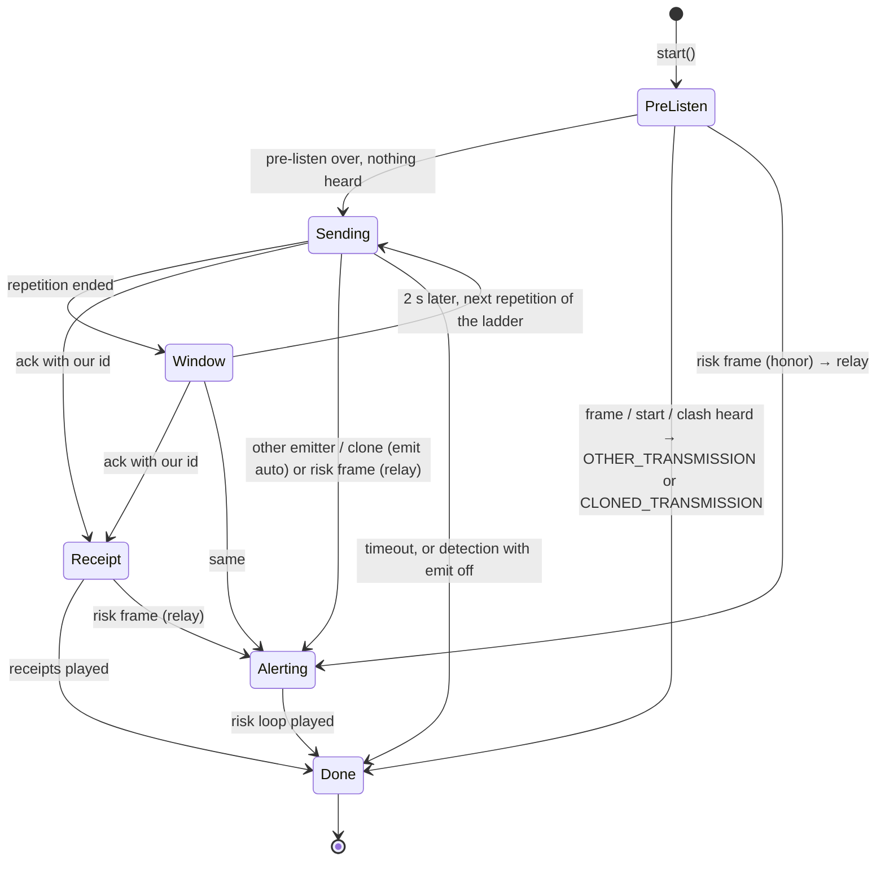
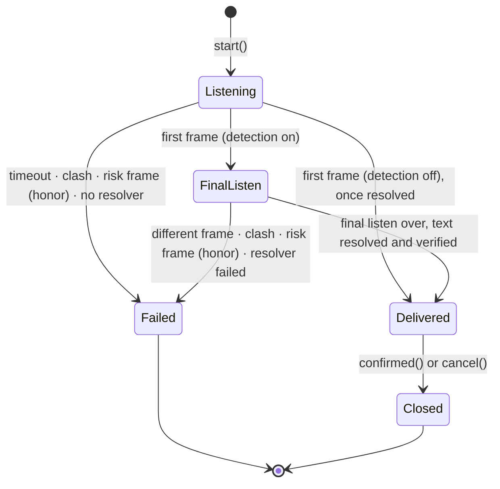
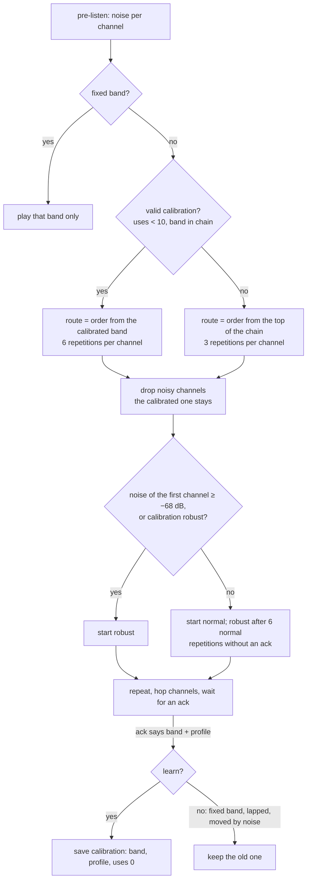
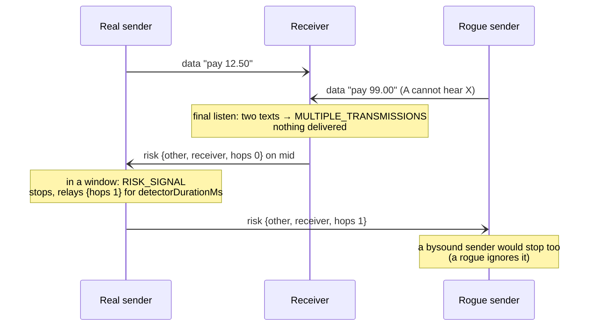
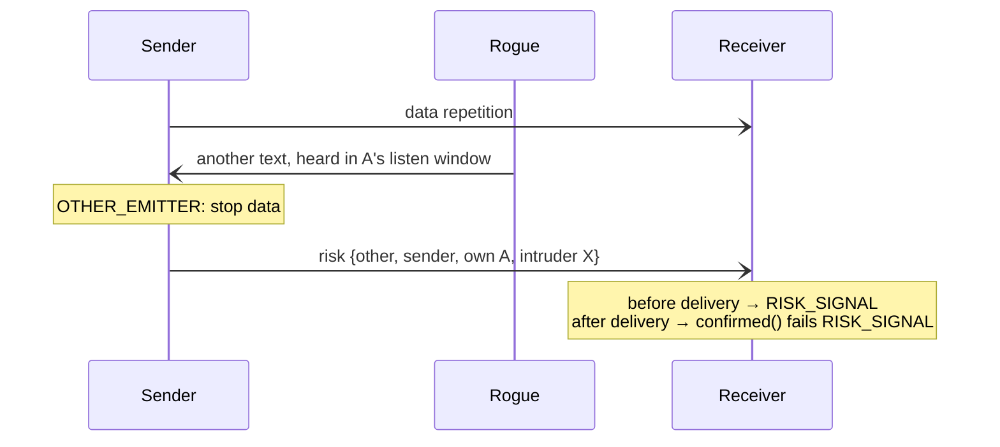
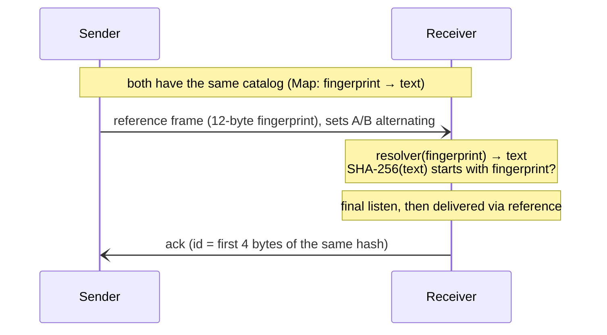

# bysound session layer

**Status:** normative for the session layer of bysound v4. The modem (frames, modulation, receiver) is specified in [PROTOCOL.md](PROTOCOL.md); this document builds on it and does not change any frame format that existed there.

**Implementations:** TypeScript in [`web/src/session/`](../web/src/session/) (the reference), Swift in [`ios/Sources/BySound/Session/`](../ios/Sources/BySound/Session/) and `BySoundSession.swift`, Kotlin in [`android/bysound/src/main/kotlin/io/github/beaglecoder/bysound/session/`](../android/bysound/src/main/kotlin/io/github/beaglecoder/bysound/session/) and `audio/BySoundSession.kt`, and C in [`c/include/bysound_session.h`](../c/include/bysound_session.h) and [`c/src/session.c`](../c/src/session.c). All of them MUST behave as described here; §11.1 lists where they differ in ways this text allows. Where this text and an implementation disagree, report it: one of them is wrong.

**Test vectors:** [`test-vectors/v4-acks.json`](../test-vectors/v4-acks.json), [`v4-risk.json`](../test-vectors/v4-risk.json), [`session-acks.json`](../test-vectors/session-acks.json), [`security-levels.json`](../test-vectors/security-levels.json).

The key words MUST, MUST NOT, SHOULD and MAY are used as in RFC 2119.

## Contents

1. [What the session layer adds](#1-what-the-session-layer-adds)
2. [Roles and a whole exchange](#2-roles-and-a-whole-exchange)
3. [Frames](#3-frames)
4. [What a device hears](#4-what-a-device-hears)
5. [Sender](#5-sender)
6. [Receiver](#6-receiver)
7. [Security levels](#7-security-levels)
8. [Errors, alerts and quarantine](#8-errors-alerts-and-quarantine)
9. [Automatic adaptation and calibration](#9-automatic-adaptation-and-calibration)
10. [Constants](#10-constants)
11. [Integration with the modem receiver](#11-integration-with-the-modem-receiver)
12. [More sequences](#12-more-sequences)
13. [Conformance](#13-conformance)
14. [Not included](#14-not-included)

## 1. What the session layer adds

The modem moves one text from a speaker to a microphone, intact or not at all. The session layer turns that into a two-party exchange:

- **Acknowledgement and receipt.** The receiver says "got it" by sound, so the sender stops; the sender answers "I heard you", so the receiver stops saying it.
- **The confirm gate.** The receiver keeps listening after delivering the data, and the app asks `confirmed()` before acting on it. Another transmission or an alert heard meanwhile closes the gate.
- **Other emitters.** A second sender nearby (a rogue racing the real one, a replay, an overlap) is detected by whoever hears it, and nothing is delivered from a clash.
- **Risk signal.** Whoever detects another emitter says so by sound (a risk frame) so the others stop too; a sender relays it at most twice.
- **Security levels.** One option, `basic` / `standard` / `maximum` (default), sets all of the above.
- **Quarantine.** A suggested pause after an alert, delivered as a callback. It never blocks anything.
- **Reference mode.** Only the 12-byte fingerprint travels; the receiver resolves it with a local lookup the app provides. No backend.
- **Automatic adaptation.** The sender picks a channel by the noise it measures, steps down a channel ladder until it is read, goes robust when nobody reads, and remembers where it was read.

There is no backend, no key and no network anywhere in this layer.

## 2. Roles and a whole exchange

- **Sender:** has a text, plays it, and wants to know it was received.
- **Receiver:** listens, delivers one text to its app, acknowledges it and guards the confirmation.

Every device runs a modem receiver on its microphone the whole time a session is open, the sender included: it hears its own frames, the other side's acks and anyone else.



## 3. Frames

The session layer uses two frame types of v4 besides payload (`0x56`) and reference (`0x52`). Both use the v4 header of PROTOCOL.md §8, the preamble of their band, the **normal** profile only, and a single Reed–Solomon codeword RS(n, k) over GF(2⁸) with 8 parity bytes (PROTOCOL.md §10). The frame is preamble + header symbols + body symbols, packed exactly like the other frames (`toSymbols` of the header, then of the body, each padded with zero nibbles to whole symbols).

CRC-16 below is CRC-16/CCITT-FALSE (poly `0x1021`, init `0xFFFF`) over the bytes before it, big-endian.

### 3.1 Ack and receipt (`0x41`)

Header `length` = 7. Body = the 7 data bytes followed by their 8 parity bytes (15 bytes).

| Byte | Content |
|---|---|
| 0 | low nibble: **kind**, `2` ack (receiver → sender) or `3` receipt (sender → receiver). High nibble: **heard**, see below |
| 1–4 | **ack id**: the first 4 bytes of SHA-256 of the text (UTF-8) |
| 5–6 | CRC-16 of bytes 0–4 |

**Heard nibble** (high nibble of byte 0): `0` means "not stated". Otherwise `robust << 3 | (channelId + 1)`, where `channelId` is the band id of PROTOCOL.md §8 (`top` 0 … `wide` 6) of the frame the receiver delivered and `robust` is 1 if that frame was robust. A value with `channelId + 1 = 0` and the robust bit set (`0x8`) is invalid. A receipt echoes the heard nibble of the ack it answers. With the nibble at 0 the bytes are exactly those of `v4-acks.json`, so a decoder that ignores the nibble still reads plain acks; a session decoder MUST accept both.

| | Band | Loop |
|---|---|---|
| Ack | `mid` | frames back to back, each followed by 0.15 s of silence |
| Receipt | `high` | same |

`mid` (bins 320–367) and `high` (bins 368–415) share no tone, so a receiver acking and a sender answering at the same moment do not mask each other. An ack frame lasts 0.672 s on `mid` and `high` (0.822 s with its gap).

**Known limitation.** The receipt band is always `high` (17.25–19.5 kHz), whatever band the data was read on. A sender whose speaker cannot play above about 17 kHz is read on `mid` and hears the ack, but its receipts do not reach the receiver, which keeps acking until `ACK_TOTAL_SECONDS` (30 s) and resolves `receipt` as `false`. Delivery and the confirm gate are not affected; a half-duplex receiver cannot hear a new text until that ack loop ends (§6.4).

### 3.2 Risk signal (`0x58`)

Header `length` = 10. Body = 10 data bytes + 8 parity bytes (18 bytes).

| Byte | Content |
|---|---|
| 0 | **reason**: `1` other (a different transmission was heard), `2` clone (someone else is playing this device's own data), `3` overlap (two frames overlapped, nothing could be separated), `4` cancelled (reserved for an app-initiated alert; the reference never emits it) |
| 1 | low nibble: **source**, `0` the alert was raised by a sender, `1` by a receiver. High nibble: **hops**, 0 for the original, +1 per relay |
| 2–4 | **own**: short id (first 3 bytes of SHA-256 of the text) of the data the originator was sending or had received; `000000` if none |
| 5–7 | **intruder**: short id of the other transmission; `000000` if it could not be read |
| 8–9 | CRC-16 of bytes 0–7 |

A risk frame lasts 0.736 s on `mid` (0.96 s on `top`). The **incident key** of a risk frame is (reason, source, own, intruder): hops are not part of it, so a relay is the same incident.

**Risk bands.** A risk frame is looped, alternating bands, each frame followed by 0.15 s of silence. The list of bands, given the emitter's working band `work` and the band `avoid` of what is being reported (or none):

1. `base` = `[mid]` if `work` is `mid` or `audible`, otherwise `[mid, work]`.
2. Without `avoid`, or if `avoid` is `audible`: `base`.
3. Otherwise the members of `base` that share no tone with `avoid`. If none is left, those of `[mid, top]` that share no tone with `avoid`. If none, `base`.

Risk frames are never sent on `audible`. A receiver that detected an overlap without knowing its band uses `work = top`, `avoid` = none: `[mid, top]`, which do not overlap each other.

### 3.3 Identifiers

All are computed from the UTF-8 bytes of the text, as lowercase hex in APIs:

| Name | Bytes of SHA-256 | Used in |
|---|---|---|
| `payloadId` | all 32 | — |
| `fingerprint` | first 12 | reference frames |
| ack id | first 4 | acks, receipts |
| short id | first 3 | risk frames |

None of them is a secret or a proof: anyone who knows the text can compute them.

## 4. What a device hears

A session reacts to these events from its microphone (in the reference: `AirEvent` in `ears.ts`):

| Event | Meaning |
|---|---|
| `frame` | A payload or reference frame decoded (PROTOCOL.md). Carries text or fingerprint, band and profile. |
| `header` | A payload or reference header read with near certainty (≥ 7 of 8 nibbles): a frame is starting on that band. |
| `clash` | The modem receiver saw two overlapping frames and delivered neither (PROTOCOL.md §15.3). |
| `ack` | An ack or receipt decoded (§3.1). |
| `risk` | A risk frame decoded (§3.2). |
| `noise` | Every 0.25 s, the noise measured on each high band (§9.2). |

Rules that apply everywhere:

- Acks, receipts and risk frames are **never** "another transmission": they do not trigger `OTHER_TRANSMISSION`, `OTHER_EMITTER`, `MULTIPLE_TRANSMISSIONS` or a clone.
- A device ignores a risk frame whose incident key it emitted or relayed itself within the last `quarantineMs` (it hears its own speaker). This memory is per device, shared by its sessions (`RiskMemory`).
- Within one session, each incident key is reported at most once.
- Events arrive with the time the device heard them; all times in this document are on one monotonic clock per device.

## 5. Sender

### 5.1 States



`stop()` goes to Done from any state and silences everything at once, the risk loop included.

### 5.2 Pre-listen

If `listenBeforeSendingSeconds > 0` and (detection is on or the ambient check is on), the sender listens for `listenBeforeSendingSeconds`, plus, **only when `detectMultipleEmitters` is on**, a uniform random extra in `[0, scanJitterSeconds)`. The jitter keeps two senders that start together from ending their pre-listen together.

During the pre-listen, with `detectMultipleEmitters`:

- a decoded frame with the sender's own content → end with `CLONED_TRANSMISSION`;
- a decoded frame with other content → end with `OTHER_TRANSMISSION`;
- a `header` or `clash` → remembered; at the end of the pre-listen, end with `OTHER_TRANSMISSION` (unless a decoded frame already ended it).

Nothing was sent, so none of these emits a risk frame. Noise reports heard during the pre-listen feed the ambient check (§9.2). A risk frame is handled as in §5.6.

### 5.3 Repetitions and listen windows

The sender plays one **repetition** (one frame plus the 0.35 s gap of PROTOCOL.md) at a time, chosen by the ladder of §9. After each repetition it is silent for a **listen window** of `LISTEN_WINDOW_SECONDS` = 2 s, then plays the next. A reference-mode sender alternates parity sets A and B on consecutive repetitions.

Windows are what lets a half-duplex device (one that cannot hear well while it plays) hear acks and other emitters. A device that can listen while it plays MAY act on what it hears at any time; the reference does.

The timeout (`timeoutSeconds`, default 60) counts from the first repetition. When it expires before an ack: stop, `TIMEOUT`.

### 5.4 Other emitters while sending

With `detectMultipleEmitters` **and** `listenWhileSending`, in states Sending and Window:

- a decoded frame with **other** content → reason `other`, intruder = its short id, `avoid` = its band;
- a decoded frame with the sender's **own** content → reason `clone`, intruder = own short id, `avoid` = its band, if either
  - the sender is silent and at least `CLONE_GUARD_SECONDS` = 0.5 s have passed since its last repetition ended, or
  - the sender is playing and the frame's band differs from the band it is playing.

  (A device decodes its own frame right after the frame ends, inside its own gap: within the guard.)
- `header` and `clash` are ignored while sending: the sender's own frames and the receiver's acks produce them.

On detection the sender stops the data at once. With `riskSignal.emit = 'auto'` it emits a risk frame (§5.6), reports an `emitted` alert and a quarantine notice, and `delivered` fails with `OTHER_EMITTER` (reason other) or `CLONED_TRANSMISSION` (reason clone). With `emit = 'off'` it only fails.

### 5.5 Ack and receipts

An `ack` event with kind ack (not receipt) and the sender's ack id, in Sending or Window:

1. Stop the data at once.
2. Resolve `delivered` with the heard band and profile from the ack (if stated), the time from the first repetition, the repetition count, and the calibration it saved (§9.4).
3. Loop receipts (§3.1, echoing the heard nibble) on `high` for `receiptSeconds = ackRunSeconds(L) + RECEIPT_LISTEN_SECONDS`, where `L` is the longest repetition of this content (§6.4). Then Done.

Acks with another id are ignored. A second ack is ignored.

### 5.6 Risk frames: emitting, hearing, relaying

**Emitting.** The frame is `{reason, source: sender, hops: 0, own: own short id, intruder}`. It is looped on the risk bands of §3.2 with `work` = the band the sender was playing and `avoid` = the band of the intruding frame, for `riskSignal.detectorDurationMs`. The sender records the incident in its `RiskMemory`.

**Hearing** (with `riskSignal.listen`; ignored in Alerting, and ignored if it is the sender's own incident, §4). In any other state:

1. Report a `heard` alert (with `matchesMine` = frame's `own` equals the sender's short id; informative only) and a quarantine notice.
2. If `riskSignal.honor`: stop the data (and receipts) at once. **Any** honored risk frame stops the sender, whoever raised it and whatever it reports. Then, if `hops < RISK_MAX_HOPS` (2), **relay** it once: the same frame with `hops + 1`, looped as above with `avoid` = the band it was heard on, for `detectorDurationMs`; record the incident. If `hops ≥ 2`, do not relay; go to Done. Before the ack, `delivered` fails with `RISK_SIGNAL`.
3. Without `honor`: only the alert and the notice.

Since a device ignores incidents it already emitted or relayed, two senders cannot pass one incident back and forth, and the chain is at most original → relay (hops 1) → relay (hops 2).

## 6. Receiver

### 6.1 States



Delivered has two activities that run independently: the **confirm watch** (§6.5) and the **ack loop** (§6.4). A risk loop (§6.6) may run after Failed or during the watch.

### 6.2 First frame and final listen

The first decoded `frame` (payload or reference) becomes **the** frame. The receiver reports `onHeard(band)`. For a reference, it calls the resolver now (§6.7), in parallel with the final listen.

With `detectMultipleEmitters`, the receiver keeps listening for `FINAL_LISTEN_SECONDS` = 1.5 s after the first frame:

- the same content again (on any band, any profile) is the sender repeating: ignored;
- different content → fail `MULTIPLE_TRANSMISSIONS`, risk reason `other`, intruder = its short id, `avoid` = its band;
- `clash` → fail `MULTIPLE_TRANSMISSIONS`, risk reason `overlap`, intruder `000000`, `avoid` = the first frame's band (or none before any frame);
- a `header` on a band other than the first frame's extends the final listen to `max(current end, now + FINAL_EXTEND_SECONDS)` (2.5 s), never past `FINAL_LISTEN_MAX_SECONDS` (6 s) after the first frame. A frame starting on another band gets the chance to be decoded or to clash.

A `clash` while Listening (before any frame) also fails with `MULTIPLE_TRANSMISSIONS` / overlap. Without `detectMultipleEmitters` there is no final listen and `clash` is ignored.

Every failure of this section emits a risk frame if `riskSignal.emit = 'auto'` (§6.6). The timeout (`timeoutSeconds`, default 60) applies only while Listening, and fails with `TIMEOUT` without a risk frame.

### 6.3 Delivery

When the final listen is over (or at once without detection) **and** the text is known (payload, or resolved and verified), the receiver resolves `result = {text, band, via}` and enters Delivered. It then starts the confirm watch (if `confirmWatch`) and the ack loop (if `ack`, default on).

### 6.4 Ack loop

Let `L` be the **longest repetition** of this content on the default ladder: the frame on `top` in the robust profile plus the 0.35 s gap (for a reference frame, the reference on `top`, robust). The sender may have hopped or gone robust since the frame the receiver read; `L` covers that. Then

```
ackRunSeconds = clamp(L + 2 × LISTEN_WINDOW_SECONDS + ACK_MARGIN_SECONDS, ACK_RUN_MIN_SECONDS, ACK_RUN_MAX_SECONDS)
             = clamp(L + 4.5, 3, 20) seconds
```

The receiver repeats, until a receipt is heard or `ACK_TOTAL_SECONDS` = 30 s have passed since delivery:

1. loop acks (kind ack, the ack id, heard nibble = band and profile of the delivered frame) on `mid` for `ackRunSeconds`;
2. listen for `RECEIPT_LISTEN_SECONDS` = 3 s.

Why these numbers: any interval of length `L + W` contains the start of one of the sender's windows, and a window of `W` = 2 s inside a continuous ack loop always contains a whole ack (period 0.822 s, frame 0.672 s). So a half-duplex sender hears the first run. The sender's receipts last `ackRunSeconds + 3`, which covers the end of the run and the receiver's following receipt listen however late in the run the sender heard it.

A receipt (kind 3) with the right ack id stops the loop: `receipt` resolves `true`. Otherwise it resolves `false` when the loop ends, on a failure, a conflict, or `cancel()`. `confirmed()` does **not** stop the ack loop: the acks are the sender's stop signal.

### 6.5 Confirm gate

With `confirmWatch`, from delivery until `confirmed()`, `cancel()` or `confirmWatchSeconds` (the **watch**):

- different content decoded → **conflict**: stop watching and acking, emit a risk frame (reason `other`, intruder = its short id, `avoid` = its band) if `emit = 'auto'`. `confirmed()` will fail with `MULTIPLE_TRANSMISSIONS`.
- a risk frame, if `riskSignal.listen` and `listenUntil = 'confirm'`: alert + quarantine notice; with `honor`, conflict: `confirmed()` will fail with `RISK_SIGNAL`. The receiver never relays.
- the same content again, `clash`, `header`, acks: ignored. Only a different text read whole closes the gate.

`confirmed()` waits for `result` (and fails like it), then:

| Situation | Answer |
|---|---|
| `cancel()` was called | fails `CANCELLED` |
| a conflict happened | fails with it (`MULTIPLE_TRANSMISSIONS` or `RISK_SIGNAL`, with the alert) |
| no watch at this level | `{watch: 'off', watchedSeconds: 0, uncoveredSeconds: 0}` |
| the watch hit `confirmWatchSeconds` | `{watch: 'expired', watchedSeconds, uncoveredSeconds}`: the gap between the end of the watch and this call |
| otherwise | `{watch: 'clean', watchedSeconds, uncoveredSeconds: 0}`, and the watch stops |

A second call returns the same. An expired watch does not fail: the absence of evidence is not a conflict; the app decides what an uncovered gap means.

`cancel()` never throws. Before delivery, `result` fails with `CANCELLED`. After `confirmed()` it does nothing. It stops the watch and the ack loop; a risk loop already playing finishes.

### 6.6 Risk frames

**Emitting.** `{reason, source: receiver, hops: 0, own: short id of the first frame or 000000, intruder}` looped on the risk bands of §3.2 with `work` = the first frame's band (or `top`), for `riskSignal.durationMs`. Recorded in `RiskMemory`. An `emitted` alert and a quarantine notice are reported.

**Hearing** (with `riskSignal.listen`): while Listening or in the final listen, or during the watch if `listenUntil = 'confirm'`, a risk frame is reported (`heard` alert, `matchesMine` = its `own` equals the short id of the first frame) with a quarantine notice. With `honor`, before delivery `result` fails with `RISK_SIGNAL`; during the watch it is a conflict (§6.5). A receiver never relays.

### 6.7 Reference mode

A reference frame carries only the 12-byte fingerprint. The app passes a **resolver**: a function from fingerprint (24 hex) to text or nothing, typically a `Map` of texts both devices already have (a menu, a list of products, a set of commands). It MAY be asynchronous. It MAY also query the app's own server; the session layer still opens no connection itself. That pattern (publish before sending, a read-only resolver, side effects only after `confirmed()`) is described in [SECURITY.md, Using a backend](SECURITY.md#using-a-backend).

| Resolver outcome | Result |
|---|---|
| a text whose SHA-256 starts with the fingerprint | delivered with `via: 'reference'` |
| a text that does not match | `MISMATCH` |
| nothing (`null` / `undefined`) or it throws | `NOT_FOUND` |
| no answer within `RESOLVE_TIMEOUT_SECONDS` = 15 s | `TIMEOUT` |
| no resolver | `NO_RESOLVER`, at once |

These failures emit no risk frame.

## 7. Security levels

`securityLevel` is one of `basic`, `standard`, `maximum`; **`maximum` is the default**, on both sides. The level only provides defaults: every field can be overridden explicitly, field by field (also inside `riskSignal`). The table is [`test-vectors/security-levels.json`](../test-vectors/security-levels.json); implementations MUST resolve exactly these values.

| Field | basic | standard | maximum | Used by |
|---|---|---|---|---|
| `detectMultipleEmitters` | false | true | true | sender pre-listen and windows; receiver final listen and clash |
| `listenWhileSending` | false | true | true | sender §5.4 |
| `listenBeforeSendingSeconds` | 1 | 2 | 3 | sender pre-listen |
| `scanJitterSeconds` | 0.6 | 0.6 | 1.2 | added to the pre-listen, only with detection |
| `confirmWatch` | false | true | true | receiver §6.5 |
| `confirmWatchSeconds` | 120 | 120 | 120 | receiver §6.5 |
| `riskSignal.emit` | off | auto | auto | both |
| `riskSignal.listen` | false | true | true | both |
| `riskSignal.honor` | false | true | true | both |
| `riskSignal.listenUntil` | delivery | confirm | confirm | receiver |
| `riskSignal.durationMs` | 4000 | 4000 | 6000 | receiver's risk loop |
| `riskSignal.detectorDurationMs` | 4000 | 15000 | 30000 | sender's risk loop and relays |
| `riskSignal.quarantineMs` | 30000 | 30000 | 60000 | notices; `RiskMemory` window |

What each level means in practice:

- **basic:** integrity only. The sender pre-listens 1 s for the ambient check but acts on nothing it hears; the receiver delivers the first frame at once; no risk frames, no watch (`confirmed()` answers `off`). For demos and data without consequences: a receiver at this level can act on a rogue's data even with two senders playing.
- **standard:** detects other emitters before and while sending and at the receiver, emits and honors risk frames, watches until confirmation.
- **maximum:** standard with a longer pre-listen (3 s + up to 1.2 s), longer risk loops (6 s receiver, 30 s sender) and a longer suggested quarantine (60 s).

Not levels, always on: integrity (CRC-8, Reed–Solomon, CRC-32), acks, the channel ladder and calibration.

## 8. Errors, alerts and quarantine

| Code | Side | When | Risk frame emitted |
|---|---|---|---|
| `OTHER_TRANSMISSION` | sender | pre-listen heard another frame, a frame start or a clash | no |
| `CLONED_TRANSMISSION` | sender | its own data played by someone else (pre-listen, or while sending) | while sending, reason clone |
| `OTHER_EMITTER` | sender | another transmission heard while sending | reason other |
| `RISK_SIGNAL` | both | a risk frame was heard and honored | sender: relay (hops < 2) |
| `MULTIPLE_TRANSMISSIONS` | receiver | two different texts, or a clash, before delivery; or a different text during the watch (from `confirmed()`) | reason other / overlap |
| `TIMEOUT` | both | sender: no ack in `timeoutSeconds`; receiver: nothing heard, or the resolver did not answer | no |
| `STOPPED` | sender | `stop()` before the ack | no |
| `CANCELLED` | receiver | `cancel()` | no |
| `NOT_FOUND`, `MISMATCH`, `NO_RESOLVER` | receiver | reference mode, §6.7 | no |

An error caused by a risk frame, emitted or heard, carries the **alert**: `{direction: 'emitted' | 'heard', reason, source, hops, own, intruder, bands, matchesMine, relay}`. The same alert goes to `onAlert` when it happens, also when nothing fails (for example with `honor: false`).

**Quarantine is only a callback.** Each time a device emits or hears a new incident, it calls `onQuarantine({durationMs: riskSignal.quarantineMs, reason, source})` (not for its own relays, nor when `quarantineMs` is 0). bysound never refuses or delays an operation because of it: there is no quarantine error. What to do (show a notice, hold a payment for a minute, log it) is the app's decision. The only state kept across sessions is `RiskMemory`, which exists so a device ignores its own frames and relays an incident only once.

## 9. Automatic adaptation and calibration

Phones differ: many speakers are weak above 18 kHz, some microphones roll off early, and places differ in noise. Without a fixed `band`, the sender adapts by itself and remembers what worked, so a device whose tweeter cannot reach 18 kHz ends up starting on `mid` and being read on the first repetition.



### 9.1 Channel ladder

The **chain** is `channels` (default `DEFAULT_CHANNELS` = `top, high, upper, mid`: from the least audible down; `mid` is the most audible and comes last). From a start band, the **order** is the chain from that band down, then the bands above it, nearest first:

```
order(start) = chain[i..] ++ reverse(chain[..i])      where chain[i] = start
order(top)   = top, high, upper, mid
order(mid)   = mid, upper, high, top
```

The **route** is the order after the ambient check (§9.2). The sender plays `every` repetitions on a channel, then hops to the next channel of the route, and after the last one starts again from the first. `every` = `HOP_REPETITIONS` = 3, or 6 when starting from a calibration (`CALIBRATED_HOP_FACTOR` = 2). A fixed `band` disables the ladder, the ambient skip and the calibration.

### 9.2 Ambient check

During the pre-listen, the device reports the noise of each high band every `NOISE_REPORT_SECONDS` = 0.25 s: the mean, over the band's tones and the hops of that interval, of the tone energy computed for the preamble search (window `1/Δf` with the Tukey taper of PROTOCOL.md §14.1), in dB relative to the energy of a full-scale grid tone in the same window, `(Σ window / 2)²`. Without a microphone there are no reports and no ambient decision.

At the end of the pre-listen, per channel of the chain, the **noise** is the median of its reports. With `quietest` the lowest:

- a channel is **noisy** if its noise is more than `NOISY_CHANNEL_DB` = 10 dB above `quietest`;
- the place is **loud** if `quietest ≥ LOUD_PLACE_DB` = −63 dB.

Effects: noisy channels are dropped from the route, except the calibrated one (it is where this speaker works). If nothing is left, the route is the single quietest channel of the chain. In a loud place the level is raised to 1 unless the app set `level`. If the noise of the route's first channel is `≥ ROBUST_NOISE_DB` = −68 dB and no `profile` was given, the sender starts robust. Everything played during the pre-listen counts as noise, including another device's acks.

**These two thresholds are not calibrated in the field.** For scale: white noise of standard deviation σ (full scale 1) measures about `20·log10(σ) − 24` dB at 48 kHz, so σ = 0.003 is about −74 dB and σ = 0.01 about −64 dB.

### 9.3 Robust ladder

Without an explicit `profile`, the sender counts repetitions played in the normal profile. After `ROBUST_AFTER_REPETITIONS` = 6 of them without an ack, every following repetition is robust on the bands that have a robust profile (`top`, `high`, `upper`, `mid`; PROTOCOL.md §5); `xhigh`, `wide` and `audible` stay normal. It also starts robust for noise (§9.2) or from a robust calibration. An explicit `profile` disables all of this. The receiver must listen to both profiles (the reference `ReceiverHost` does).

### 9.4 Calibration memory

A **calibration** is `{band, profile, uses}`: where the last receiver read this device, and how many sends have started from it since. It lives in a **store** with `load()` and `save()`: in memory by default; the browser API uses `localStorage` (key `bysound.calibration`) because the speaker of a device does not change between page loads. Apps MAY pass their own store, or `null` to disable it.

**Using it.** A calibration is valid if `uses < CALIBRATION_USES` (10) and its band is in the chain. A valid calibration sets the start of the route, doubles `every`, and gives the start profile. The sender saves it back with `uses + 1` as it starts sending. A calibration that stops being confirmed therefore expires after 10 sends, and the ladder starts from the top again.

**Learning it.** On an ack, the sender saves `{band: heard band, profile, uses: 0}` from the ack's heard nibble (§3.1), unless:

- the band was fixed by the app;
- the ack does not state where it was read;
- the heard band is `audible`;
- the send **lapped**: counting each change of band in the played sequence as one, there were more changes than channels in the route (it went all the way round and came back; a late read says when the receiver listened, not what the speaker can do);
- the ambient moved it: there was a calibration, the heard band differs from it, and the calibrated band was noisy here or the place was loud.

The saved `profile` is the heard one, except that a robust read reached through the robust ladder or the noise start saves `normal`: that robustness belongs to the place, not to the speaker. Any successful read resets `uses` to 0.

**Effect.** With a speaker that cannot play above 17.3 kHz, the first send plays top ×3, high ×3, upper ×3 (going robust after 6), then mid, and is read there; the next send starts on mid and is read on its first repetition (`web/src/session/adapt.test.ts`).

## 10. Constants

| Name | Value | Section |
|---|---|---|
| `LISTEN_WINDOW_SECONDS` | 2 s | 5.3 |
| `CLONE_GUARD_SECONDS` | 0.5 s | 5.4 |
| `FINAL_LISTEN_SECONDS` | 1.5 s | 6.2 |
| `FINAL_EXTEND_SECONDS` | 2.5 s | 6.2 |
| `FINAL_LISTEN_MAX_SECONDS` | 6 s | 6.2 |
| `ACK_MARGIN_SECONDS` | 0.5 s | 6.4 |
| `ACK_RUN_MIN_SECONDS`, `ACK_RUN_MAX_SECONDS` | 3 s, 20 s | 6.4 |
| `RECEIPT_LISTEN_SECONDS` | 3 s | 6.4 |
| `ACK_TOTAL_SECONDS` | 30 s | 6.4 |
| `RESOLVE_TIMEOUT_SECONDS` | 15 s | 6.7 |
| `CONTROL_GAP_SECONDS` | 0.15 s | 3 |
| `RISK_MAX_HOPS` | 2 | 5.6 |
| ack band, receipt band | `mid`, `high` | 3.1 |
| control parity | 8 bytes | 3 |
| sender `timeoutSeconds`, receiver `timeoutSeconds` | 60 s, 60 s | 5.3, 6.2 |
| `DEFAULT_CHANNELS` | top, high, upper, mid | 9.1 |
| `HOP_REPETITIONS`, `CALIBRATED_HOP_FACTOR` | 3, 2 | 9.1 |
| `NOISE_REPORT_SECONDS` | 0.25 s | 9.2 |
| `NOISY_CHANNEL_DB` | 10 dB | 9.2 |
| `LOUD_PLACE_DB` | −63 dB (not field-calibrated) | 9.2 |
| `ROBUST_NOISE_DB` | −68 dB (not field-calibrated) | 9.2 |
| `ROBUST_AFTER_REPETITIONS` | 6 | 9.3 |
| `CALIBRATION_USES` | 10 | 9.4 |

Frame durations (normal profile; add 0.15 s gap for control loops, 0.35 s for data repetitions):

| Band | Ack / receipt | Risk | Reference | Data, 19 characters |
|---|---|---|---|---|
| top | 0.864 s | 0.960 s | 1.344 s | 1.504 s |
| high, upper, mid | 0.672 s | 0.736 s | 0.992 s | 1.120 s |
| xhigh | 0.576 s | 0.608 s | 0.800 s | 0.896 s |
| wide | 0.480 s | 0.512 s | 0.640 s | 0.704 s |

For the 19-character text `pay 12.50 to shop 7`, `L` (top, robust, with gap) is 3.36 s, the ack run 7.86 s and the receipts 10.86 s.

## 11. Integration with the modem receiver

The session reacts to the events of §4. Payload and reference frames, headers and clashes come from the modem receiver (PROTOCOL.md §14–15). Ack, receipt and risk frames are read as follows:

| Implementation | Who reads ack and risk frames | Noise reports (§9.2) |
|---|---|---|
| TypeScript | The modem receiver (`web/src/modem/receiver.ts`) lists their headers among its candidates and skips their bodies. A separate, smaller decoder, `ControlListener` (`web/src/session/controlListener.ts`), reads them: the same preamble search with a per-tone noise floor, the most likely of the two valid headers (≥ 6 of 8 nibbles), Reed–Solomon with 0, 2 and 4 erasures, then the CRC-16. It does not remove echo or combine repetitions, so control frames are somewhat less robust than data in heavy noise. `Ears` merges both into `AirEvent`s. | `ControlListener` |
| Swift | As in TypeScript: `ChannelReader` skips the bodies and `Session/ControlListener.swift`, a port of `controlListener.ts`, reads them; `Ears` (`Session/Platform.swift`) merges both. | `ControlListener` |
| Kotlin | The modem's `ChannelReader` reads the bodies itself, with the same soft symbols as data (echo removed): Reed–Solomon with 0, 2 and 4 erasures on the least confident bytes, then the CRC-16. It reports them through `ReceiverEvents.onControl(magic, data, band)`, forwarded by `ReceiverHost`; `session/Ears.kt` turns them into `ack` / `risk` events. | the normal-profile receiver's tone bank (`onNoise`) |
| C | The demodulator decodes acks, receipts and risk frames like data frames (Reed–Solomon errors only, as for every C frame) and delivers them as `BYS_EV_FRAME` with `result->kind`; `bys_result_t.heard` carries the heard nibble. | `bys_session_noise_from_demod()` (§11.1) |

Whatever reads them, every implementation MUST:

1. include the ack and risk headers among the header candidates, so they are never misread as payload frames;
2. decode the body with RS parity 8 (§3) and check the CRC-16; trying erasures on the least confident bytes is optional;
3. keep searching past the frame, raise no `header` event for it and not count it in clash detection (§4: control frames are never "another transmission").

### 11.1 Implementation notes

Differences allowed by this text, beyond the receiver integration above.

**C** (`c/src/session.c`; details in [`c/README.md`](../c/README.md)):

- **Ambient check:** the noise reports come from the demodulator's running per-tone noise floor, converted to the scale of §9.2 by `bys_session_noise_from_demod()`, not from the mean tone energy of the last 0.25 s. They differ from the reference by a few dB (white noise of σ = 0.003 and 0.01 measures within 1 dB of the −74 and −64 dB of §9.2 in the tests). Without reports there is no ambient decision (plain ladder).
- **Reference mode:** the receiver's resolver is synchronous (`bys_resolve_fn`), so there is no resolver timeout (`RESOLVE_TIMEOUT_SECONDS` does not apply).
- **One speaker:** one frame plays at a time, so a risk loop and an ack loop never mix. A half-duplex device that does not feed the microphone while it plays relies on the listen windows (§5.3) and receipt listens (§6.4).
- **Output level:** always maximum; there is no `level` option and no loud-place level change (§9.2).
- **Other texts:** the short id of another text (risk frames) needs a `scratch` buffer to unpack into; without one it is `000000`.
- **Errors:** two extra codes, `BYS_SERR_PLAY` (playback failed) and `BYS_SERR_NO_SPACE` (the receiver's text buffer is too small).

## 12. More sequences

**Two senders, only the receiver hears both.**



**The sender hears the rogue.**



**Reference mode.**



## 13. Conformance

A port is conformant when:

- ack and risk frames reproduce `v4-acks.json`, `v4-risk.json` and `session-acks.json` exactly (header, body, symbols, frame seconds), and decode back;
- its security table equals `security-levels.json`, with field-by-field overrides;
- it passes scenarios equivalent to `web/src/session/session.test.ts` and `adapt.test.ts` on simulated air (the Swift, Kotlin and C ports run them in `ios/Tests/BySoundTests/SessionTests.swift` with `SessionAir.swift`, `android/.../session/SessionTest.kt` and `AdaptTest.kt` with `SimAir.kt`, and `c/test/test_session.c`): ack stops the sender and the receipt reaches the receiver; a second sender makes the receiver fail and warn, and the real sender stop and relay; a sender hearing another text stops and warns; overlap on one band is a clash; a copy on another band is a clone; pre-listen refusals; the confirm gate per level (off / clean / expired, and closed by a later text); quarantine never blocks the next session; relays stop at 2 hops; `honor: false` only reports; reference mode with a local resolver (and its failures); the channel ladder with a speaker that only plays `mid`, the calibration learned and used; noisy channels skipped; robust start and the explicit profile; calibration expiry.

The simulated air of the reference (`testAir.ts`) sums every device's sound into every microphone with a gain per pair and white noise, on one sample clock, and can filter a device's speaker.

## 14. Not included

This layer does not include: any backend (publish / fetch / mark received; how an app builds one on the resolver is in [SECURITY.md](SECURITY.md#using-a-backend)), an energy-based second-emitter detector or short listens, a per-microphone noise floor, a "can it be heard" level guard, an audible cue, emission self-tests or calibration of the output level.
