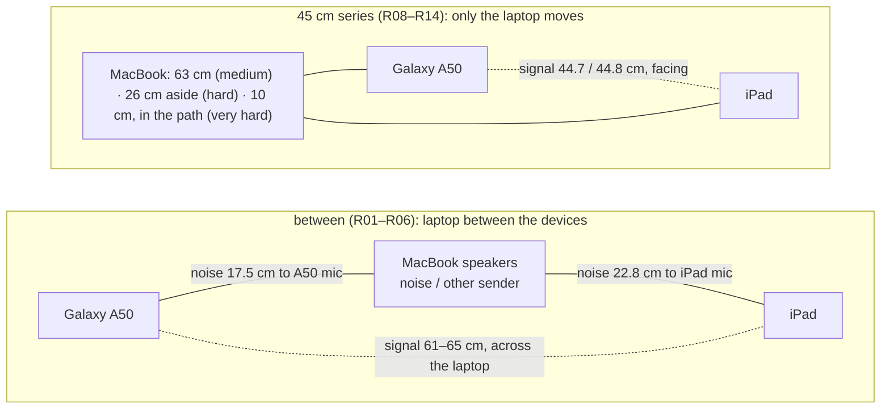
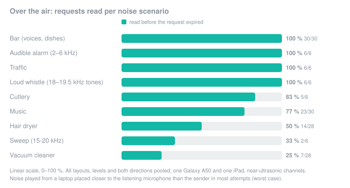
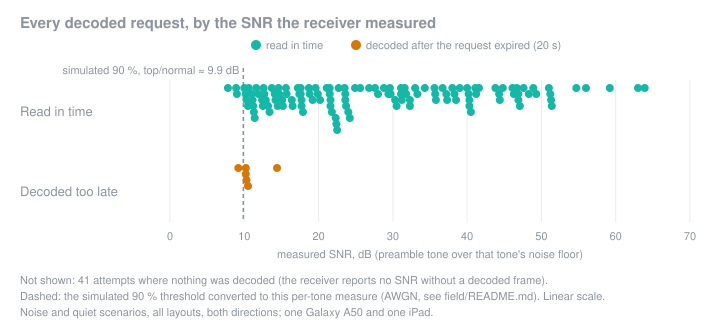
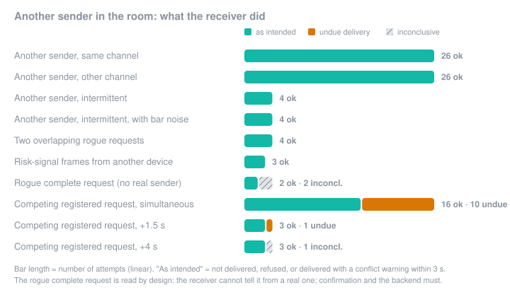

# Over-the-air field evaluation (v4)

Real measurements of the v4 over-the-air format between two consumer devices, with recorded noise and a second emitter played from a laptop's speakers. This complements the simulated benchmark in [`bench/`](../bench): the benchmark says how the modem behaves for a known SNR; this folder says what SNR a real speaker-to-microphone link reached on a table, and what happened at that SNR.

| File | What it is |
|---|---|
| [`field-v4.csv`](field-v4.csv) | One row per attempt (293 rows), cleaned and anonymised. Column dictionary below. |
| [`analyze.py`](analyze.py) | Standard-library Python. Regenerates [`results.md`](results.md) and [`charts/`](charts) from the CSV and from `../bench/results/` and `../protocol-v4.json`. |
| [`results.md`](results.md) | Every table, generated. All numbers in this README and in the paper's Section 6.8 come from it. |
| [`charts/`](charts) | `noise-by-scenario.svg`, `success-vs-snr.svg`, `security-outcomes.svg`. |

```sh
python3 field/analyze.py
```

## What was measured, and with what

**Read this first.** These runs were made with the author's private application, not with the code in this repository. That application uses earlier builds (library 4.0.0, 4.1.0 and 4.2.0) of the same v4 over-the-air format and the same receiver family (preamble detection, per-tone noise floor, Reed–Solomon, repetition combining), but it wraps them in its own flow:

- **Payment-style requests with a backend.** The sender registers a request on a server, then plays only a reference frame (a 12-byte fingerprint with its parity, the pattern in [SECURITY.md](../docs/SECURITY.md#using-a-backend)). The receiver decodes the fingerprint and fetches the request from the server. A request lives 20 s on the server; the receiver gives up after 22 s.
- **Acknowledgements and alerts on.** Security level `maximum`: the sender listens about 3 s before playing and does not play if it hears another transmission; the receiver watches the air after delivering (8 s window) and raises a conflict warning if a different request or a risk frame appears.
- **Channel choice by the application.** The sender started on `top` and fell back to `mid` when no acknowledgement came. The CSV records the channel each frame was decoded on, not the profile (normal or robust).

So the numbers below characterise the v4 modem and session behaviour over the air, but not this repository's exact build, and the end-to-end times include the application's pre-listen and server round trips. **ggwave was not run over the air**: there is no over-the-air comparison.

### Devices and room

- **Devices:** one Samsung Galaxy A50 (SM-A505G) and one iPad 10th generation (iPad13,18), both on the table, screen up, at maximum volume through the built-in speaker. Every scenario runs in both directions.
- **Noise and second emitter:** a MacBook's built-in speakers play the noise recordings and the "other sender" frames. A browser page drives the run; the two devices run unattended.
- **Room:** one indoor room, one table, no other controlled sound. Not a shop, bar or street.
- **No sound level meter.** There are no dB SPL figures anywhere in this folder. Levels are the receiver's own measurements (SNR and an in-band noise floor on a digital scale) and relative gains.

### Layouts (top view)

Distances are speaker → listening microphone, taken from the layout recorded with each run (approximate, top view, no heights). The noise source is the laptop speaker nearest to the listening microphone.



| Layout | Runs | Sender → mic | Noise → mic | Effective margin | Class |
|---|---|---:|---:|---:|---|
| `between` | R01–R06 | 65 cm (A50→iPad), 60.7 cm (iPad→A50) | 22.8 / 17.5 cm | −24.1 / −24.3 dB (partial occlusion, off-axis) | ultra |
| `side` | R07 | 56.2 / 44.2 cm | 31.2 / 43.3 cm | −14.1 / −6.2 dB | ultra / hard |
| `s45-medium` | R10, R11 | 44.8 / 44.7 cm | 63.4 / 63.1 cm | +3.0 dB | medium |
| `s45-hard` | R09, R12, R13 | 44.8 / 44.7 cm | 26.1 / 26.0 cm | −4.7 dB | hard |
| `s45-very-hard` | R08, R14 | 44.8 / 44.7 cm | 9.9 / 10.1 cm | −19.1 / −18.9 dB (partial occlusion) | ultra |

**Geometric margin** (from the application's evaluation code) = 20·log10(noise→mic ÷ sender→mic): free field, 6 dB per doubling of distance, equal source power assumed. **Effective margin** subtracts coarse penalties: path occlusion by another device (none 0, partial 6, full 14 dB) and off-axis speaker (3 dB past 45°, 6 dB past 90°) and microphone (1.5 / 3 dB). **Classes:** easy ≥ +6 dB, medium 0…+6, hard −10…0, ultra < −10. No layout was in the easy class. The laptop at full volume is louder than a phone, so the real margin is worse than the estimate. The 45 cm series moves only the noise source; signal geometry is identical in its three layouts.

In most attempts the noise source is **closer to the listening microphone than the sender** is. This is the worst case of a counter, not the typical one.

### Scenarios

| Category | Scenario (`scenario_id`) | What plays from the laptop |
|---|---|---|
| baseline | Quiet room (`quiet`) | Nothing. |
| noise | `alarm`, `bar`, `traffic`, `music`, `cutlery`, `whistle`, `hair-dryer`, `sweep`, `vacuum` | A recording, looped. Alarm: 2–6 kHz only. Whistle: fixed tones at 18–19.5 kHz. Sweep: passes from 15 to 20 kHz twice a second. Hair dryer and vacuum: broadband, no pauses. |
| security | `other-same-channel` / `other-other-channel` | Another request, without pause, on `top` / on `mid`. |
| security | `other-intermittent`, `other-intermittent-bar` | Another request, 6 s on and 6 s off; the second one under bar noise. |
| security | `two-overlapping` | No legitimate sender: two requests at once on different channels. Must be refused as multiple transmissions. |
| security | `rogue-full-request` | No legitimate sender: one complete, well-formed request that is not registered. |
| security | `risk-signal` | Risk (alert) frames at intervals. |
| security | `competing-0s`, `competing-1.5s`, `competing-4s` | A second request **registered on the server**, played at about a phone's level (−35 dB relative to the other rival sounds), starting with, 1.5 s after or 4 s after the legitimate sender's first audio. |

**Levels.** Noise recordings play at gain low (−18 dB), medium (−9 dB) or high (0 dB), on top of the laptop's system volume (69 % or 100 % where recorded, `noise_source_volume_pct`; not recorded in 10 runs). The short plans use only high.

**Runs.** 14 runs, 1–5 November 2026 (UTC): 12 short plans of 16 v4 attempts (one cut short at 6) and one full plan of 95. Run R04 is excluded by the validity check below: its noise source was not audible.

## Method

For each attempt the browser page starts the noise or the other emitter, tells one device to register and play a request and the other to listen, and stores both devices' reports. The verdict is decided by the application's evaluation code from what the receiver delivered:

- **Noise and quiet scenarios:** success = the receiver delivered the legitimate request (the decoded fingerprint resolved on the server to the request that was played).
- **Security scenarios:** success = the receiver did not deliver while another sender was active, or refused (multiple transmissions, risk signal), or delivered with a conflict warning **within 3 s** of delivery. The 3 s window is an assumption about how long a hurried person takes to confirm, not a measurement. A delivery without a warning in time is an **undue delivery**. The rogue complete request is expected to be read: the receiver cannot tell it from a real request; the server and the user's confirmation have to.

**Validity check.** A run is kept if, for at least one receiver, the median noise floor during the high-level noise scenarios is at least 3 dB above that run's quiet baseline (`analyze.py`, `MIN_NOISE_RISE_DB`). In every kept run both receivers rose, by 4.8–38.0 dB; in R04 they moved by −1.1 and +1.6 dB, the same as silence, and its 16 attempts (including its security attempts, played by the same speakers) are left out. 277 attempts remain: 146 noise, 105 security, 26 quiet.

### What the receiver measures

Both fields come from the receiver's demodulator (Swift and Kotlin implement it identically):

- **`measured_snr_db`**: for every preamble symbol and every tone group, the energy of the expected preamble tone in its bin, divided by that tone's own noise floor; the value is the median of those ratios, in dB, rounded to 0.1 dB. The energy is |X(k)|² over a 1,024-sample window at 48 kHz (21.3 ms, Tukey with 10 % taper, equivalent noise bandwidth 48.7 Hz). The noise floor of each tone is a running average of that tone's energy (time constant 0.5 s, 0.08 s during the first 0.3 s of listening) in which anything above 4× the floor is clipped, so the floor follows the noise and not the frames. It is therefore a **per-tone, in-band** SNR: signal against everything else that falls in that 49 Hz bin (external noise, the room's echo of earlier symbols, microphone self-noise). **It exists only for a decoded frame**: an attempt where nothing was decoded has no SNR.
- **`noise_floor_db`**: 10·log10 of the mean of the per-tone noise floors of the decoded channel, on the same |X(k)|² scale with samples in [−1, 1]. A full-scale sine exactly on a tone reads +53.7 dB on this scale. It is **not** dBFS of the band and **not** SPL, and it depends on each device's microphone gain and processing: the A50's quiet floor sits around −7 to −19, the iPad's around −56 to −66. Compare it only within one receiver. In the generated tables it is used only for the validity check.
- **`sender_ambient_db`**: the sender's in-band noise measurement during its pre-listen, same scale, sender's microphone.

### From measured SNR to the benchmark's SNR

The benchmark reports SNR over the full 0–24 kHz band and an **in-band** SNR (signal power ÷ noise power within the band holding 99 % of the signal power, `bands.csv`). With K tones sounding at once spread over a band B, and white noise, the receiver's per-tone measure is

per-tone SNR = in-band SNR + 10·log10(B ÷ (K · ENBW))

which is +11.9 dB on `top` (B = 1,500 Hz, K = 2) and +11.8 dB on `mid` (B = 2,215 Hz, K = 3). For noise that is roughly flat inside the 1.5–2.2 kHz band the receiver's figure is the in-band SNR plus that constant whatever the noise outside the band; for noise with structure inside the band it is an approximation.

## Results

All tables are in [`results.md`](results.md); this section quotes them.

### Noise



All noise attempts: **99/146 read (68 %, 95 % CI 60–75)**. Quiet room: **26/26**, median measured SNR **47.0 dB**.

| Scenario | Read / attempts | High level only | Median SNR of reads (dB) | Median read time (s) |
|---|---:|---:|---:|---:|
| Bar (voices, dishes) | 30/30 (100 %) | 26/26 | 21.5 | 6.6 |
| Audible alarm (2–6 kHz) | 6/6 (100 %) | 2/2 | 40.2 | 9.6 |
| Traffic | 6/6 (100 %) | 2/2 | 18.6 | 11.0 |
| Loud whistle (18–19.5 kHz tones) | 6/6 (100 %) | 2/2 | 43.2 | 5.6 |
| Cutlery | 5/6 (83 %) | 1/2 | 15.1 | 12.0 |
| Music | 23/30 (77 %) | 20/26 | 23.5 | 6.3 |
| Hair dryer | 14/28 (50 %) | 12/24 | 17.1 | 6.6 |
| Sweep (15–20 kHz) | 2/6 (33 %) | 1/2 | 14.4 | 13.4 |
| Vacuum cleaner | 7/28 (25 %) | 6/24 | 16.4 | 6.1 |

| Difficulty class | Read / attempts | High level only | Effective margin (dB) | Median SNR of reads (dB) |
|---|---:|---:|---:|---:|
| medium | 13/16 (81 %, CI 57–93) | 13/16 | +3 | 22.3 |
| hard | 25/28 (89 %, CI 73–96) | 25/28 | −6 to −5 | 23.6 |
| ultra | 61/102 (60 %, CI 50–69) | 34/66 (52 %) | −24 to −14 | 19.6 |

- **Noise below the channels does not matter.** Bar, traffic and the 2–6 kHz alarm were read every time, even in the ultra layouts; so was the whistle that covers `top`, every time on `mid`.
- **Broadband noise near the microphone is the limit.** Hair dryer and vacuum account for 34 of the 40 attempts where nothing was decoded (vacuum 21, dryer 13; then sweep 3, music 2, cutlery 1).
- **Classes are coarse.** Medium and hard overlap (16 and 28 attempts, wide intervals; all 3 medium failures and 2 of the 3 hard ones are hair dryer or vacuum with the A50 sending). Ultra is clearly lower.
- **Failures, by kind:** 40 nothing decoded; 6 decoded only after the request's 20 s lifetime (read at 20.8–22.2 s, measured SNR 9.2–14.4 dB, all on `mid`, after `top` went unacknowledged); 1 sweep attempt where the receiver took the sweep for another transmission and refused.
- **Time:** successful reads took a median **6.5 s** from the start of listening (90th percentile 14.9 s), which includes the sender's ~3 s pre-listen and its server registration; from the first preamble to the decoded frame, median **1.09 s**.

### Measured SNR and success: the equivalence table



Noise and quiet attempts, by the SNR the receiver measured. Because SNR exists only for a decoded frame, the first four rows are conditional on a decode.

| Measured SNR | Attempts | Read in time |
|---|---:|---:|
| ≥ 20 dB | 79 | 79/79 (100 %) |
| 10–20 dB | 48 | 43/48 (90 %) |
| 0–10 dB | 4 | 3/4 (75 %) |
| < 0 dB | 0 | – |
| nothing decoded (no SNR) | 41 | 0/41 |

Every miss in the 10–20 dB and 0–10 dB rows is a frame decoded after the request expired, not a decoding error. The weakest successful reads were **7.8 dB on `top`** and **10.3 dB on `mid`** (10th percentile of reads: 12.5 and 11.3 dB).

Comparison with the simulated threshold (benchmark, AWGN, one transmission, 32 B), converted to the receiver's per-tone measure:

| | Simulated SNR90, full band | In band | As the receiver measures it | Weakest field read | Field read, in band |
|---|---:|---:|---:|---:|---:|
| `top`, normal | −14 dB | −2.0 dB | 9.9 dB | 7.8 dB | −4.1 dB |
| `top`, robust | −16 dB | −3.9 dB | 7.9 dB | | |
| `mid`, normal | −12 dB | −1.7 dB | 10.1 dB | 10.3 dB | −1.5 dB |
| `mid`, robust | −14 dB | −3.7 dB | 8.1 dB | | |

The weakest over-the-air reads sit at the simulated threshold: within 0.2 dB on `mid`, and 2.1 dB below the normal-profile figure on `top` (where it matches the robust profile; the field data do not record which profile, and the field receiver could also combine repetitions over up to 22 s). The two figures are not the same statistic: SNR90 is a 90 % point on a 2 dB grid with a 32-byte payload in white noise; the field figure is the lowest success among attempts that happened to land near the edge, with a shorter reference frame, real echo and non-stationary noise. Within those limits, **the decoder needed about the same SNR over the air as in simulation**; the over-the-air failures came from links that never reached it (broadband noise close to the microphone), not from a decoder that fell short of its simulated threshold.

### Security



| Scenario | Attempts | As intended | Undue | Inconclusive | Receiver warning after delivery, ms | Sender heard the other, ms after it started playing |
|---|---:|---:|---:|---:|---:|---:|
| Another sender, same channel | 26 | 26 | 0 | 0 | – | – |
| Another sender, other channel | 26 | 26 | 0 | 0 | – | – |
| Another sender, intermittent | 4 | 4 | 0 | 0 | – | – |
| … with bar noise | 4 | 4 | 0 | 0 | – | – |
| Two overlapping rogue requests | 4 | 4 (refused as multiple) | 0 | 0 | – | – |
| Risk-signal frames | 3 | 3 | 0 | 0 | – | 12,158 (10,632–13,685) |
| Rogue complete request | 4 | 2 (read, as designed) | 0 | 2 (not heard) | – | – |
| Competing registered request, simultaneous | 26 | 16 | 10 | 0 | 2,472 (1,375–4,877) | 4,874 (3,209–5,797) |
| Competing registered request, +1.5 s | 4 | 3 | 1 | 0 | 2,982 (2,189–3,774) | 4,709 (4,514–6,106) |
| Competing registered request, +4 s | 4 | 3 | 0 | 1 | 2,131 (1,775–2,487) | 4,892 (4,628–5,005) |

Times are median (range).

- **An unregistered second sender never got through.** With another request playing continuously, on the same or another channel, the legitimate sender heard it and did not play in **52/52** attempts; the receivers decoded the other request (median 19.6 dB), the server did not know it (51 of 52), and nothing was delivered. Intermittent rivals (8), overlapping requests (4) and risk frames (3) were never delivered either.
- **A competing request that is registered on the server is the hard case.** Both requests resolve, the preambles collide, and the only protection is the conflict warning after delivery. **11 undue deliveries in 34 competing-request attempts**, every one of them the competing request, delivered with no warning or with a warning later than 3 s (3.2–4.9 s).
- **By build:** 4.0.0: 6 undue in 16; 4.1.0: 5 in 10; **4.2.0: 0 in 8**, every attempt delivered with a warning at a median 1.8 s (1.4–2.5 s), 6 of them the legitimate request.
- **No noise or quiet attempt delivered a wrong request** (0 of 172).

### Channel and direction

| Channel | Reads (noise + quiet) | Median SNR | Median read time | Median decode time |
|---|---:|---:|---:|---:|
| `top` | 81 | 27.6 dB | 6.4 s | 1.09 s |
| `mid` | 43 | 22.4 dB | 9.6 s | 2.09 s |

| Direction | Noise: read | Medium · hard · ultra | Median SNR of noise reads | Quiet: median SNR |
|---|---:|---:|---:|---:|
| A50 → iPad | 41/73 (56 %) | 5/8 · 10/12 · 26/53 | 15.6 dB | 40.2 dB |
| iPad → A50 | 58/73 (79 %) | 8/8 · 15/16 · 35/49 | 24.5 dB | 49.3 dB |

- `mid` reads come after `top` went unacknowledged, so they are slower; its lower median SNR reflects that it was used when `top` was not getting through.
- **The link is asymmetric**: about 9 dB less SNR with the A50 sending, even in the quiet room. Under broadband noise the A50 → iPad direction read 4/14 (hair dryer) and 1/14 (vacuum), against 10/14 and 6/14 the other way. The data cannot separate the A50's speaker from the iPad's microphone (one device pair), nor geometry: in `between`, the A50's speaker sits next to the laptop and points away from the iPad's microphone.

## Column dictionary (`field-v4.csv`)

| Column | Meaning |
|---|---|
| `run_id` | Opaque run label, R01–R14 in time order. |
| `date_utc` | Date of the run (UTC). |
| `lib_version` | Build of the private library that produced the attempt (4.0.0, 4.1.0, 4.2.0). |
| `layout` | `between`, `side`, `s45-medium`, `s45-hard`, `s45-very-hard` (table above). |
| `scenario_id`, `scenario` | Scenario key and English name. |
| `category` | `noise`, `security` or `baseline` (quiet room). |
| `level` | `low` / `medium` / `high`: gain of the noise or rival recording (−18 / −9 / 0 dB). |
| `sender_device`, `receiver_device`, `direction` | Who played and who listened. `MacBook speakers (test audio)` / `rogue` = no legitimate sender. |
| `sender_to_mic_cm`, `noise_to_mic_cm` | Speaker → listening microphone, in the recorded layout. |
| `occlusion` | Path occlusion by another device: `none`, `partial`, `full`. |
| `geometric_margin_db`, `penalty_db`, `effective_margin_db`, `difficulty_class` | As defined above; `n/a` when there is no legitimate sender. |
| `geometry_source` | `recorded` (in the run's export) or `layout` (recomputed with the same code from the run's layout, for exports made before that column existed). |
| `noise_source_volume_pct` | Laptop system volume, when recorded. |
| `channel` | Channel the receiver decoded on (`top`, `mid`; `high` and `upper` appear in 3 rows). Empty if nothing was decoded. |
| `verdict` | `ok`, `fail` or `warn` (inconclusive), from the application's evaluation code. |
| `outcome` | `read`, `not_read`, `read_after_expiry` (decoded after the 20 s request lifetime), `refused_other_sender`, `not_delivered`, `refused`, `refused_multiple`, `delivered_warned`, `undue_delivery`, `delivered_with_other_sender`, `rogue_read`, `not_heard`, `not_delivered_unattributed`. |
| `receiver_code`, `sender_code` | Library result codes: `TIMEOUT`, `NOT_FOUND` (server lookup failed), `MULTIPLE_TRANSMISSIONS`, `RISK_SIGNAL`, `OTHER_TRANSMISSION`, `OTHER_EMITTER_DETECTED`, `CANCELLED`. |
| `measured_snr_db` | Receiver's preamble per-tone SNR (definition above). Empty if nothing was decoded. |
| `noise_floor_db` | Receiver's in-band noise floor, device-relative scale (above). |
| `sender_ambient_db` | Sender's pre-listen noise, same scale, sender's microphone. |
| `first_signal_ms` | From the start of listening to the first preamble detected. |
| `read_ms` | From the start of listening to the decoded data, before the server lookup. Includes the sender's pre-listen and registration. |
| `decode_ms` | From the first preamble detected to the decoded frame. |
| `receiver_warning_ms` | From delivery (start of the post-delivery watch) to the receiver's conflict warning. |
| `sender_detect_ms` | From the moment the legitimate sender started playing to when it heard another emitter. |
| `undue_delivery` | `true` if delivered while another sender was active, without a warning within 3 s. |
| `delivered_request` | In competing-request scenarios: `legitimate` or `competing`. |

Removed from the source exports: request and payment codes, plan identifiers, free-text details and traces, server timings, calibration internals, and the v2 rows (another protocol, run in the same sessions).

## Limitations

- **One device pair, one room, one table.** One Android phone and one iPad; noise from laptop speakers playing recordings, not real environments. Per-scenario cells are small (2–30 attempts).
- **No absolute levels.** No sound level meter; laptop volume recorded in 4 of 13 kept runs. Geometric margins are free-field estimates with coarse penalties; they rank layouts, they do not predict SNR.
- **Worst-case geometry.** In most attempts the noise source was closer to the listening microphone than the sender (−24 to −5 dB margins); no layout reached the easy class. A typical counter (noise 1–2 m away) was not measured.
- **Not this repository's build.** Library 4.0.0–4.2.0 inside a private application with a server, reference frames, acknowledgements, a 20 s request lifetime and a 22 s receiver timeout. Its channel fallback (`top` then `mid`) differs from the ladder in this repository (`top`, `high`, `upper`, `mid`), and the robust profile is not recorded.
- **SNR only on success.** The receiver measures SNR on a decoded frame, so failures have no SNR and the SNR tables are conditional.
- **Direction and device confounded.** Each direction is one fixed sender/receiver pair, so speaker, microphone and position effects cannot be separated.
- **Security rivals are recordings** played by the laptop at fixed gains (the registered competing request about 35 dB below the other rival sounds, to approximate a phone), except that the competing request is genuinely registered on the server. The 3 s warning limit is an assumption.
- **No ggwave over the air.**
- **One run excluded** (R04) by the validity check: its noise source did not play.
