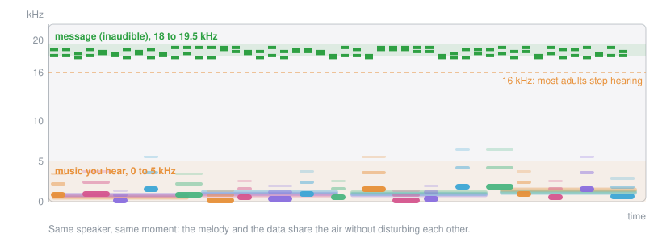

# bysound (web)

TypeScript implementation of **bysound v4**, and the reference for the Swift, Kotlin and C ports: text over sound with near-inaudible multi-tone FSK (channels between 15 and 19.5 kHz, plus an audible channel), Reed–Solomon blocks and a CRC-32. No runtime dependencies, no backend.

## Install and run

The package is this folder (`"name": "bysound"`, entry `src/index.ts`); it is not published to npm. Use it from another project with `npm install ../path/to/bysound/web`, or import `src/index.ts` directly as the [examples](../examples) do.

```sh
npm install && npm run dev      # demo at http://localhost:5173 (the microphone needs HTTPS or localhost)
npm run build                   # static site in dist/, usable from any static host
```

The demo's **♪ Music + hidden message** button plays a short melody with the text hidden above 18 kHz; another device pressing Listen decodes it (`send(text, { backing })` does the same from code). `npm run make:music-demo` rebuilds [`docs/assets/music-demo.wav`](../docs/assets/music-demo.wav).



## API

```ts
import { send, listen, encode, decode } from 'bysound';

const tx = await send('hello', { band: 'top', repeat: 'forever' }); // call from a click/tap
tx.stop();

const rx = await listen({
  onFrame: (h) => h.kind === 'payload' && console.log(h.payload, h.band),
  onLevel: (e) => console.log(e.rms),
});
rx.stop();

const samples = encode('hello', { band: 'mid', profile: 'robust', sampleRate: 48000 }); // Float32Array: one frame + gap
const heard = decode(samples, 48000); // offline, e.g. samples read from a WAV file
```

### Session (acks, confirm gate, other emitters, adaptation)

```ts
import { sendSession, receiveSession } from 'bysound';

const s = await sendSession('pay 12.50 to shop 7');           // from a click; channel chosen automatically (channel ladder)
const d = await s.delivered;                                   // the receiver's ack: d.band is where it was read

const r = await receiveSession({ onAlert: (a) => console.warn(a) });
const got = await r.result;                                    // after the final listen; fails on two senders
await r.confirmed();                                           // right before acting on got.text
```

`src/session/` implements [docs/SESSION.md](../docs/SESSION.md): acks and receipts, the confirm gate, other-emitter detection, risk frames, security levels (`maximum` by default), quarantine as a callback only, reference mode and channel adaptation with calibration memory (`localStorage`).

`sendSession` rejects with a `RangeError` for an empty text and a `TooLongError` if the text does not fit one transmission on every channel it may play (the fixed `band`, or every channel of the ladder). A text that fits the normal profile but not the robust one stays in the normal profile when the ladder would switch to robust.

### Length limit

One transmission (preamble + header + body + gap) never lasts more than 30 s (`MAX_FRAME_SECONDS`), so `encode` and `send` throw a `TooLongError` (`code === 'TOO_LONG'`) for a longer text. `maxPayloadBytes(band, profile)` gives the limit in packed bytes; ASCII letters pack 1:1, digit pairs 2:1.

| Channel | Max packed bytes, normal | Max packed bytes, robust |
|---|---:|---:|
| `top` | 700 | 335 |
| `high`, `upper`, `mid` | 1,052 | 520 |
| `audible` | 1,122 | – |
| `xhigh` | 1,408 | – |
| `wide` | 2,114 | – |

Channels: `top` (18–19.5 kHz), `high` (17.25–19.5 kHz), `upper` (16.5–18.75 kHz), `mid` (15–17.25 kHz), `xhigh` (16.5–19.5 kHz), `wide` (15–19.5 kHz) and `audible` (1.9–4.9 kHz). `profile: 'robust'` is twice as slow and more noise tolerant (`top`, `high`, `upper`, `mid` only); the receiver always listens for both profiles.

## Tests

```sh
npm test                        # modem, session and API tests (vitest)
npm run typecheck               # tsc --noEmit
```

## Notes

- Playback and capture must start from a user gesture. The microphone needs HTTPS or `localhost`.
- Echo cancellation, noise suppression and automatic gain are turned off on the microphone; they destroy the tones.
- Safari/iOS: Web Audio is stricter (a gesture is required for every new context, the silent switch can mute playback, microphone permission is asked each session). Test on the device.
- Many phone and laptop speakers or microphones cannot reproduce above ~17 kHz. If nothing is heard, use `mid` or `audible`.
- Use the device speaker at high volume; headphones and Bluetooth outputs change the audio path.
- The sample rate follows the device (44.1 or 48 kHz); the modem supports both.
- `src/modem/` is the normative modem (protocol, codec, Reed–Solomon, modulator, receiver) and `src/session/` the session layer; `src/audio.ts` and `src/session/browser.ts` are the only code that touches Web Audio.
